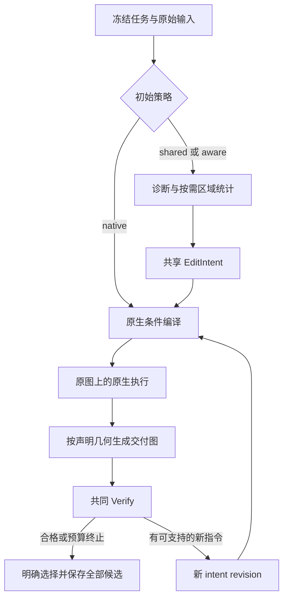

# 四模型功能完善设计与实现交付

## 1. 本轮目标与完成边界

基线分支：`research/model-aware-restoration-20261024`，基线提交 `bffdb5243ac38e21b4498cde2205926256506362`。

本轮把 Qwen、FireRed、FLUX、FIBO 从配置层的模型描述推进为仓库内可直接调用的原生编译器与编辑器，并补齐单图复原、A/B 参考增强、有限反馈、批量对比和部署入口。NB 不进入新的模型注册表、示例或默认对比矩阵。

代码以 `hre models` 为新入口，实现在 `engine/src/hre/v3/`。原 `hre v2`、`run_harness.py` 和历史请求/schema 保持原有语义，避免新功能改变历史数据的 hash、预算与恢复。新 case 使用 `hre_task_v3`，不能原地把旧 case 当作新协议继续运行。

工程完成依据是实际调用路径、输入/输出合同和流程闭环。真实权重兼容性、显存、耗时和画质由服务器后续验证。本轮没有调用正式图像模型，也没有将画质实验结果作为编码前置条件。

## 2. 已补缺口

| 原有缺口 | 本轮处理 | 实现位置 |
|---|---|---|
| native compiler 依赖用户另写外部 worker | 四个内置 compiler，外部进程只作为已有实现的隔离传输 | `qwen.py`、`firered.py`、`flux.py`、`fibo.py` |
| 内置图像执行仅 Qwen/FireRed | 四模型都真实调用对应 Diffusers pipeline | 同上 |
| A/B 合同无法表达 source-only | 明确 `restoration` 和 `reference_enhance` | `contracts.py` |
| 加轮数可能仍执行最初 Compose | 每轮意图带 revision/parent hash，重新编译并绑定当前条件 | `runner.py` |
| 模型差异只停留在前缀说明 | 接入 PE、Recaption、PUP、Thales；保留原生结构和特殊参数 | 四个 adapter |
| 空间控制仅为声明 | 公共 crop/fuse、FLUX bbox、FIBO 单图 mask | `spatial.py`、`flux.py`、`fibo.py` |
| 缺少输入/原生输出/交付输出的清晰分离 | 原文件、canonical 图、工作图、native 图、交付图分别保存并绑定 hash | `contracts.py`、`spatial.py` |
| shared 与 aware 每次重新规划会混入随机差异 | batch 默认每案例先冻结一次 planning，再跨模型/臂导入 | `batch.py` |
| 每轮启动/模型加载、依赖版本相互牵制 | 内置常驻 worker、模型缓存、独立 Python 环境 | `worker.py`、`common.py` |
| 版本标签不能识别 dev 代码差异 | 校验关键原生源码 Git blob，记录实际 SHA256 | `native_sources.py` |
| 中断后可能重复提交 | 请求先落盘、append-only journal、真实 response 对账、未知状态暂停 | `runner_journal.py`、`runner.py`、`worker.py` |
| 缺少四模型批量交付与对比页面 | matrix runner、HTML、CSV、完整 JSON | `batch.py`、`report.py` |

## 3. 两种任务，不混淆目标

### `restoration`

输入仅 `source`。任务可以是去噪、去模糊、低光复原等；目标须由 brief 和可见证据支持。允许恢复有依据的边缘和结构，不把“保护内容”解释成保留模糊本身；不能把不可读文字改成猜测的可读字符串。

### `reference_enhance`

输入固定为 `source`、`appearance_reference`。A 决定内容、身份、文字、构图与几何；B 仅提供亮度、色彩、影调及可支持的区域关系。B 可以与 A 未对齐，不能把 B 的坐标直接应用到 A，也不能把参考内容当作恢复真值。

两种任务都从原 source 执行下一轮。上一轮 candidate 进入 Verify/Refine，不能自动成为下一次图像编辑输入。

第一版输入为 SDR 八位图像；显式处理 EXIF 和 ICC，保留透明通道记录。RAW/HDR、视频、训练、自动选模型和多场景参考检索不在本轮交付范围内。旧工程的高级外部工具链保留在旧入口；新入口的 S2 已实现全局和显式 ROI 的亮度/颜色证据，不声称已迁移 depth、segmentation、OCR 等全部旧工具服务。

## 4. 四个模型的原生方式

| 模型 | 条件编译 | 真正图像执行 | 关键特性在本框架的使用 |
|---|---|---|---|
| Qwen-Image-2.1 | 本地官方 PE-I2I；另保留显式 direct 对照 | `QwenImage21Pipeline` | 统一语义目标与区域关系；原始 PE 与规范化结果保留；RGBA；画布/条件分辨率/cache 明确冻结 |
| FireRed-Image-Edit-1.1 | 固定官方 Recaption 模板与图号映射，通过明确本地文本 endpoint 执行 | `QwenImageEditPlusPipeline` + 1.1 权重 | 连贯编辑指令、身份/文字/细结构保护；不声称 Recaption 看过图像；单次图像调用 |
| FLUX 3 Image Klein distilled | 官方本地 PUP 或显式命名的本地 VLM 替代编译器 | 去除 `prompt_upsampler` 的 `ModularPipeline` | 区分 i2i 与 i2i_bbox；一次 PUP；bbox 作为语义/布局条件；16 步 distilled，不误用 base CFG |
| FIBO 2.0 Dev | 官方 Thales payload/schema/prompt + 本地 OpenAI-compatible transport | `BriaFibo2Pipeline` | 完整目标场景 VGL + edit_instruction；结构与引用校验；单图 native mask；50 步、guidance 5 |

### Qwen

PE 真实使用 `AutoProcessor` 和 `AutoModelForImageTextToText`。原始答案的 `rewritten_prompt` 与解析后的 `positive_prompt` 分层保存；要求 `parse_ok=true`、`ratio_follow=<image1>`、`wh_ratio=""`，最终执行文本等于接受的 `positive_prompt`。PE 没有保留 source 画布时明确失败，不修改 metadata 掩盖语义错误。

执行端显式传 `width/height`、`output_resolution`、`use_kv_cache`、`true_cfg_scale`、`negative_prompt` 和 seed。Qwen 使用 32 像素网格；统一对比默认也使用 32 网格。`output_resolution` 是条件预处理参数，与输出画布不同。示例冻结为 1024，用户可在新的配置身份中显式改为 2048；不能根据 README 的描述假定源码默认已经改变。

### FireRed

本地实现沿用官方 Recaption 的真实提示和图号映射，但改变服务执行策略：必须显式 endpoint；禁用官方云默认值、自动重试和失败后返回原提示的 fallback。receipt 名称为 `firered_official_template_local_provider`，准确区分这种本地 transport 与未经修改的官方 demo。

图像端固定 1.1 权重，不运行默认 1.0 的完整示例脚本，也不附带 optimized 演示的第二次生成。原生输入整理能力与公共输出 crop/fuse 分开。默认 40 步、CFG 4、negative prompt 为一个空格。

### FLUX

PUP 的 i2i 输出并不一律要求重新描述整幅场景。局部目标采用改变内容加保留要求；bbox 模式采用文本加 JSON 数组。不能用通用 `json_object` 去约束普通 PUP 文本。

编辑 pipeline 在加载时拆除 `prompt_upsampler`，执行前再次检查不存在该 block。receipt 编译端记录一次 PUP、图像端记录零次 PUP。保留原始 PUP、reconciliation 后条件和 bbox 记录。bbox 坐标为 `[y_min,x_min,y_max,x_max]`、输入 0–1；本轮复原合同要求源/目标框一致，不移动对象。bbox 不保证框外像素保持。

图像执行显式使用输出画布；native 单图/多图条件预处理仍分别记录，不把显式 W/H 当成条件图没有降采样的证明。distilled 不接受 CFG、negative_prompt 或通用 img2img strength。

### FIBO

完整 VGL 校验覆盖 `short_description`、`objects`、`background_setting`、`lighting`、`aesthetics`、`photographic_characteristics`、`style_medium`、`text_render`、`context`、`artistic_style`、`edit_instruction` 及嵌套结构，检查输入 token 绑定，再调用官方 payload parser。原始与规范化对象分开记录，未知字段不静默忽略。

原生 schema/模板来自固定 VGL checkout；实际编译由用户本地 VLM 完成。没有虚构 `modify(api_base=...)`，也没有调用官方 gateway 的隐式重试或 Gemini fallback。条件合法与语义一致分开：JSON/schema 可以确定性检查，场景描述是否忠实由保存的 sidecar、共同 Verifier 和后续人工观察判断，不能将结构合法宣称为画质保证。

FIBO native mask 只允许一张 source。A+B+mask 明确拒绝，不能偷偷丢 B。mask 阈值为 128，统一二值副本交给编译和执行。原生 mask 没有保证输出外部区域逐像素保持；需要硬保持时使用公共 crop/fuse。字体只接受明确的本地文件，记录实际字体策略。

## 5. 五阶段完整运行

S1/S2 的事实判断按任务与证据变化，不按模型名称预设“容易幻觉”或“过于保守”。S2 内置统计只解释为显示域 RGB/亮度，不冒称线性辐射值或精确 EV。可给 source/reference 各自定义归一化 ROI；参考框有独立坐标空间。

S3 输出统一 `EditIntent`：最多三个有证据的目标、区域关系、保护项、不确定性、版本和反馈来源。`shared` 与 `model_aware` 引用同一份 intent；差异由表达指导与真实模型编译器产生。

S5 获得原图、可选 B、candidate、冻结的目标/评价合同；不获得编辑模型名称或本轮编译出的提示词，避免评价目标随策略移动。可观察问题包括残余退化、外观目标未达成、过度处理、内容/文字/身份损伤和不确定性。反馈只能响应具体可支持的问题，不能把残余模糊直接解释为模型能力不足。

每次采纳 refinement 后保存新 intent、parent hash、feedback refs，然后重新编译。`resample` 则固定首轮条件，只改变计划内的图像 seed，不再次 PE/PUP/VGL。

## 6. 空间与颜色合同

默认 `geometry={policy:pad,grid:32}`，只在右/下 edge padding 到共同网格；生成后按预先声明的范围裁回 source。`strict` 要求原画布满足网格；`resize` 显式声明工作尺寸与反向恢复。所有变换都形成 geometry plan，不能推理失败后偷偷缩图再继续。

公共 `crop_and_fuse` 从明确二值 mask 得到 ROI，加 context 后形成工作图。B 保持自己的画幅，不假设与 A 对齐。生成的局部结果先逆变换，再按 mask 融合。feather 只发生在 mask 内侧，原二值 mask 外从 canonical source 精确复制；receipt 明确区别于 native mask 的软控制。

Qwen 原生 RGBA 不被提前丢弃。交付可选 `require_opaque`、`composite_over_input`、`drop_alpha`，默认第一种；native 图始终保留。A/B 影调任务不自动套用 source color alignment，以免把参考目标抵消。ICC 到 sRGB 的输入处理与模型后处理分别记录。

交付前再次核对原始 source、prepared source、reference、mask、geometry plan 与 raw output 的 hash，防止模型运行期间文件变化导致虚假的保护声明。

## 7. 对比矩阵与预算

主对比为四模型 × `native/shared/model_aware` × 冻结案例/seed。`native` 不取得 Harness 派生 intent，但仍走该模型选定的真实 compiler。Qwen/FireRed 的 `direct` 是显式可选路径；同一模型跨臂保持 compiler 固定，不能把 direct 对 native 的差异混入 Harness 增益。

`share_planning=true` 时，每案例先执行 S1–S3，不生成图像，然后共享同一份 intent 与 planning 证据。其成本单独列在 batch 的 planning 记录里，不在每个臂中伪造一次新分析调用。

另可开启两个有限预算臂：`model_aware + feedback`，以及 `native/shared/model_aware + resample`。policy、最大生成数、seed schedule、stage call cap、compiler call cap 分别冻结。相同整数 seed 仅用于配对与复现记录，不声称不同架构共享同一噪声状态。

一次 editor invocation 请求一张图；如果 provider 意外多返回，原顺序全部保存，按实际返回数计入预算，不在 adapter 中挑最好。固定 selector 优先首次合格结果；无合格但有合法画布候选时选一个明确的 `candidate_unaccepted` 并保留 `quality_not_met`；没有合法交付图才返回明确标注的 source baseline。

## 8. 恢复与运行身份

`task.json/config.json/freeze.json` 冻结 case；hash journal 的不可变 append 是提交点，`state.json` 为可恢复投影。每次模型调用前写 immutable request 与提交记录；收到结果后先保存真实结果再推进状态。

未知结果不会自动重发。`reconcile` 接受已确认结果、明确未提交、已消费但失败、停止四种决策，必须附具体证据。worker 的 spool 也保存 `started/result`；同 job 只复用相同已完成结果，冲突拒绝，旧 started 没有结果时不再执行。人工确认的新尝试带新 attempt 身份，不能误读上一尝试的结果。

部署身份记录 checkpoint model ID/revision、本地文件 manifest、pipeline 版本、实际源文件 hash、dtype/device/采样参数、compiler 模型与 endpoint、输入顺序与变换、全部原始输出及调用次数。文件 manifest 冻结的是本机字节，不能独立证明这些字节一定来自声称的上游 commit。

## 9. 文件与实施顺序

| 工作包 | 完成实现 | 依赖 |
|---|---|---|
| 合同与兼容边界 | `contracts.py`、`common.py` | 原 storage/hash helpers |
| Qwen/FireRed | `qwen.py`、`firered.py`、`official_checkout.py` | 合同 |
| FLUX/FIBO | `flux.py`、`fibo.py`、`native_sources.py` | 合同 |
| 几何与硬融合 | `spatial.py` | 合同 |
| 五阶段与恢复 | `stages.py`、`runner.py`、`runner_journal.py` | compiler/editor dispatch |
| 生命周期与隔离 | `worker.py`、`dispatch.py` | 四模型实现 |
| 部署、运行、批量、导出 | `deployment.py`、`cli.py`、`batch.py`、`report.py` | 上述全部 |

这也是后续维护顺序：先明确合同，再更新特定 adapter，最后检查 controller、batch 与 receipt。升级上游时必须重新核查调用 API 与关键源码 blob，不能只修改版本字符串通过 guard。

## 10. 当前验收与服务器交接

已进行不使用正式权重的定向合同检查，覆盖两种任务、真实 adapter 的参数路径、一次编译/一次执行、PUP 拆分、完整 VGL、RGBA、32 网格、mask 互斥、外部像素硬保持、反馈条件更新、fixed-prompt resample、预算、未知提交、共享 planning、四模型批量和报告。固定版本的第三方 API 与源码已经逐项核对。

这些检查不等于正式模型执行成功。服务器接手时按 [RUNBOOK.md](RUNBOOK.md) 部署本地权重/依赖/上游 checkout，先 `doctor`，再运行单个案例，最后跑 batch。软件完成、正式推理验证、画质比较是独立状态；本轮没有提供未经实际模型运行支持的质量排名。

## 11. 原生接口依据

- [Qwen 2.1 模型与图像环境说明](https://github.com/QwenLM/Qwen-Image-2.1/blob/ab96caa944157ca28a4f36b695c3047549f48f98/README.md)
- [Qwen PE Transformers 与依赖](https://github.com/QwenLM/Qwen-Image-2.1/tree/ab96caa944157ca28a4f36b695c3047549f48f98/prompt_rewrite)
- [FireRed Recaption](https://github.com/FireRedTeam/FireRed-Image-Edit/blob/456d010bd3f9bd727f1ab7fe60838caf6ee479e6/agent/recaption.py)
- [FireRed 1.1 模型](https://huggingface.co/FireRedTeam/FireRed-Image-Edit-1.1)
- [固定 FLUX3 Diffusers 文档](https://github.com/huggingface/diffusers/blob/aaf57d03a3edfbd9de457d2872417a92f149a91d/docs/source/en/api/pipelines/flux3.md)
- [固定 PUP 原生实现](https://github.com/huggingface/diffusers/blob/aaf57d03a3edfbd9de457d2872417a92f149a91d/src/diffusers/modular_pipelines/flux3/prompt_upsampler.py)
- [固定 Thales payload/schema](https://github.com/Bria-AI/vgl/tree/8211c2cdbc4c1a2bd78b51e40ffbc8e6c751f6f8/src/bria_vgl/dialects/thales)
- [固定 FIBO2 pipeline](https://github.com/huggingface/diffusers/blob/aaf57d03a3edfbd9de457d2872417a92f149a91d/src/diffusers/pipelines/bria_fibo2/pipeline_bria_fibo2.py)
