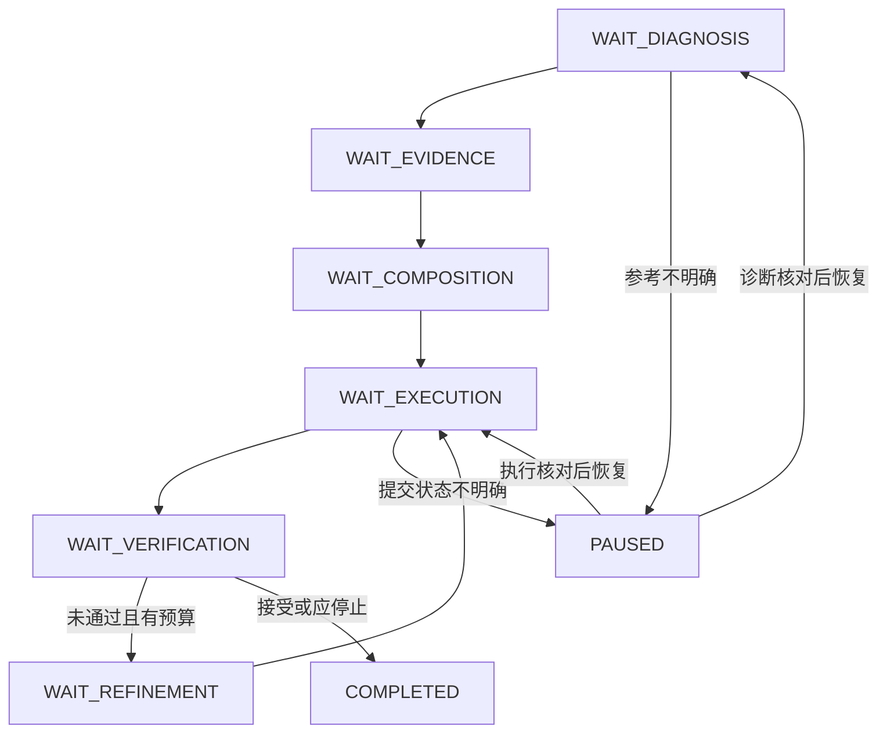

# HarnessRefEnhance v1：工程交付总方案

**任务：以 Modular Neural ISP prediction A 为唯一编辑对象，使用同场景、非像素对齐的 iPhone 17 reference B 指导外观增强，得到内容稳定、rendering更接近B的候选C。**

版本：`ref_enhance_v1`；日期：2026-10-13。本包由四个并行设计 Agent 产出 PRD、状态/文件协议、Prompt、实验方案，由主 Agent 统一合同与工程计划，并另设独立审查。设计交付之后已实现本地运行系统；请从 [实现与验证记录](../IMPLEMENTATION_STATUS.md)、[安装与命令](../../../engine/README.md) 和 [运行手册](../IMPLEMENTATION_RUNBOOK.md) 进入代码。真实模型增强与 Windows 桌面能力尚未实测。

## 1. 实施决议

| 项目 | 最终决定 |
|---|---|
| 系统名称 | HarnessRefEnhance；借鉴 HarnessIR 流程的独立增强任务 |
| 输入 | 冻结 A、B；B是目标外观参考，非像素GT |
| 输出 | 增强候选、style/content核查、过程报告与可选审查候选包 |
| 第一阶段 | 本地文件 Controller + Streamlit，ChatGPT桌面两图编辑，无外部模型API |
| 目录 | `engine/src/hre/`；先盘点已有engine/Data/cases再增量接入 |
| 自动部分 | 状态、协议校验、Prompt、缓存筛选与读取、预算、日志与报告 |
| 能力待实测 | 桌面读写文件、角色派发、两图编辑、图像保存，分别probe |
| 不足时交接 | 导出任务、上传A/B、导入JSON、保存一次结果；同一验证链 |
| 工具 | 保留T1 OCR/T2 FACE/T3 DEPTH/T4 SEG；新增CPU STATS、manual ROI_COMPARE |
| 重试 | 每轮仍从A+B开始，最多3次生成；工具彩图/上轮C不进Executor |
| 候选 | raw不覆盖；禁颜色回拉；几何默认strict |
| 接受 | 可比目标有支持+有效geometry+style improved+content pass+无critical defect+confidence≥.7 |
| 选图 | 最早accepted；否则最早usable且review_required；否则baseline fallback |
| 实验 | 单次对单次、3次上限对3次上限；最终独立盲评 |

0.7是工程冻结阈值，未作概率校准。COMPLETED只是流程完成；未accepted预算耗尽必为successfalse。固定K正常结束记fixed_k_complete，按候选判断成功；不与失败耗尽混写。

## 2. 一张图如何运行

1. 用户提供A/B与prediction来源；canonical化为可解释SDR sRGB PNG，保留原文件、ICC/EXIF与hash。
2. Diagnoser真正看两图，先判断可比較性，再给至多3项有支持的rendering gap与内容保护约束。
3. Controller按tool_plan自动读取匹配缓存；缺项显示清单。离线可提前全算，Compose只消费已规划项。
4. Composer看A/B、诊断与已验证证据，把目标写成短、明确、可执行的编辑文字。不能因为保真而锁住合法亮度/颜色变化。
5. Executor收到A+B+文字，生成一张C。输出先登记、保raw、查geometry与task/hash，再交Verifier。
6. Verifier按固定标准分别判断C对B的外观、C对A的内容。其观察由Controller校验并驱动接受、有限重试或失败回退。
7. Refiner只修订指令；新Executor依然用A+B。最终报告与选图绑定同一hash/round，独立评价另行盲化。

### 状态与返回关系

图仅展示主闭环与部分暂停入口；完整状态/事件/恢复范围以02为准。PAUSED恢复到其resume_state，不固定回到Execute。

## 3. 工程师阅读顺序与权威关系

| 顺序 | 文件 | 用途 |
|---|---|---|
| 1 | [00_SHARED_CONTRACT.md](00_SHARED_CONTRACT.md) | 最终公共字段、边界、预算与选图决议 |
| 2 | [01_PRD.md](01_PRD.md) | P0/P1、用户journey、页面与迁移 |
| 3 | [02_STATE_AND_PROTOCOL.md](02_STATE_AND_PROTOCOL.md) | 状态事件、文件事务、幂等、缓存与恢复 |
| 4 | [03_PROMPTS.md](03_PROMPTS.md) | 核心四Prompt、Executor/Direct模板、绑定及schema |
| 5 | [04_EXPERIMENTS.md](04_EXPERIMENTS.md) | 公平对照、分组、独立盲评与统计 |
| 6 | [05_IMPLEMENTATION_PLAN.md](05_IMPLEMENTATION_PLAN.md) | M1–M6，文件职责、签名、测试与命令 |
| 7 | [06_ACCEPTANCE.md](06_ACCEPTANCE.md) | 需求覆盖、失败矩阵、R1/pilot与可复制任务 |
| 8 | [07_REPOSITORY_INTEGRATION.md](07_REPOSITORY_INTEGRATION.md) | 已核查源码、复用边界、Windows迁移 |
| 9 | [REVIEW_AND_DECISIONS.md](REVIEW_AND_DECISIONS.md) | 独立审查与汇总修正 |
| 10 | [VALIDATION_REPORT.md](VALIDATION_REPORT.md) | 本次真实静态校验结果与未运行范围 |

`schemas/` 是JSON结构合同；跨字段/文件/预算与可比较性规则由02/公共合同执行，不能仅通过schema就算业务通过。`prompts/`、`config/`、`examples/` 可直接复制使用；examples全为合成/占位，必须替换真实数据并验证，不能混入正式实验。

发生矛盾先以00最终决议和schema字段为准，修复文档后再执行；不要让不同工程师各挑一份解释。

## 4. 最小对照设计

| 对照臂 | 输入/策略 | 生成上限 | 比较目的 |
|---|---|---:|---|
| Baseline | A | 0 | 记录原始外观，非成功增强 |
| DirectRef | A+B+固定DirectRef文字 | 1 | 无诊断/工具的两图直接编辑 |
| AgentSingle | 诊断+按需证据+Compose | 1 | 主比较：流程是否提高单次编辑 |
| DirectBestOf3 | 固定DirectRef生成最多3候选，同流程selector | 3 | 排除更多采样解释 |
| AgentAdaptive | 完整流程+反馈refine | 3 | 相同上限下的自适应策略 |
| ColorCurve（辅助） | dev冻结的确定性颜色/曲线映射 | 0 | 检查生成Agent是否比简单外观调整更必要 |

DirectBestOf3的“best”采用本包相同冻结selector；它不是用最终test裁判或oracle选图。Adaptive允许早停，需报告实际调用和总成本。不同臂的文本分析、工具预计算、人工时间也要计入，不只算生成次数。

先合成协议测试→真实1对链→12对pilot→独立dev/validation/test的正式冻结集。建议正式≥60对作为起点，非power保证；所有图按scene group隔离，失败/uncertain保留在分母中。只支持当前配对参考增强结论，不能推出对所有iPhone17场景的风格泛化。

## 5. 非对齐参考的工程原则

B的全局亮度/色彩可能因视角、照明、时间、天空比例或拍摄曝光而不同。先确认可比语义/材质/照明，manual ROI各用A/B自己的坐标；无法比较就unknown，不能要求输出复制B。

不对B直接计算PSNR/SSIM/LPIPS并称增强质量。外观评价对B，内容评价对A；A/C原始光度相似度不作恢复门禁。输出未恢复真实信息、可能生成细节，审查后的candidate也不自动成为GT。

## 6. 工程实施依赖与首个验收目标

M1 双图冻结 → M2 协议/状态/预算 → M3 缓存/统计/ROI → M4 Prompt/桌面实测 → M5 验证/选图/报告 → M6 UI/批处理/盲评。

M2完成后可以用合成结果演练流程；M4必须用真实两图与真实编辑结果验证。无需先部署所有大工具，但任何缺证据的情况都要明确等待或依冻结profile处理，不能用fixture冒充真实证据。

首个可交付运行目标：**创建真实A/B case，实际看图写回诊断，自动读计划内缓存形成Compose任务，完成一次两图编辑与验证，生成与最终图片一致的报告；中途退出后可恢复。**

完整验收与可发工程师的任务文本见06最后一节。实施命令见05，均是工程师应实现的接口，不是当前已有命令。
