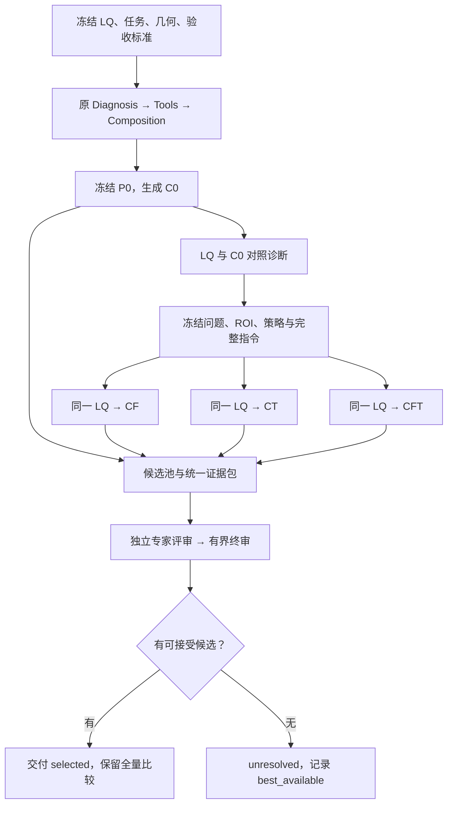

# HarnessIR 多候选恢复与专家 Judge：工程实施方案 v1.0

日期：2026-11-14  
状态：供工程实现的设计稿；本次已核查仓库源码，未修改仓库、未运行图像模型。  
任务：单张图像恢复／超分，优先解决人物与文字的恢复分歧。  
交付边界：本文件包含架构、接口契约、提示词规范、任务拆分、实验与验收；不包含业务实现代码。文中的新增路径、字段与命令均为待实现接口。

## 0. 工程师先读：已确定的决策

1. **在 HarnessIR 同一仓库中增加独立、默认关闭的多候选入口**，不另建项目，也不把候选伪装成原有 redo 轮次。
2. 复用原 Diagnosis → Tools → Composition 的语义流程；原 Composer 产生完整指令 P0，先生成原版 C0。针对 C0 的实际缺陷确定替代策略，再从同一原始 LQ 生成 CF、CT、CFT。
3. 第一轮固定一个现有 Qwen 执行器。模型、权重、推理参数、输出几何及后处理保持一致。改变的变量是候选指令与预先规定的 seed。
4. 人物调整可加强恢复、减少蜡感或减轻过锐；文字调整可增强受证据支持的笔画重建。**候选不是统一的弱／中／强生成档位。**
5. Code 负责数据绑定、坐标、文件和尺寸契约及数值证据；VLM 负责可见内容冲突、恢复程度、自然度与整图取舍。软指标不负责提前淘汰候选。
6. Judge 使用四个独立评审视角与一个终审：人物、文字、整图技术画质、日常观看体验。它们是 VLM 角色，不是真实厂商专家；同模型多角色也不代表统计独立。
7. 区分“候选中最优”“达到可接受标准”“真实性已验证”。允许最佳结果仍不合格，此时只保存审计结果，不伪造成功。
8. 最小实验比较“原版四次采样”与“原版＋三个策略候选”。共享一次原版，合计每图 7 次生成；GT 只进入独立离线终审。
9. 第一轮不加入局部裁切融合、专用人脸/OCR生成器、训练、经验库、自我进化或跨模型路由。上述功能只有在失败证据表明必要时再加。

## 1. 仓库基线与核查事实

### 1.1 分支锁定

本次从 GitHub 读取到的状态如下，工程开始前需再次读取远端 SHA，并保留已有工作。

| 分支 | 2026-11-14 读取到的 SHA | 用途 |
|---|---|---|
| main | `0a0c04883990186c4d7d7e9cd754ffb6673978b9` | 用户所给仓库默认入口，包含原始 harness 流程 |
| codex/reference-unified-20261101 | `90283e5189160c4c6e3429ddfa48f04d5bc27dfd` | 前期约定的工程基线 |
| codex/evidence-sr-v02-20261111 | `d44d40fa209a9978d37ce38efa9a6ef89abe7432` | 建议新实现分支的起点 |
| codex/minimax-h3-executor-20261113 | `47a42f2f804b765342ddfe91cfa973ba10a88a5f` | 存在独立执行器工作；本方案不依赖、未审查其实现 |

GitHub compare 显示 evidence-sr 分支相对 reference-unified **ahead 2、behind 0**。选择 d44d40f 是为了保留既有基线并利用已有执行记录和证据机制，并不表示现有 SR 实验已获得真实质量提升。

建议新分支：`feat/restoration-candidates-v1-20261114`，从上述锁定提交创建独立工作目录。不要对旧分支强制重置，不自动合并 H3 分支。若工程师使用服务器上未推送的修改，先记录其 diff 和基线，再进行集成。

### 1.2 已核查的真实接口与限制

| 现有文件／函数 | 已核查行为 | 本方案处理 |
|---|---|---|
| `harness/pipeline.py::run_sample` | Diagnose、Tools、Compose 后执行；redo 默认关闭，关闭时不运行 Verify；redo 各轮仍从原图执行 | 复用前三阶段，不直接套用原循环 |
| `harness/stages/diagnosis.py::run_diagnosis` | VLM 按图像规划 T1 OCR、T2 FACE、T3 DEPTH、T4 SEGMENTATION；有基础统计输入 | 保留，增加独立的候选规划输出，不重写原 Diagnosis |
| `harness/stages/compose.py::run_compose` | 输出一个 `Composition.prompt`；空指令可压缩重试一次 | P0 原样归档；记录实际调用数，包括这次重试 |
| `harness/stages/execute.py::run_execute` | 会把执行器结果 resize/crop 回既定尺寸；SR 分支新增原生结果归档，但仍保留归一化行为 | 不作为新的严格 x4 执行入口 |
| `harness/stages/verify.py` | 使用原图、结果、任务标准与证据；不以生成 Prompt 作为唯一验收标准 | 保留原路径；新 Judge 同样依据独立 EvaluationContract |
| `harness/selection.py::select_final` | 有 best_round、最早 accepted、overall/NR 等规则；所有 gates 失败时仍可能返回一张结果 | 新路径不用这一选择器，显式区分 best_available 与正式 selected |
| `engine/src/hre/sr/contracts.py::recipes` | C0=RealESRNet，C1=预滤波+RealESRNet，C2=SeeSR，C3=Qwen；严格 x4 | 保持原配方不变，不把其 C0–C3 直接改成人物/文字版本 |
| `engine/src/hre/sr/evidence.py` | 已有图像/ROI/数值绑定、匿名附件、visual/evidence 两种 Judge 输入 | 借用设计与可独立复用函数；不直接调用含旧槽位和旧 baseline 逻辑的 bundle |
| `engine/src/hre/sr/runtime.py` | 冻结输入、操作提交回执、恢复执行、正式选择 | 参考运行记录语义，不直接修改私有函数或旧状态文件 |
| `engine/src/hre/v3/qwen.py::generate` | 显式 seed、输出 canvas、原生图像保存；无原生硬 Mask 参数 | 复用现有本地执行器；区域指令不宣称像素级空间控制 |
| `engine/src/hre/v3/dispatch.py` | 编译条件、执行结果与请求做哈希绑定 | 复用 `seal_condition`、`generate` 等边界能力 |
| `engine/src/hre/v3/common.py::render_instruction` | 即使 direct/native，仍会追加通用保持源画布等要求 | 不能把 direct 等同于 P0 字节直通；新增局部的完整 Prompt 绑定桥接 |

`harness/pipeline.py` 与 `harness/selection.py` 在本次 main 和 evidence-sr 树中的 blob SHA 相同。旧方法的行为描述来自代码阅读，不是本次实验结论。

## 2. 目标、研究假设与范围

### 2.1 要回答的问题

- H1 候选覆盖：相同 4 次图像生成预算下，针对缺陷的策略候选是否更容易包含合格答案？
- H2 Judge：同一候选池内，分工评审能否比单 Judge 更接近独立终审的最佳结果？
- H3 数值证据：加入有绑定关系的 Code 证据是否改善选择，而非让 Judge 机械偏好更高锐度或更接近 LQ？
- H4 控制有效性：Prompt 中的人物/文字调整是否实际落实，还是差异主要来自 seed？

先检查这些假设，再增加 Prompt 复杂度。若池中没有可接受结果，改 Judge 不能解决生成覆盖不足。

### 2.2 两个实验配置，独立统计

| 配置 | 输入/输出 | 首轮用途 |
|---|---|---|
| restoration_x1 | 规范化 sRGB LQ → 相同内容尺寸 | 去噪、去模糊、去压缩；适配当前真实图像恢复讨论 |
| sr_x4 | 原始 LR → 严格四倍内容尺寸 | 有 GT 合成退化试验，验证细节重建与保真 |

实现两个几何配置；第一轮质量实验默认 sr_x4。x1 运行单独记录，不将其插值放大结果计为 x4。SR 指令外层只声明倍率和输出大小，不顺带重写原 P0 的人物/文字策略。两组共用这一声明。

仅接受 8-bit SDR、可解释的 sRGB/ICC 输入；RAW、HDR和透明图像需明确转换后另立实验。不对输入静默长边缩为 1024。

## 3. 流程与状态



状态：`created → baseline_ready → plan_frozen → candidates_complete → evidence_ready → reviewed → selected/unresolved`。

辅助状态：`blocked` 为依赖或契约无法满足；`failed` 为已知失败；`unknown` 为请求可能已执行但结果无法确认。状态更新必须记录原因、操作 ID 与对应结果，不从“文件存在”推断请求成功。

两个冻结点：

1. 生成 C0 前冻结任务、预算、模型、图像尺寸、候选策略规则和评价政策。
2. 看完 C0 后冻结该图的问题、ROI、具体替代策略和最终 Prompt；之后不能因为 CF/CT 的结果不好而暗改计划补抽。自适应策略本身是事先冻结的算法，不等于看过全部结果后挑策略。

首轮不增加后续反馈迭代。每个 case 完成一池后停止。

## 4. 候选规划契约

### 4.1 输入与输出

Planner 输入：LQ、C0、P0、原 diagnosis/tool evidence、图像几何、EvaluationContract。不得读取 GT、离线评分或其他尚未生成的候选。

输出 `CandidatePlan`，包含 `issues`、`roi_registry`、`shared_requirements`、`candidate_specs`、`plan_reason`、`status`。每条 issue 必须带：区域 ID、观测、替代解释、证据引用、希望改变的属性、需保持的属性与可观察验收描述。

不要输出没有依据的百分比“生成强度”。置信状态用 `supported / ambiguous / unavailable`，附具体依据；VLM 自报 0.95 不作为已校准概率。

### 4.2 人物与文字均为主要问题时

| 策略 ID | 人物 | 文字 | 作用 |
|---|---|---|---|
| baseline | 原策略 | 原策略 | 保留 P0 的真实基线 |
| face_alt | 针对具体问题的替代策略 | 原策略 | 检验人物调整 |
| text_alt | 原策略 | 针对具体问题的替代策略 | 检验文字调整 |
| joint_alt | 与 face_alt 同一策略 | 与 text_alt 同一策略 | 检验共同实施的效果 |

显示名 C0/CF/CT/CFT 只用于报告；持久 ID 用 `strategy_id + sample_index + seed`，不与旧 SR C0–C3 共享命名空间。实际候选例：`face_alt_s1_seed101`。

### 4.3 如何选替代策略

| 问题 | 候选方向 | 不应偷换的目标 |
|---|---|---|
| 五官结构欠恢复、眼眉或唇线破碎 | 补全有依据的结构、改善连续性 | 不能把“更完整”改成美化脸型、改变表情 |
| 皮肤蜡感 | 降低过度平滑，探索自然质感 | 不强制生成密集毛孔 |
| 过锐、假毛孔、皱纹过重 | 减少伪高频和边缘硬化 | 不把整个脸重新抹平 |
| 肢体/手部结构错误 | 探索受可见结构约束的人物恢复 | 不只看脸，忽略身体、姿态、手部 |
| 字符可确认、笔画粘连/断裂 | 强化原字符结构和可见笔画 | 不新增字、不改变行数/内容 |
| 字符只部分可确认 | 保持可确认笔画与布局，探索其余部分的恢复 | 不用语言常识补出的词当成已知原文 |
| 字符完全不可确认 | 优先减少伪笔画或探索可见性；未知细节保留标记 | 不预先规定必须恢复成可读词语 |

人物区域的生成许可与验收属性分开：允许探索细节，不允许把“自然”直接当成身份正确；重要表情/姿态按已有证据判断。

### 4.4 四槽位的适应性规则

- 人物、文字均有问题：C0/CF/CT/CFT。
- 仅人物有问题：C0、人物替代 A、人物替代 B、原版追加样本。只有一种有依据的替代方向时，第四槽与第二替代槽用于预定 seed 的重复采样，不凭空编出策略。
- 仅文字有问题：同上，围绕文字定义替代方向。
- 主要问题是其他区域：可将 face/text 位置替换为两个明确的问题属性；记录真实策略名，不再叫 CF/CT。
- 没有明确分歧：四次原策略采样；production 可后续支持早停，但固定预算对照实验不早停。
- C0 生成失败：本轮反馈策略无法建立，记录 baseline_failed；不临时换一个更好 seed 充当 C0。全数据结果包含该失败，另报成功执行子集。

首轮实验最多 2 个问题轴、4 个候选。多个脸/招牌仍归入有限数量的策略轴，但所有重要实例都需验收。

## 5. Prompt 改写与执行接口

### 5.1 最小接法

**原 Composition P0 → 按 CandidatePlan 改写相关要求 → 冻结完整 Prompt → 同一执行器。**

Rewriter 输出每个候选的完整字符串及修改清单：`changed_requirements`、`retained_requirements`、`evidence_refs`、`expected_effect`。不把相反的要求简单追加到末尾；如 P0 中某句过度禁止局部细节恢复，应在相关作用域内改写。

C0 的 P0 原文不改。SR 的统一倍率声明、几何描述由可审计的共同 wrapper 添加，四个候选完全一致。CF、CT、CFT 的差异只来自冻结的问题策略。

批量调用一次 Rewriter 产生三个完整指令；随后做一次独立语义核查：任务目标是否遗漏、保护属性是否改变、是否新增无依据 OCR 文本、联合版是否同时保留两个已选方向。核查不是效果证明。

预设语义修复最多一次，修复仍失败则将该策略槽转为预先规定的 baseline resample，并记录 `plan_fallback`；不得悄悄声称已执行原策略。传输结果 unknown 时不自动修复重发。

### 5.2 执行器连接的具体决定

新增 bridge 使用 v3 请求的 `profile_id=qwen21`、`task_mode=restoration`、`strategy=native`、`intent=null`、`inputs=[source]`、`spatial.mode=full_frame`、明确 canvas 与 seed。这里 native 只是兼容底层请求契约，不表示没有使用 HarnessIR Composer。

在 bridge 内把已冻结完整 Prompt 作为 condition.text，使用现有 `dispatch.seal_condition` 绑定请求，再调用 `dispatch.generate`。本地 direct condition 构建不调用 `render_instruction`，避免通用模板再次追加“保持源画布”而影响 x4，或抵消候选策略。必须测试实际送达生成器的 Prompt 哈希等于已冻结 Prompt 哈希。

第一轮 `PE=off`，不同时测试 PE 效果。后续 PE 实验按“P0/候选完整 Prompt → PE → 审计 → 执行”接入，四个候选使用同一编译器设置；保存 PE 前后文本。PE 丢失策略差异时记录失败，不以运行成功替代语义核查。不要现在修改所有模型的全局 render_instruction。

### 5.3 空间与几何

- 凡图像模型输入均来自原始规范化 LQ；C0 只作为 Planner/Judge 依据，不输入候选执行器。
- ROI 是证据与评估坐标，不是模型硬 Mask。整图生成可能影响未指定区域，必须验收整图。
- Qwen canvas 需满足当前 adapter 的 32 像素网格；本方案采用右/下边缘 padding，保留原图像内容尺寸与 padding 记录。
- x1：LR padding 到 32 倍数，输出对应 canvas，再裁回原 W×H。
- x4：LR padding 到 8 倍数，输出四倍 padded canvas，再按四倍 padding 裁回 4W×4H。
- 原生输出尺寸错误直接 contract_fail，不 resize 成“合格”。native 和 delivered 都保留。
- 原 Composer 看未 padding 的图像/证据，避免边框影响诊断。padding 只发生在执行桥接。
- 首轮 `color_adjust=off`，所有候选一致。如沿用生产后处理，必须对所有候选一致应用，并同时保存前后图；Judge 看真正交付版本。

## 6. 证据包：Code 与 VLM 的边界

### 6.1 同一 ROI 坐标注册表

ROI 以 EXIF 已规范化的原始 LQ 像素为准，整数 `[x0,y0,x1,y1]`，右下边界不含。记录 `id / semantic_type / importance / box / provenance / availability`。

优先用现有检测或已有人工 ROI；缺失时允许 Planner 提议并显式记录来源。Pilot 可人工校正检测框，只看 LQ，不看 GT/候选优劣。GT 可提供离线评估框，但不能混入在线 ROI 发现流程。

主 ROI 默认最多 6 个（最多 3 个人物区域、3 个文字区域），同类型按任务重要性、面积、位置确定稳定顺序。超过上限进入多个评审包或标为 coverage_incomplete；不得静默漏掉重要脸或招牌。身体/手、头发必要时作为人物子 ROI。

模型输出发生位移时不重新检测并追着新位置取框来掩盖位移；使用同一投影框加必要上下文，位移本身由 Judge 检查。

### 6.2 证据层级

| 层级 | 默认内容 | 权限 |
|---|---|---|
| 硬契约 | 可解码、来源哈希、输出大小、crop/pad、透明度、图像/证据绑定 | 确定错误可使候选 ineligible |
| 输入内容证据 | LQ 对应裁图、OCR 候选/置信度、已有可确认笔画、人脸与姿态定位 | 帮助判断内容；OCR 或 embedding 单项不能证明真实性 |
| 输出差异证据 | 相同 ROI 原图/结果、C0–候选差异图 | 显示改变位置与幅度；差异本身不是损坏 |
| 软数值 | clipping、edge energy、声明下采样下的 LR consistency | 提示风险/变化，不设未校准的淘汰阈值 |
| 可选工具 | OCR 稳定性、face embedding、landmark displacement | 仅在可用且适配质量时提供，标明模型与局限 |
| 离线 GT 证据 | PSNR/SSIM/LPIPS、字符真值、身份/表情与结构终审 | 只评估方法，不进入在线 Planner/Judge |

LR consistency 必须记录下采样方法。对含噪声、压缩或模糊的 LR，仅使用 bicubic 得到的是 proxy，不等于真实退化模型一致性。edge energy 增大可能来自伪细节；OCR 置信度增大可能来自清晰错字。

每条 Measurement 绑定 `source_sha256 / candidate_sha256 / roi_id / geometry_sha256 / method_id / method_version`，值缺失用 null，并标记 `measured / missing / failed / stale / not_applicable`。缺失不等于 0，不等于通过。

### 6.3 VLM 图像输入

统一输入含：整图 LQ、每个匿名候选整图、同位置人物与文字 ROI；必要时加上下文裁图。提供独立图像，不只给一张低分辨率拼图。浏览用联系表用于人类报告，不替代 VLM 的可读 ROI。

所有候选使用相同裁图位置、显示尺度和压缩流程；记录实际传输图像哈希。接口容量不足时拆成区域评审包，不悄悄只给首几张图。文字裁图不得为了省 token 缩到无法辨认。

候选以随机匿名 ID A01…A04 显示。模型名、策略名、seed、生成 Prompt、GT、最终 Code 综合分不发送给 Judge。评价要求从 EvaluationContract 独立输入；生成策略遗漏某个目标不能让验收标准也跟着消失。

## 7. 专家 Judge 与终审规则

### 7.1 四个视角，不平均四个分数

| 专家角色 | 输入重点 | 必须回答 | 不具有的权限 |
|---|---|---|---|
| J-P 人物恢复 | 整图、脸/身体/头发 ROI、相关内容证据 | 哪个更清楚自然；是否改表情、姿态、可见五官结构；蜡感/过锐在哪里 | 不凭自然脸证明原身份 |
| J-T 文字恢复 | 整图上下文、招牌 ROI、LQ OCR及可见笔画依据 | 可读性是否提高；是否有明确笔画/字符冲突；哪些仍不可核实 | 不把输出 OCR 当原文 |
| J-G 整图技术画质 | 全部整图、关键 ROI、软数值 | 去退化、伪影、颜色/光照、几何及区域协调 | 不用锐度/IQA抵消重要内容错误 |
| J-U 日常观看体验 | 正常观看尺寸整图、任务用途；必要 ROI | 用户是否更愿保留；人物是否自然；局部改善是否换来整体不协调 | 不声称模拟意见代表真实用户比例 |

不存在人物/文字则对应专家返回 `not_applicable` 并可省去调用，不伪造通过。四个专家先独立输出，不能看彼此结论。优先使用相同已部署 VLM 保持成本可控；异构模型只在后续对照中测试。

### 7.2 每位专家的输出

`ExpertReview`：`role / applicability / candidate_assessments / preference_groups / pairwise_conflicts / evidence_refs / limitations`。

每候选评估含：

- `candidate_id`；
- `content_state = supported | no_visible_conflict | conflict | unverifiable`；
- `restoration = insufficient | adequate | strong | uncertain`；
- `artifact_severity = none | minor | major | uncertain`；
- `issues[] = {region_id, attribute, severity, observation, evidence_refs}`；
- `preference_reason`；允许并列偏好组，不强迫微小差异产生虚假顺序。

`no_visible_conflict` 表示没有观察到矛盾，不意味着未知高频真实。`conflict` 必须引用具体图像/ROI/可确认内容，缺少依据的强指控转待复核。

### 7.3 两类用途的可接受政策

默认 `photo_restoration`：保护已知内容，允许自然、合理但无法逐像素验证的细节；未知不自动判失败，也不宣称真实性验证通过。若未知涉及用户明确要求准确的关键属性，则升级为 critical_uncertainty。

`information_critical`：用于读取号码、重要文字或要求准确身份的任务。关键内容缺乏充分依据时，不能将生成结果交付为“已验证正确”，可输出 unresolved。政策在生成前冻结，不能为了让更多候选通过临时切换。

| 情况 | photo_restoration | information_critical |
|---|---|---|
| 已知文字/表情明确改错 | 不合格 | 不合格 |
| 自然纹理无法逐像素确认，无可见矛盾 | 可接受，保留不确定说明 | 若不是关键属性，可接受 |
| 核心号码/身份无法确认 | 可标视觉候选，但不得宣称准确 | unresolved 或不进入合格集合 |
| 退化明显未解决，只有内容保持 | 不因保真自动通过 | 同样记录恢复不足 |

### 7.4 终审 J-A

终审必须看到原始图像证据和专家输出，不能只汇总专家文字。先做候选独立可接受性判断，再在可接受集合中比较整体收益。C0 同样可能失败。

顺序：

1. Code 排除确定的文件/几何/绑定错误。
2. 终审逐条核查专家指出的重要内容冲突，记录 `confirmed / dismissed / unresolved` 及依据。
3. 根据冻结用途政策形成 `eligible_ids`。重要内容冲突、严重伪影、关键未满足任务进入不合格；软数值异常本身不能淘汰。
4. 在 eligible 中比较恢复充分性、自然度、整图协调与使用价值，给出有理由的偏好组。人物/文字之外的严重退化同样要考虑。
5. 若前两名有实质争议，最多追加一次二选一复核，交换显示顺序，只看争议区域和整图上下文。若是多个相互独立的关键内容争议，超出复核预算者保持 unresolved，不能一律多数表决消除。
6. 最终 `best_candidate` 必须在 eligible 且属于首个偏好组。并列时若 C0 在首组，保留 C0；否则按 case 创建前冻结的 tie_order 选择，并记录等价，不能由较高 NR 分数偷换决策。

默认完整评审最多 4 个专家＋1 次终审＋1 次争议复核；没有相关区域可少调用。格式修复另设总预算最多 1 次，独立计费。超时 unknown 不自动重发。

### 7.5 最终输出，避免 best 与 PASS 混淆

| 字段 | 定义 |
|---|---|
| `best_available_id` | 可读取、契约有效候选中相对最优；可以仍未达标 |
| `eligible_ids` | 达到本任务可接受要求的候选 |
| `preference_groups` | 对合格候选的分组排序，允许并列 |
| `best_candidate` | 正式选择，必须属于第一偏好组；无合格结果为 null |
| `status` | selected / baseline_retained / unresolved / judge_failed |
| `content_verification` | 各关键属性的证据状态，不用一个总布尔值掩盖未知 |
| `reason` | 相对其他候选具体好在哪里、仍有哪些代价 |

所有候选失败时：selected_output=null；best_available 如有则只供审计。LQ 不是合格 HR 输出，C0 也不因“基线”身份自动获得 PASS。

## 8. 数据对象与模块接口

### 8.1 核心对象

| 对象 | 必填信息 | 禁止混入 |
|---|---|---|
| TaskSpec | case_id、source、task_types、scale、用途政策、seed_schedule、预算 | GT 图像/字符真值 |
| EvaluationContract | 任务目标、关键属性、可接受标准、未知处理、tie_order | 候选名称带来的偏好 |
| BaselineContext | diagnosis、tool_evidence、visual_pack、P0、C0、来源哈希 | 从 GT 推断的诊断 |
| CandidateSpec | strategy_id、sample_index、seed、source_hash、issue_refs、完整 prompt/hash、expected_effect | 仅一个“人物增强”名称 |
| CandidateArtifact | 请求/原生/交付图像哈希、几何、模型/编译器/参数、状态、耗时与成本 | 通过改文件名冒充另一策略 |
| EvidenceBundle | ROI 注册表、图像附件、别名映射本地引用、绑定数值和缺失状态 | 策略名、执行器身份、GT |
| ExpertReview | 逐候选结论、问题、引用、偏好组、不确定性 | 只有一个无法解释的总分 |
| SelectionResult | eligible、排序、best、best_available、状态、复核记录 | best 不在 eligible |
| OracleLabels | 候选哈希、合格与否、错误类型、最佳集合、标注者分歧 | 在线 request 输入 |

所有新对象采用独立版本前缀 `hre_candidates_v1`，严格校验必填项、枚举、有限数值、唯一 ID 和引用存在性；新版本不得读成旧 sr_v02 状态。

### 8.2 模块输入输出

| 拟建接口 | 输入 | 输出 |
|---|---|---|
| `prepare_baseline` | TaskSpec、RuntimeConfig | BaselineContext |
| `plan_candidates` | BaselineContext、EvaluationContract | CandidatePlan |
| `rewrite_candidates` | P0、CandidatePlan、共同 wrapper | 完整 CandidateSpec 列表 |
| `execute_candidate` | CandidateSpec、几何、adapter config | CandidateArtifact |
| `build_evidence_bundle` | LQ、所有候选、ROI registry、measure profile | EvidenceBundle |
| `review_pool` | 匿名 EvidenceBundle、EvaluationContract | ExpertReview 列表 |
| `adjudicate` | 原图像证据、专家输出、EvaluationContract | SelectionResult |
| `evaluate_offline` | 冻结候选、在线选择、OracleLabels、GT | 离线指标与失败归因 |

### 8.3 最小文件边界

建议新建 `engine/src/hre/candidates/`，功能按下表组织；工程师可合并短文件，不为每个字段建类。

| 拟新增文件 | 职责 |
|---|---|
| `contracts.py` | 对象验证、策略与用途政策、选择一致性 |
| `bridge.py` | 原 harness 前三阶段桥接、VLM chat_json 适配、v3 Qwen 请求和完整 Prompt 直通 |
| `planner.py` | C0 缺陷诊断、四槽位分配、完整指令改写与语义审计 |
| `evidence.py` | ROI、匿名图像包、Code 数值绑定 |
| `judge.py` | 专家调用、终审、冲突复核与选择规则 |
| `runtime.py` | 两次冻结、执行顺序、预算、resume、状态与回执 |
| `report.py` | 对照图、Markdown 报告、CSV、离线终审和指标 |
| `cli.py`、`__init__.py` | 独立入口与导出 |

修改 `engine/src/hre/cli.py` 仅增加 `candidates` 子命令。新 Prompt 模板放入 `engine/src/hre/resources/prompts/candidates_*.j2`，利用现有 package-data 规则，并用 wheel 安装测试确认打包。

新增示例放 `engine/examples/restoration_candidates_v1/`，新增测试放 `engine/tests/test_candidates_*.py`，文档放 `docs/restoration_candidates_v1/`。

原 `harness/` 位于仓库根目录，不是 engine wheel 自动打包内容。bridge 要显式接收并校验 `harness_source_root`，验证其源码身份和 prompts 资源，或把依赖抽成正式包。v1 优先前者；不要依赖工程师恰好在仓库根目录启动而隐式导入成功。基础依赖/工具权重由 preflight 检查。

## 9. 执行、记录、预算与恢复

单 GPU 默认串行执行候选，逻辑上的候选并列不要求 GPU 同时运行。多 GPU 可按设备分发独立 worker，但固定 seed 与独立输出目录，不共享可变随机状态。模型在单 worker 内复用已加载权重。

预算分开记录 image generation、diagnosis/composer、planner/rewriter/audit、PE、各专家/终审、工具调用与复核。美元/token 未返回则为 unknown；不能将空值统计为零。

每次外部调用前写 request 和 submitted 标记，完成后写原始响应与回执。已完成观察可在 resume 重用；提交后断连没有回执时标 unknown，不自动重复生成。恢复应复用仓库已有 journal/storage 能力；如必须抽共享函数，先加回归测试并保留旧契约。

推荐记录结构：

| 相对路径 | 内容 |
|---|---|
| `case.json`、`freeze.json` | 输入、模型、政策、预算与身份 |
| `baseline/` | 原诊断、工具、P0、C0生成记录 |
| `plan/plan.json`、`plan/prompts/` | 缺陷、策略、原始/最终 Prompt 与哈希 |
| `candidates/<candidate_id>/` | request、condition、native、delivered、receipt |
| `evidence/` | ROI、数值、实际附件及哈希 |
| `judge/` | 本地别名映射、匿名请求、专家响应、终审及复核 |
| `selection.json` | 正式选择及一致性结果 |
| `report.md`、`contact_sheet.png`、`results.csv` | 人类可读结论 |
| `offline/` | 独立终审、GT指标；不被在线模块遍历或加载 |

精确重复按交付像素哈希检测：保留每次生成及成本，可共享评价，但映射回所有候选 ID。不用近似重复判据直接淘汰细微但关键的文字/表情差异。若策略落地差异不足，报告 diversity_collapse。

## 10. 最小实验与离线评价

### 10.1 数据与冻结

Pilot：10 张有 GT 图像，建议 3 人物主问题、3 文字主问题、3 混合、1 无明显人物/文字问题对照。只用于检查接口、理解失败和修订策略，不凭 10 张推断总体收益。

Pilot 后冻结协议，再做 24 张 held-out（人物/文字/混合/其他或无明显问题各 6 张）；按场景源划分，避免同场景裁图跨集合。覆盖可确认、部分可确认、不可确认三个信息等级，等级只根据 LQ 标注。真人图像和文字真值需具备合法数据来源。

各组数据记录：场景、退化 recipe 与 seed、scale、人物/文字大小、可辨识程度、任务用途、关键 ROI。生成退化保持 LQ/GT 几何一致。真实无 GT 图像后续单独评估自然度、明确冲突和未知率，不混入字符真实性结论。

### 10.2 候选池 A/B：每图 7 次生成

| seed | A：原版多采样 | B：策略候选 |
|---|---|---|
| s0 | C0，共享 | C0，共享 |
| s1 | P0 | PF |
| s2 | P0 | PT |
| s3 | P0 | PFT |

seed schedule 在 case 前冻结；可按预设规则在图像间轮换 PF/PT/PFT 对应的 s1–s3，避免固定偏置。每张图的共享 C0、诊断与原 Composer 完全相同。无人物或文字时按第4节策略分配规则执行，报告真实策略。

不能据此宣称单图 PF 的差异纯由策略造成：该四槽设计首先比较预算内的系统覆盖。若要确定策略效应，再在一小组诊断样本上做 4 策略×2 seed 全因子补充。

A/B 图像生成预算相同，B 多了规划与改写成本；同时报告总耗时、总 VLM 调用/成本。若要宣称“相同总成本更好”，再做 wall-clock/token 总预算匹配，不以“都是4张”代替成本公平。

### 10.3 固定图像池的 Judge 消融

| Judge 版本 | 图像 | 数值证据 | 专家分工 | 回答的问题 |
|---|---|---|---|---|
| J0 | 同样的整图与 ROI | 无软数值 | 单 Judge | 基础视觉选择能力 |
| J1 | 与 J0 完全相同 | 有绑定数值 | 单 Judge | 数值证据的增益 |
| J2 | 同一图像来源与区域覆盖 | 同 J1，按角色提供 | 四视角＋终审 | 分工是否改善选择 |

三者共享任务政策和硬契约，不共享彼此结论。匿名顺序在 J0/J1 间严格相同；J2 每个角色的顺序记录。生成结果完全冻结，Judge 比较不再重新生成图像。

全部 Pilot 运行 J0/J1/J2。若 J2 未显示选择收益，保留 J1 作为默认上线候选，不强行上专家团。J2 结果对顺序敏感时，使用少量交换顺序测试；报告 winner_flip_rate 与不一致原因。

### 10.4 独立终审与 best 定义

两名人工评审独立标注，匿名且不看在线 Judge 结论，分两遍：先正常观看比较可用性/自然度，再结合 GT 与对应 ROI 判断内容错误。重要分歧由第三人裁决；只有一名标注者时报告 single_rater，不能写成共识。

对每个候选标注：contract_valid、content_conflict、restoration_adequate、artifact_major、acceptable、相对 C0 的 improved/tie/worse、best_set、错误区域和原因。

GT PSNR/SSIM/LPIPS 在相同分辨率与色彩域计算，记录实现/版本/范围和裁边政策；不得按某个 PSNR 阈值定义全部感知质量。文字主指标用人工确认 GT 转录后的 CER/精确匹配，并把机器 OCR 漏检单列。人物需结合身份、表情、姿态/结构的人工判读；embedding 仅作辅助。

### 10.5 必报指标与分母

设 U_i 为第 i 张图契约有效的候选，A_i 为独立终审认为合格的候选集合，B_i 为其中最佳集合。

| 指标 | 定义 |
|---|---|
| Produced / ContractValid coverage | 实际生成、尺寸/文件有效数量；都不等于质量通过 |
| Oracle Pass@4 | 全部测试图上，A_i 非空的比例；生成失败保留在分母 |
| Oracle Improvement@4 | 存在合格且独立终审认为优于 C0 的候选比例；C0失败的个案另报不可比较与总失败 |
| Selected Pass | 全部测试图上，正式所选候选属于 A_i 的比例；null 计未通过 |
| Conditional Selection Success | 在 A_i 非空的图上，所选属于 A_i 的比例 |
| Best-in-pool Agreement | 在 A_i 非空的图上，所选属于 B_i 的比例，允许并列最佳 |
| False Reject / False Accept | 人工合格被在线排除／在线交付但人工不合格；分别给明确分母 |
| Avoidable unresolved | A_i 非空但在线不交付的比例，分母为 A_i 非空的图 |
| Content Error | 人物、文字、几何等独立错误率，报告适用样本数 |
| Cost | 实际图像/VLM/tool次数、时间、显存峰值、可获得费用 |

比较 A/B 用同图配对结果，报告胜/平/负以及按图像重采样的 bootstrap 区间。小样本区间宽时继续标为 pilot/方向性，不把候选当独立样本放大 N。Judge 错选与候选池无解分开归因。

建议扩大实验门槛：Pilot 全链路可审计；固定池上 Judge 确实选中过新增的合格候选；无系统性重要内容错误。正式效果是否采纳，以 held-out 的 Selected Pass、Best Agreement、内容错误与成本共同决定。暂不预设未经验证的必须提升百分比。

## 11. 实施任务与验收

| 阶段 | 工程任务 | 交付与完成条件 |
|---|---|---|
| P0 基线确认 | 新工作目录、锁提交；识别现有服务器模型与未提交修改；做 preflight | baseline_record、依赖/权重状态；旧命令可运行，不覆盖旧结果 |
| P1 最小闭环 | 新契约＋CLI；接原前三阶段；完整 Prompt 直通；1张LQ生成C0及预定候选；基础报告 | 先用fixture检验流程，再有真实输出；所有候选源相同且无GT输入 |
| P2 规划与证据 | C0对照规划、四槽规则、Rewriter/审计、ROI/匿名/数值绑定 | 展示P0→候选修改及实际结果；欠修/过锐/文本不确定均有明确行为 |
| P3 Judge | 先J0/J1，后四角色与终审；并列、冲突、null与恢复处理 | 固定池选图可重放；best与eligible一致；全失败不输出合格图 |
| P4 Pilot | 10图、7生成/图、J0/J1/J2、独立终审 | 10张七候选对照图、比较表、错误归因、成本；决定是否保留J2 |
| P5 冻结与扩展 | 根据Pilot修订一次协议，冻结后运行24图held-out | 无按测试图改策略；提交最终研究结论与适用边界 |

工程质量检查不需要等待大批量 GPU 实验。优先覆盖有实际风险的边界：

| 测试类别 | 必须覆盖的情形 |
|---|---|
| 来源与 Prompt | 全候选来自原LQ；不把C0当执行输入；P0直通；wrapper一致；无重复追加通用prompt |
| 几何 | 256×256、257×193、EXIF旋转；x1/x4 ROI投影；错误原生尺寸不能被resize掩盖 |
| 策略 | 欠修、蜡感、过锐；无人物/无文字；只有一个方向；策略回退有记录 |
| 证据 | 错候选hash、错ROI、stale、missing、OCR为空、face检测失败；软指标不直接淘汰 |
| 选择 | 最好在首位/末位；顺序置换；并列；best不在eligible；遗漏ID；全不合格；C0也失败 |
| 恢复 | 已完成不重复调用；中断unknown不自动重发；预算不超发；重复图仍记实际生成成本 |
| GT隔离 | 禁止字段拦截、在线请求快照检查；文件名和文本不泄漏答案；offline指标不反馈在线选择 |
| 回归与打包 | 原sr_v02、reference、v3入口测试；wheel安装后模板和source bridge可发现 |

需测试的严重语义用例：清晰但错字、锐利但换表情、低锐度但自然、草地变好但人物变坏、人物好但背景严重欠修。先可用人工构造固定图池验证 Judge 输入和报告，再用真实生成图检验判断效果；fixture通过不等于画质有效。

## 12. 拟议运行接口（实现后才可用）

以下命令是交付接口要求，**当前仓库没有本方案的 candidates 命令**：

```bash
python -m hre candidates preflight --config runtime.local.json
python -m hre candidates create --case-root runs/case01 --spec task.json --config runtime.local.json
python -m hre candidates run --case-root runs/case01
python -m hre candidates resume --case-root runs/case01
python -m hre candidates judge --case-root runs/case01 --variant J1
python -m hre candidates report --case-root runs/case01
python -m hre candidates evaluate-offline --case-root runs/case01 --labels oracle.json --gt gt.png
```

create 冻结配置；run 完成已配置的生成和 Judge；judge 在固定候选上追加一个新的、有独立身份的评价版本，不覆盖旧选择；report 纯读；evaluate-offline 不修改在线结果。unknown 的人工对账接口由工程师参照已有 sr reconcile 实现，必须指明操作 ID 和说明。

RuntimeConfig 至少包括：harness源码root/SHA、diagnoser/composer/planner/judge实际模型与端点、Qwen模型路径与revision、Diffusers版本、steps/CFG/dtype/device、geometry、PE模式、seed schedule、用途政策、候选/调用预算、超时与输出root。密钥只引用环境变量，不写入报告。

TaskSpec 至少包括：case_id、source路径、任务类型、scale、用途、关键区域可选输入、任务目标。不设置虚构的默认部署模型名；缺实际配置时 preflight=blocked。

## 13. 每张图与整批交付要求

每张图必须给工程/研究人员：

1. LQ、七个真实结果及离线GT（GT只出现在离线报告）的整图和关键ROI对照。
2. 原版哪里不足、为何分配这些策略；每个策略预期与实际变化是否一致。
3. 每个候选的Code证据、人物/文字/整图评语、明确错误和未知项。
4. J0/J1/J2所选、独立终审best_set、有没有合格候选、失败发生在生成还是选择。
5. 真实提交、调用、时间、费用缺失状态、模型/提交/Prompt身份。

整批 `EXPERIMENT_REPORT.md` 固定包含：Configuration、Data、Coverage、Selection、Content Errors、Cost、Failure Cases、Decision、Next Experiment。同时导出 `per_case.csv`、`per_candidate.csv`、`judge_comparison.csv`，使用户仅返回文本也能分析。

工程交付清单：实现代码和测试；README/runbook；config/task示例；10图pilot报告；固定候选可重跑Judge；已知限制；独立代码复审记录。合并前由未参与实现的工程师或独立会话复审来源绑定、尺寸、GT隔离、选择一致性和异常恢复。本次没有执行该独立复审。

## 14. 方案复核与阶段边界

| 风险或替代解释 | 当前处置 | 何时进一步修改 |
|---|---|---|
| 更好只是抽样运气 | 相同4次生成预算、共享C0、预定seed；必要时4×2因子实验 | 策略收益不稳定时 |
| Prompt差异未落实 | 同时检查指令变化与真实ROI结果 | 多图策略collapse时，考虑执行器参数/专用工具 |
| 专家角色只是重复同一偏见 | J0/J1/J2消融、顺序测试、独立人工终审 | J2无收益则保留J1 |
| 数值使Judge过度保守 | 不设proxy硬筛、统计false reject | 明确发现误导证据时移除该项 |
| 未知高频全部判失败 | photo与information用途分开，区分冲突与未核实 | 真实用户用途变化时另冻结政策 |
| 多区域策略在整图内相互干扰 | CFT及全图验收、记录非目标退化 | 存在稳定局部收益但整图互相破坏时，再做局部生成/融合 |
| 默认工程已验证效果 | 文档明确只有源码核查，真实运行单独列证据 | 取得真实实验报告后更新结论 |

若后续引入局部融合，区域外应来自已恢复底图，同时保留原始 LQ 作为内容依据；不能直接把区域外原始 LQ 贴回而重新带入退化。该步骤不属于 v1 实现。

## 15. 源码依据（固定提交）

以下是本次实际阅读的仓库依据；设计决策由本方案提出，不冒充原论文已有机制。

- [原始 pipeline](https://github.com/baolinv0/HarnessIR/blob/0a0c04883990186c4d7d7e9cd754ffb6673978b9/harness/pipeline.py)
- [原始 selection](https://github.com/baolinv0/HarnessIR/blob/0a0c04883990186c4d7d7e9cd754ffb6673978b9/harness/selection.py)
- [Diagnosis](https://github.com/baolinv0/HarnessIR/blob/d44d40fa209a9978d37ce38efa9a6ef89abe7432/harness/stages/diagnosis.py)
- [Composition](https://github.com/baolinv0/HarnessIR/blob/d44d40fa209a9978d37ce38efa9a6ef89abe7432/harness/stages/compose.py)
- [原生归档与尺寸处理](https://github.com/baolinv0/HarnessIR/blob/d44d40fa209a9978d37ce38efa9a6ef89abe7432/harness/stages/execute.py)
- [SR v0.2 runbook](https://github.com/baolinv0/HarnessIR/blob/d44d40fa209a9978d37ce38efa9a6ef89abe7432/docs/evidence_sr_v02/RUNBOOK.md)
- [SR contracts](https://github.com/baolinv0/HarnessIR/blob/d44d40fa209a9978d37ce38efa9a6ef89abe7432/engine/src/hre/sr/contracts.py)
- [SR evidence](https://github.com/baolinv0/HarnessIR/blob/d44d40fa209a9978d37ce38efa9a6ef89abe7432/engine/src/hre/sr/evidence.py)
- [SR runtime](https://github.com/baolinv0/HarnessIR/blob/d44d40fa209a9978d37ce38efa9a6ef89abe7432/engine/src/hre/sr/runtime.py)
- [Qwen adapter](https://github.com/baolinv0/HarnessIR/blob/d44d40fa209a9978d37ce38efa9a6ef89abe7432/engine/src/hre/v3/qwen.py)
- [Condition/generation binding](https://github.com/baolinv0/HarnessIR/blob/d44d40fa209a9978d37ce38efa9a6ef89abe7432/engine/src/hre/v3/dispatch.py)
- [通用 Prompt rendering](https://github.com/baolinv0/HarnessIR/blob/d44d40fa209a9978d37ce38efa9a6ef89abe7432/engine/src/hre/v3/common.py)
- [v3 请求契约](https://github.com/baolinv0/HarnessIR/blob/d44d40fa209a9978d37ce38efa9a6ef89abe7432/engine/src/hre/v3/contracts.py)
- [基线 ancestry comparison](https://github.com/baolinv0/HarnessIR/compare/90283e5189160c4c6e3429ddfa48f04d5bc27dfd...d44d40fa209a9978d37ce38efa9a6ef89abe7432)

本次结论仅为：上述源码足以定位一个不破坏旧路径的工程接入方案。候选策略、专家Judge及所列soft evidence能否提高实际恢复质量，须由本方案的固定池对照与独立终审验证。
