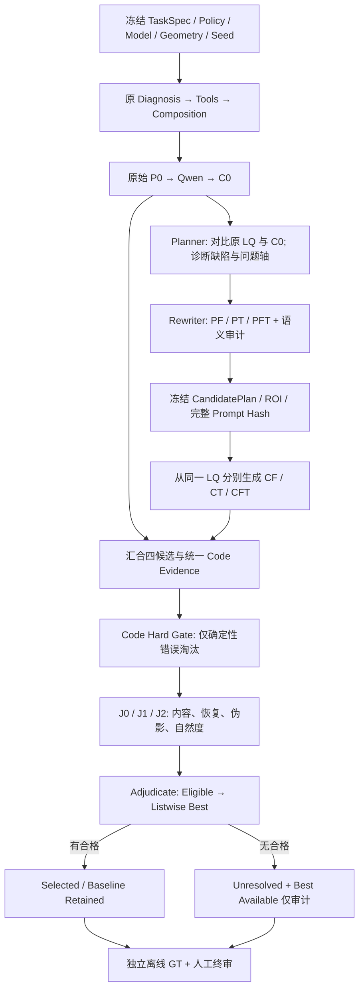

# HarnessIR 多候选生成与证据驱动 Judge：工程实施方案 v1.1

> 日期：2026-11-14
> 评审修订：2026-11-17。补齐唯一 Issue schema、主阶段与 CG 工单映射、逐调用日志与预算、unknown 对账、依赖回退及实验评价口径。文档路径与 `hre_candidates_v1` 保持不变，新增合同均属于待实现规格。
> 交付性质：供工程师直接分阶段实现的设计/验收合同；**不是已经完成的代码或实验报告**。
> 仓库：[`baolinv0/HarnessIR`](https://github.com/baolinv0/HarnessIR)
> 参考设计：[`docs/restoration_candidates_v1/IMPLEMENTATION_PLAN.md`](https://github.com/baolinv0/HarnessIR/blob/docs/restoration-candidates-judge-plan-20261114/docs/restoration_candidates_v1/IMPLEMENTATION_PLAN.md)（v1.0）
> 本版增量：落实本轮讨论最终确定的 **Code 硬检查 → Code 质量证据 → VLM 合格判断 → Listwise Best 选择**；把实现接口、四槽策略、实验预算、异常恢复、验收用例写成明确合同。优先保持 v1.0 已锁定的设计，不另建系统。

## 0. 执行摘要：不允许工程师自行改动的决定

1. **同一仓库独立模块、独立命令、默认关闭**。新增 `engine/src/hre/candidates/`，不把四个策略候选塞进原始 redo 多轮循环；旧 `harness/`、`engine/src/hre/sr/` 行为必须保持。
2. 复用原 `Diagnosis → Tools → Composition`，得到完整 `P0`；先以原 LQ 生成 `C0`；Planner 比较 LQ/C0 并生成替代计划；从**同一原始 LQ**独立生成 `CF、CT、CFT`。C0 仅作为规划/评审输入，不是后续生成器的图像输入。
3. 首轮固定**一个**现有 Qwen 执行器，固定模型 revision、steps、CFG、几何、后处理和环境。候选只能在事先定义的语义策略和 seed schedule 上变化；不能额外引入 PE、专用人脸/OCR 生成器、局部融合或训练。
4. 四候选是**策略覆盖**，不是统一的弱/中/强生成档位：`C0=P0`；`CF=只替代人物恢复策略`；`CT=只替代文字恢复策略`；`CFT=同一人物替代策略+同一文字替代策略`。无人物/文字时按预定规则适配槽位，不假造人物/文字问题。
5. **Code-first 是保留的，但淘汰权限严格限定**：Code 确定性检查可排除不可解码、输出尺寸错误、源/候选/ROI/证据绑定不一致等候选；锐度、OCR 置信度、LR consistency、NR-IQA 等**软指标不预先淘汰**候选，只向 Judge 供证。
6. Judge 首先按逐关键属性、恢复充分性、伪影和评审覆盖判定每候选资格，形成 `eligible_ids`；之后仅在 eligible 内做 Listwise 优选。必需属性未评完或必需真实性无法验证的候选不能交付。允许 `best_available` 存在但 `best_candidate=null`，即 `unresolved`；严禁将“相对最好”等同于“已验证真实”。
7. 默认优先实现 `J0=单 VLM+图像` 和 `J1=单 VLM+图像+绑定 Code 证据`；`J2=人物/文字/整图技术/日常观看四视角+终审` 是**消融验证方案**。先完成生成闭环与 J0/J1。若 J2 未带来净收益，使用 J1，不强行上线专家团。J2 与 J1 的比较检验系统收益；声称角色分工贡献还需预算匹配对照。
8. 任务用途必须在生成前冻结：`photo_restoration` 容许无可见冲突但未经真实性验证的自然细节；`information_critical` 对关键字符/号码/身份的未知不能声称正确。
9. 在线阶段**绝不读取 GT**；GT 与独立人工判断只用于离线评估。评审匿名，不暴露策略名、seed、执行模型、Prompt 和离线评分。
10. 实验比较“P0 四次 seed 采样”与“C0+CF+CT+CFT”；**共享 C0，每图总计 7 次图像生成**。Pilot=10 张，协议冻结后 held-out=24 张；比较候选池覆盖和 Judge 选择能力，避免把二者混为一谈。

## 1. 问题、假设和边界

### 1.1 研究问题

- **H1 候选覆盖**：同为 4 次图像生成，针对 C0 实际缺陷的策略分支是否比 P0 随机采样更容易包含“可接受”结果？
- **H2 Judge 选择**：同一冻结候选池上，新 Judge 是否更容易选中独立终审认定的合格/最佳候选？
- **H3 数值证据**：带绑定关系的 Code 证据是否帮助 VLM，还是使其机械地偏好高锐度/保守输出？
- **H4 执行可控性**：CF、CT 的预期语义变化是否真实发生，还是差异主要来自随机 seed？

### 1.2 实验模式

| 模式 | 输入→输出 | 重点 | 不可混用的评价 |
|---|---|---|---|
| `restoration_x1` | 8-bit sRGB LQ → 同内容尺寸 | 去噪、去模糊、去压缩、真实图像恢复 | 不把插值后的 x1 当成 x4 |
| `sr_x4` | LR → 严格 4W×4H | 有 GT 的合成退化 SR、真实性与感知质量平衡 | 不用原始等尺寸 Gate 误判正常 x4 |

第一轮质量实验优先 `sr_x4`，`restoration_x1` 作为独立数据层；只接受经过解释的 SDR/sRGB 输入，RAW/HDR/透明度转化必须另记数据流程；不得隐式将原图长边缩成 1024。

### 1.3 本轮明确不做

跨执行器路由、自动研究经验库、RSI/强化学习、局部裁图生成+融合、专用人脸修复器、OCR 条件生成器、硬 Mask、Prompt 多轮反馈追跑、PE 优化、自动重新训练、动态增加第 5 个候选。若观察到稳定的区域干扰或策略无效，作为下一阶段研究，而非本轮隐式实现。

## 2. 仓库与实现起点

- 固定参考基线：`codex/reference-unified-20261101 @ 90283e5189160c4c6e3429ddfa48f04d5bc27dfd`。
- 建议实现分支起点：`codex/evidence-sr-v02-20261111 @ d44d40fa209a9978d37ce38efa9a6ef89abe7432`；其相对 reference-unified ahead 2、behind 0（读取时状态），已有 evidence/runtime 接口可借鉴。
- 设计分支：`docs/restoration-candidates-judge-plan-20261114`；设计文档不是实现提交。
- 新实现分支建议：`feat/restoration-candidates-v1-20261114`，独立 worktree；工程开始前**重新核对远端 HEAD 与服务器未提交 diff**，不 reset、不 force push、不覆盖旧实验。
- 确认已有真实接口：`harness/pipeline.py::run_sample`、`harness/stages/diagnosis.py::run_diagnosis`、`harness/stages/compose.py::run_compose`、`harness/stages/verify.py::run_verify`、`harness/selection.py::select_final`、`engine/src/hre/v3/{qwen,dispatch,common}.py`、`engine/src/hre/sr/{evidence,runtime,contracts}.py`。
- 原始 Verify 已有确定性 Gate、VLM verdict、缺陷、`needs_redo`、`best_round`；新模块重用思想与安全函数，不对原 `select_final` 进行语义修改。原选择器在全部 Gate 失败时仍可选择输出，新入口必须改为 `unresolved`。
- 工程桥接 `harness/` 需显式 `harness_source_root` 与版本/资源校验；该目录不随 engine wheel 自动包含，不能靠从仓库根目录运行时的隐式 import。

## 3. 全链路与冻结点



**冻结点 F0（C0 之前）**：任务/用途、关键属性与验证要求、模型 revision、有效参数、x1/x4、候选规划算法、策略预算、统一封装、seed schedule、评价政策、ReviewPlan 分包/聚合算法及分类调用上限、成本上限、tie_order，统一存档和 hash。研究运行另在首次 E1 输出之前冻结 E2 抽样清单与评价 seed。

**冻结点 F1（C0 之后、生成 CF 前）**：C0 的实际问题、各 issue 的 ROI/来源/证据/替代解释、F/T 策略、完整 PF/PT/PFT、fallback、审计结果。看到 CF/CT/CFT 后禁止修改计划补抽。

状态机：`created → baseline_ready → plan_frozen → candidates_complete → evidence_ready → reviewed → selected | baseline_retained | unresolved`。独立异常状态：`blocked`（依赖/契约缺失）、`failed`（确定失败）、`unknown`（调用可能已提交但无回执）。每次状态转移附操作 ID/证据。

## 4. 核心对象合同（Schema v1）

所有对象以 `schema_version=hre_candidates_v1` 标识；使用 pydantic/dataclass+显式校验均可，必须拒绝未知枚举、非有限浮点、重复 ID、悬空 evidence refs、无效路径与 hash。

| 对象 | 必要字段 | 约束 |
|---|---|---|
| `TaskSpec` | `case_id,source,task_mode,scale,usage_policy,user_intent,critical_attributes` | `task_mode ∈ {restoration_x1,sr_x4}`；x1/x4 输出几何确定；用途生成前冻结 |
| `RuntimeConfig` | `harness_source_root/sha,diagnoser/composer/planner/judge endpoints,qwen profile/model revision,steps,cfg,dtype,device,geometry,PE=off,seeds,budgets,output_root` | 实际环境/模型权重缺失则 preflight=blocked；凭据只从环境变量读取 |
| `EvaluationContract` | `task_goals,critical_attributes,content_policy,acceptance_rules,unverifiable_policy,tie_order` | 来源于用户任务与任务类型；不能从生成 Prompt 反推或事后宽松修改 |
| `CriticalAttribute` | `attribute_id,region_selector,attribute,required_for_acceptance,verification_requirement` | F0 冻结语义；`verification_requirement∈{visible_consistency,verified_content}`；F1 解析实例 ROI，不得删除或放宽必需属性 |
| `AttributeAssessment` | `candidate_id,attribute_id,region_id,content_state,coverage,evidence_refs,limitations` | 逐实例输出；未返回的必需项为 missing，不能从候选总评推断通过 |
| `ReviewPlan` | `variant,pool_hash,roi_registry_hash,required_checks,packages,calls,budget,aggregation_rule,freeze_hash` | 首次 Judge 调用前冻结；全部必需检查均有负责角色与包；遵守 §8.6 |
| `FrozenExecutionRequest` | `candidate_id,request,condition_text_sha256,canonical_source_sha256,prepared_source_sha256,geometry_sha256,editor_config_sha256,execution_manifest_sha256` | 完整 seed、模型及执行配置在提交前独立校验；遵守 §6.3 |
| `BaselineContext` | `source_hash,original_diagnosis,tool_evidence,visual_pack,P0,C0,receipts` | P0 原文、生成器真实 condition、C0 原生/交付产物均归档 |
| `Issue` | `schema_version,issue_id,region_ids,domain,problem_type,attribute,severity,task_criticality,observation,evidence_refs,cause_hypotheses,alternative_explanations,desired_change,protected_attributes,expected_observation,support,intervention_feasibility,spatial_control_risk` | 唯一字段合同见 §4.1；不能用 VLM 自报概率当校准置信度 |
| `CandidatePlan` | `plan_origin,issues,roi_registry,shared_requirements,candidate_specs,plan_reason,fallbacks,freeze_hash` | plan_origin 为 fixture 或 planner；研究运行拒绝 fixture；最多 2 个问题轴 / 4 个槽；不读取 GT、后验候选评分 |
| `CandidateSpec` | `strategy_id,sample_index,seed,issue_refs,full_prompt,prompt_hash,expected_effect,source_hash` | 每个候选对应可重放的完整请求；不只记录“人物增强”名称 |
| `CandidateArtifact` | `request_id,status,native_image,delivered_image,sha256,geometry,model_version,compiler_version,seed,receipt,cost` | 原生尺寸错误=contract_fail；禁止 resize 冒充 x4 成功 |
| `EvidenceBundle` | `roi_registry,anonymous_image_refs,measurements,measurement_status,bindings` | 匿名候选图片；禁止泄露策略名、Prompt、GT |
| `ExpertReview` | `role,applicability,assessments,preference_groups,conflicts,evidence_refs,limitations` | 有证据定位与未确定状态；允许同分组并列 |
| `SelectionResult` | `contract_valid_ids,eligible_ids,eligibility_decisions,coverage,review_plan_sha256,preference_groups,best_candidate,best_available_id,status,content_verification,reason` | best 必在 eligible 首组且必需检查完整；eligible 为空则 best=null |
| `OracleLabels` | `candidate_hash,acceptable,best_set,GT_metrics,content_error,annotator_disagreement` | 仅 offline 使用，在线模块不得导入 |

`source_hash` 与 `source_sha256` 在候选合同中均指规范化 LQ 的 `canonical_source_sha256`。实际 padding 后输入另用 `prepared_source_sha256`，两者按 §6.2 的来源链校验，不混用。

`Measurement` 至少绑定 `source_sha256,candidate_sha256,roi_id,geometry_sha256,method_id,method_version,value,status`。`status∈{measured,missing,failed,stale,not_applicable}`；缺失≠0、缺失≠通过。

### 4.1 Issue 的唯一序列化合同

[schemas/issue.schema.json](./schemas/issue.schema.json) 是 Issue 的权威机器合同。专项文档中的 IssueRecord 统一更名为 Issue，不另建类型。所有列出的字段均必需，未知字段拒绝；数组不能用 null 代替。`cause_hypotheses` 和 `alternative_explanations` 可为空数组。`support=supported` 必须有至少一项 evidence_refs，引用必须能在该 case 的在线证据注册表解析。region_ids 同样必须存在于 ROI 注册表。引用存在性由运行时校验，不由 JSON Schema 代替。

`domain` 为 person、text、building、grass 或 other；`severity` 为 minor 或 major；`task_criticality` 为 low、medium 或 high。`attribute` 是被干预属性的稳定 ID，`problem_type` 是策略目录的问题类型。二者不互相替代。`support` 为 supported、ambiguous 或 unavailable；`intervention_feasibility` 为 plausible、limited 或 unsupported；`spatial_control_risk` 为 low、medium 或 high。

[examples/issue.valid.json](./examples/issue.valid.json) 必须通过结构校验；[examples/issue.invalid.json](./examples/issue.invalid.json) 必须因缺少 support 且含未知 support_status 拒绝。旧草案的 source_evidence_refs、alternative_explanation 和 support_status 不是合法字段。若导入旧草案，只能在显式离线迁移中分别转换为 evidence_refs、alternative_explanations 数组和 support，重新校验后创建新 case，禁止在冻结对象或在线请求中静默兼容。

## 5. Candidate Planner：C0 后如何规划 CF/CT/CFT

### 5.1 输入与职责

Planner 输入只含：原始 LQ、已生成 C0、P0、原诊断/工具/视觉证据、ROI 记录、TaskSpec、EvaluationContract。输出：具体失败原因、F/T 轴策略、需保持的其他目标、完整 Prompt 差分说明。**不得**读取 GT、Oracle 标签、CF/CT/CFT 输出。

每个 Issue 需回答：**哪一处**（ROI）→ **什么实际缺陷**（观测）→ **怎么证明/可能误判**（Code/图证据及替代解释）→ **调整什么属性** → **不改什么** → **如何观察是否落实**。

### 5.2 固定四槽策略

| 槽位 | 人物策略 | 文字策略 | 从哪张图执行 |
|---|---|---|---|
| `C0 = baseline` | P0 原样 | P0 原样 | LQ |
| `CF = face_alt` | 替代人物策略 F | P0 原样 | LQ |
| `CT = text_alt` | P0 原样 | 替代文字策略 T | LQ |
| `CFT = joint_alt` | **同一个** F | **同一个** T | LQ |

这里“只修改人物/文字”指 Prompt 的**语义策略差异**；执行仍是整图生成，不承诺非目标像素不变。

- 人物常见问题：`under_restored_features`（五官边界断裂→受依据支持的连续结构恢复）；`waxy_skin`（蜡感→减少过平滑、恢复自然低对比纹理）；`over_sharpened`（假毛孔/过锐→降低无依据伪高频）；`body_hand_incorrect`（身体/手部几何错误→受可见结构约束的修复）。不能将增强等同美颜、改变身份、表情或姿态。
- 文字信息等级只在**原 LQ**上标注：`legible`（字符可确认→修复已有笔画）；`partly_legible`（确认部分增强，其余未知保留）；`unreadable`（仅探索可见性/布局，不要求输出具体词语）。OCR 是证据，不等于 GT；清晰错字优先标记内容冲突。
- 两类问题均有依据时生成 C0/CF/CT/CFT；仅 F 或仅 T 有问题时，按 v1.0 已冻结的替代 A/B 和 P0 resample 规则分配；只有一个合理替代方向则空余槽位按预定 seed 采样；无明确分歧时 P0 四次采样；其他场景如建筑/草地将轴真实命名为其他 issue，不强制叫 F/T。
- C0 失败：记录 `baseline_failed`，本 case 的 C0 后反馈策略**不可进行**，不偷偷换 seed 制造 C0；对照统计包含失败案例并单独报告成功执行子集。

### 5.3 Rewriter 规范

输入：完整 P0 + Issue/F/T 的期望变化 + protected 属性 + 公共 SR/x1 wrapper。一次批量输出 PF/PT/PFT 的**完整 Prompt**及：`changed_requirements,retained_requirements,evidence_refs,expected_effect`。修改原有相关作用域，不在末尾简单叠加与原要求矛盾的句子。

示例：如果 P0 的“preserve text unchanged”导致可见笔画无法恢复，T 策略改为“restore visible broken/merged strokes where supported by LQ; preserve confirmed characters/layout; do not invent unknown text”。如果 C0 人物蜡感，F 策略可以增加自然细微纹理，不允许统一提高生成强度。

**语义审计（最多一次修复）**：验证全局去退化任务没有遗漏、非目标要求未丢、已知文字未被重写、F+T 联合方向与两个单项一致；失败时将对应槽位变为预定 `baseline_resample`，记录 fallback，不能冒充 face/text 策略已经执行。通过后保存完整文本与字节 hash，不再动态修 Prompt。

### 5.4 单项与联合策略的依赖回退

初审必须区分 `intervention_invalid`，表示干预无证据或破坏保护条件，和 `compile_invalid`，表示完整 Prompt 编译丢要求、越作用域或引入冲突。先记录失败，再对失败项进行全计划最多一次批量修复，并独立复审。修复不得改变已通过的干预 ID、语义或 Prompt。若需要新干预方向，本轮不再搜索，直接回退。下表应用于最终复审结果，失败类型均保留供归因。

| 最终结果 | CF 槽 | CT 槽 | CFT 槽 |
|---|---|---|---|
| F、T、FT 均通过 | F | T | 相同 F+T |
| F 失败，T 通过，FT 即使通过 | baseline_resample | T | baseline_resample |
| T 失败，F 通过，FT 即使通过 | F | baseline_resample | baseline_resample |
| F、T 通过，只有 FT 失败 | F | T | baseline_resample |
| F、T 均失败 | baseline_resample | baseline_resample | baseline_resample |

这是保守依赖规则。单项完整 Prompt 未通过时，联合槽不得单独宣称该轴有效。所有回退使用同一 P0 的实际 executor condition，包括统一 wrapper，保留原槽 sample_index 和 seed，不重新分配 seed，也不增加候选。记录 `slot_id,planned_strategy_id,effective_strategy_id,dependency_ids,failure_kind,fallback_reason,audit_refs`，candidate_id 使用 effective_strategy_id、sample_index 和 seed。表中 F/T 可替换为其他两个真实问题轴；单轴 A/B 互不依赖，各自失败只回退自己的槽。

任何回退或非双轴配置均令 E2 的机制分析 `joint_applicability=not_applicable`。预注册样本和调用记录不删除，端到端 Joint Success 的失败处理见 §10.5。回退只在 F1 前完成；生成后失败不能触发策略重写。

## 6. 执行器、坐标与复现

### 6.1 执行契约

新 `bridge.py` 复用 v3 `profile_id=qwen21,task_mode=restoration,strategy=native,intent=null,inputs=[source],spatial.mode=full_frame` 与明确 seed/canvas。`native` 是请求路由术语，不代表没有使用原 Composer。

- 将已冻结完整 Prompt 作为 `condition.text`；用已有 `dispatch.seal_condition` 绑定，再调用 `dispatch.generate`。
- **不要**通过现有通用 `render_instruction()` 再附加“保持画布/源内容”的模板，以免 x4 或候选差异被改变；只在候选 bridge 内提供可审计的完整 Prompt 直通。
- 检查“冻结 Prompt SHA = 实际送达生成器的 condition.text SHA”，并记录 dispatch 输入绑定 hash。
- C0/PF/PT/PFT 使用同一模型版本、推理步数、dtype、guidance、颜色处理和输出解析；seed schedule 预先冻结。`PE=off`、`color_adjust=off` 为首轮默认值。
- 无硬 Mask；ROI 是证据坐标而非生成模型空间约束。所有候选从规范化 LQ 执行，不得传入 C0 作为编辑图。

### 6.2 x1 / x4 几何

| 模式 | 输入 padding | 执行 canvas | 最终裁切 | 错误处理 |
|---|---|---|---|---|
| x1 | LR 宽高向右/下 pad 到 32 倍数 | padded W×H | 原 W×H | native 尺寸不符=contract_fail |
| x4 | LR 宽高向右/下 pad 到 8 倍数 | 4×padded W/H，满足 Qwen 32 网格 | 严格 4W×4H | 不得 resize 成“通过” |

EXIF 先归一化，记录 ICC/sRGB 处理、padding 像素、裁切坐标、ROI 从 LQ 到交付图的投影矩阵；固定 `[x0,y0,x1,y1)` 左上原点。原 Composer 接收未经 padding 的图像，避免边框污染语义。保留 native 和 delivered 两套 hash/图像。对于模型或 adapter 实际不支持的 canvas 配置，preflight 阻断，不擅自降级倍率。

**几何所有权**归候选 bridge。复用 diagnosis、tools、visual pack、compose 的 stage 函数，不调用旧 `run_sample()` 组织新流程，不经 `prepare_lq()` 做 1024 缩放，也不经 `run_execute()` 归一化结果。工具如自行缩放图像，须返回其坐标变换，再投影至规范化 LQ；不得把工具内部坐标直接登记为原图 ROI。

现有 v3 `spatial.prepare_request()` 与 `deliver_outputs()` 以同源画布交付为目标，不能直接用于本模块严格 x4 的准备和交付。候选 bridge 自行实现上述 pad、原生尺寸校验和 crop，仅复用 `dispatch.seal_condition()`、`dispatch.generate()` 及独立安全函数。不得修改旧入口的几何语义。

来源链分成原始文件、规范化 LQ、padding 后执行输入。四候选的 `canonical_source_sha256` 必须相同；相同几何设置下的 `prepared_source_sha256` 也必须相同。执行请求绑定后者，任务来源绑定前者，变换记录连接两者。合法 padding 不要求两种 hash 相等。禁止以 C0 参与准备执行输入。

### 6.3 完整执行请求冻结与提交校验

基线 `v3.dispatch.request_binding()` 不包含 seed。它绑定图像与条件的适用关系，不足以独立保证本方案的 seed schedule。执行回执中的完整请求 hash 是事后审计，不能代替提交前检查。

候选模块使用 `FrozenExecutionRequest`。C0 在首次生成前冻结；其余候选在 F1 冻结。只读执行清单包含以下内容：

- 完整 v3 request，包含 seed、brief、输入顺序、实际输入 hash、canvas 和 spatial。
- UTF-8 完整 Prompt hash、规范化与准备后来源 hash、pad/crop 与 ROI 映射 hash。
- 完整有效 editor config，包含模型 ID、revision、部署清单 hash、adapter 与 pipeline 版本、steps、CFG、negative prompt、output_resolution、use_kv_cache、dtype、device 和后处理政策。默认参数先展开再冻结；凭据值不得写入清单。

`execution_manifest_sha256` 使用固定版本 canonical JSON 与 SHA-256。来源及几何算法在 F0 冻结；C0 的文本在 Composition 完成后、生成前冻结，不要求尚不存在的 P0 在 F0 有值。F1 不得改变 C0 的清单。

runtime 在持久化 submitted **之前**，用实际待提交请求、condition 与有效配置重新计算清单并逐项比对。任何差异返回 `execution_manifest_mismatch`，不得调用生成器。通过后再完成预算预占、submitted 持久化与派发。回执同时绑定预提交清单 hash、实际 Prompt hash、完整请求 hash 和 editor config hash。resume 同样校验，不得重新 seal 修改过的请求使其看似合法。

## 7. 证据与 Code 权限：严格区分 Gate 和 Measurement

### 7.1 Code Hard Gate：可以淘汰的条件

1. 输出不可解码、为空、尺寸不符合声明倍率、位深/通道不符合约定。
2. request/source/output hash 或几何/ROI/measurement 绑定不一致，记录被篡改或 stale。
3. 输入源并非冻结的 LQ、实际 Prompt/seed 与冻结版本不一致、执行失败或 artifact 缺失。
4. 可确定的格式/空间契约错误：例如 native 输出尺寸错误、错误裁剪映射。

原 Verify 的全图结构 SSIM/颜色漂移 Gate 不能直接搬过来当严格 x4 的内容真实性判定；若需要保留，只可作为支持当前任务的软证据或在证明其判据适用后重新定义。未知/缺失检查为 `unknown`，不默认通过。

### 7.2 Code Soft Evidence：默认只提示风险，不淘汰

- `clipping_ratio`、`edge_energy`、颜色变化、声明下采样条件下 `lr_consistency`（若真实退化未知，标记为 proxy）；
- OCR 输入/候选识别与置信度、LQ 的可确认笔画；人脸框/关键点偏移、可用时 embedding（不能单独证明身份）；
- LQ↔候选、C0↔其他候选的同坐标 ROI/Change Map；
- NR-IQA 可选，标记模型/版本/有效性，不能以数值高低自动筛掉低锐度但自然的候选。

### 7.3 ROI Registry 和 Judge 可见图片

ROI 来源优先：已有 detector 或合法人工标注；必要时 Planner 建议但必须记录 `provenance`。Pilot 只允许**看 LQ**修正 ROI，不能看 GT/候选优劣后再移动框。默认每个主图像包最多 6 个主要 ROI，人和文字各最多 3 个。这是单包容量，不是场景重要实例的总上限。超限按 §8.6 分包并登记必需检查；仅标记 `coverage_incomplete` 不允许交付。候选结构位移时保持同一投影框，位移本身是错误证据。

Judge 输入包含：独立的 LQ 整图、四张匿名候选整图、相同位置/尺寸的人物与文字 ROI，以及必要上下文；不能只给缩水拼图。全部候选同一显示和压缩设置，保存实际传输图 hash。候选随机匿名 `A01…A04`，本地保留映射；**不传** Prompt/策略名/seed/GT/离线评分/最终综合分。

## 8. Judge：J0/J1/J2、可接受性和终审

### 8.1 先最小功能，再验证专家分工

| 实验版本 | 图像 | Code 软证据 | Judge 组织 | 对照目的 |
|---|---|---|---|---|
| `J0` | 同一匿名整图及关键 ROI | 不提供 | 单 VLM | 视觉选择基线 |
| `J1` | **与 J0 完全相同** | 提供 hash 绑定测量 | 单 VLM | Code 证据是否增益 |
| `J2` | 同一个冻结候选池，关键 ROI 覆盖一致 | 提供相关绑定证据 | J-P/J-T/J-G/J-U 独立 + J-A | 额外角色与调用预算下的系统收益 |

同一策略/图像池下分别执行，不共享其他 Judge 的结论。J0/J1 匿名顺序必须相同；J2 顺序固定且记录。可以离线用固定图片包测试 Judge，无需重新生成。

### 8.2 四种角色（仅 J2）

- **J-P 人物**：脸、皮肤、头发、身体/手的清晰度、蜡感、过锐、可见表情与姿态变化；不得把自然等同真实身份。
- **J-T 文字**：原 LQ 可支持的字符/笔画、布局、可读性、错字/虚构文字、未知；不能用候选 OCR 冒充 GT。
- **J-G 技术画质**：去退化充分性、残留噪声、伪影、色彩/几何、人物文字之外的背景问题；不以锐度分数抵消重要内容错误。
- **J-U 日常观看**：正常观看尺寸下是否愿意保留、自然性、局部/整体协调；它是任务视角，不代表真实厂商或统计用户人群。

不适用的专家返回 `not_applicable` 且可跳过调用；专家之间不能读其他专家输出。不得把四专家分数简单求均值。

### 8.3 单候选的 Judge 输出

```json
{
  "candidate_id":"A02",
  "content_state":"no_visible_conflict",
  "restoration":"adequate",
  "artifact_severity":"minor",
  "issues":[{"region_id":"face_01","attribute":"skin_texture","severity":"minor","observation":"slightly waxy","evidence_refs":["roi_face_01_A02"]}],
  "preference_reason":"more natural face texture than A01 without confirmed text conflict",
  "attribute_assessments":[{"attribute_id":"critical_number","region_id":"sign_01","content_state":"unverifiable","coverage":"complete","evidence_refs":["lq_roi_sign_01","roi_sign_01_A02"],"limitations":["number is unreadable in LQ"]}],
  "limitations":["unknown fine text cannot be validated from LQ"]
}
```

枚举：`content_state ∈ {supported,no_visible_conflict,conflict,unverifiable}`；`restoration ∈ {insufficient,adequate,strong,uncertain}`；`artifact_severity ∈ {none,minor,major,uncertain}`。重要 `conflict` 必须有图像/ROI/可确认内容引用；否则作为未确定项核查，不能做无证据硬否决。专家可以返回**并列偏好组**。

候选级 content_state 仅是摘要。资格判断必须读取 `attribute_assessments`，为每个必需属性的每个适用实例返回一条记录。`coverage∈{complete,missing,failed}`，表示是否看完要求的证据；看完后仍无法确认内容是 `coverage=complete,content_state=unverifiable`。未返回的必需记录由 Code 补记 missing，禁止自动填 supported。不适用必须符合预先冻结的适用规则并留依据，不能由 Judge 为了通过而自行省略关键属性。

### 8.4 Adjudicate：两阶段终选

**第一阶段 Eligibility**：先看 Code Hard Gate；再核查 VLM 的原图、证据引用与逐属性结果，按 §8.5 的确定规则判定。每候选的 `eligibility_decision∈{eligible,ineligible,undetermined}`。明确的关键内容冲突、严重伪影、任务核心恢复不足为 ineligible；未完成必需评审、真实性要求未满足或关键争议未解决为 undetermined。两者都不进入 `eligible_ids`。软证据数值异常本身不得淘汰。人物/文字以外的背景严重欠恢复，也可以导致不合格。

J0/J1 在单次主评审中同时输出逐项评估和偏好组，Code 校验引用、覆盖及资格规则。这里不声称又调用了一个独立 VLM。J2 的 J-A 依据原图与证据核查专家意见。任何额外模型核查都必须列入 ReviewPlan；未解决的必需项不能靠重复计票变为通过。

**第二阶段 Best**：仅对 `eligible_ids` 进行 Listwise 分组排序，比较恢复充分性、自然度、整图协调、用途价值。若首组并列且有 C0，保留 C0；否则使用 F0 冻结 `tie_order`。前两名出现实质争议时最多一次二选一复核（交换匿名显示顺序，保留整图和相关 ROI）；多项关键争议不能用多数投票掩盖。

输出：`best_available_id`（硬契约有效池相对最好，**可不合格**）、`eligible_ids`、`preference_groups`、`best_candidate`、`status∈{selected,baseline_retained,unresolved,judge_failed}`、`content_verification`、`reason`。无 eligible 候选时，包括全部 ineligible、存在 undetermined 或覆盖不足，均有 `best_candidate=null,selected_output=null,status=unresolved`。响应解析失败且预定修复仍失败使用 `judge_failed`。硬契约有效池为空或预算不足以形成可靠相对排序时，`best_available_id` 也为 null。Judge 失败不使用综合 NR 分数悄悄选图。

### 8.5 用途政策与逐属性资格表

F0 为每个关键属性冻结 `required_for_acceptance` 与 `verification_requirement`。后者区分 `visible_consistency`，要求无可见冲突，和 `verified_content`，要求在线允许证据确实支持该内容。information_critical 的关键字符、号码和身份，以及用户明确要求准确的属性，必须有 `required_for_acceptance=true,verification_requirement=verified_content`。photo_restoration 可对自然微纹理使用 visible_consistency，不得通过切换用途放宽明确准确性要求。

按下表判定每个必需属性。先检查覆盖，再检查内容。非必需属性仍报告限制，已确认且达到冻结严重度阈值的内容冲突不得因属性非必需而忽略。

| 必需属性的结果 | visible_consistency | verified_content |
|---|---|---|
| coverage=missing 或 failed | undetermined | undetermined |
| complete，且有已核查的关键 conflict | ineligible | ineligible |
| complete，supported 且证据适用于该属性 | 通过该项 | 通过该项 |
| complete，no_visible_conflict | 通过该项，真实性仍未知 | undetermined |
| complete，unverifiable | photo_restoration 的预先允许属性通过并标记未知，其他为 undetermined | undetermined |

完整评审后仍有 restoration=uncertain、artifact_severity=uncertain 或未解决的关键冲突，同样为 undetermined。已确认的严重伪影或核心恢复不足为 ineligible。候选存在任一已确认拒绝项时为 ineligible，否则存在任一必需未确定项时为 undetermined；仅全部必需项通过时才为 eligible。自然细纹理未知不能自动证明身份或字符正确，候选总评不能覆盖逐属性结果。

例如同一候选的人物自然、关键号码不可确认，在 photo_restoration 且无准确性要求时可作为注明未知的视觉结果；在 information_critical 时为 undetermined，禁止正式交付。若其余候选也无 eligible，case 必须 unresolved。离线 GT 不得用于消除在线 unknown。

### 8.6 ReviewPlan、分包与预算

F0 冻结角色、分包算法、提供商图像与上下文限制、聚合规则和调用预算。F1 解析该图必需属性与 ROI 实例，不能缩减 F0 规定的检查。证据包形成后、首次 Judge 调用前生成只读 ReviewPlan，绑定候选池、ROI、实际传输图像 hash、匿名顺序和配置版本。分包只依据容量与覆盖规则，不读取任何 Judge 结论。

每包记录 `package_id,role,candidate_ids,region_ids,required_check_ids,image_hashes,context_refs`。每次模型调用记录 `call_id,kind,package_ids,max_output_tokens`。kind 为 primary、aggregate、dispute 或 format_repair。每个必需检查都有负责调用，所有候选使用相同 ROI、显示设置和覆盖范围。required_checks 同时包含逐属性检查、整图恢复充分性和伪影检查，防止只评完局部就视为整图合格。整图与必要上下文不能为省预算静默删除。

默认单包 J0/J1 各 1 次 primary，至多预留 1 次 dispute 与 1 次 format_repair，总上限为 3。默认 J2 为 4 次专家 primary、1 次 J-A aggregate，至多 1 次 dispute 与 1 次 format_repair，总上限为 7。角色不适用可跳过，空出的预算不能自动用于追加探索。默认最多一次格式修复是整个 variant 的限额，不是每包各一次。

ROI 超限时，依据 F0 的容量规则拆包。多包的主评审数为实际包调用数，聚合数为预先登记的调用数，不能仍把一个逻辑角色视为一次调用。多包配置必须在 F0 明确冻结更大的 `max_judge_calls` 与分类限额；不得运行中自动扩大单包默认预算。请求前预占预算，unknown 也占用调用额度，未执行的预留调用不计实际成本。

汇总以 `candidate_id,attribute_id,region_id` 合并逐项结果，并核对 required_check_ids。未完成包产生 missing，重复相同意见不增加票数；同项互相冲突由有预算的复核核查，无结论保留 undetermined。J0/J1 多包需计划独立 aggregate 调用；J2 由 J-A 汇总。终审必须能访问相关原图、全部必需逐项结果与证据引用；若终审上下文装不下，按预注册规则分级汇总并逐次计费，禁止截断后声称完整覆盖。

首次评审前若预算容纳不了必需包和聚合调用，结束为 `unresolved`，原因 `review_budget_insufficient`，不启动残缺评审。执行中额度耗尽、包失败或 unknown 后，受影响候选为 undetermined；只有必需检查和最终排序都完整的 eligible 候选才可正式选择。无此候选则 unresolved。覆盖不足时 best_available 只可在已完成比较的集合中给出，并显式标记比较范围，不能声称是全池最好。

## 9. 运行、审计、异常与预算

新增目录建议：

```text
engine/src/hre/candidates/
  __init__.py
  contracts.py        # schema、验证、Policy 与状态
  bridge.py           # 原 harness / v3 Qwen 适配与 Prompt 直通
  planner.py          # C0 缺陷分析、四槽、Rewriter 与 audit
  evidence.py         # ROI、Hard Gate、Soft Evidence、匿名附件
  judge.py            # J0/J1/J2、J-A 与资格/优选
  runtime.py          # 冻结、任务/请求日志、预算、resume
  report.py           # 逐图对照、CSV、离线评估
  cli.py
engine/src/hre/resources/prompts/candidates_*.j2
engine/examples/restoration_candidates_v1/
engine/tests/test_candidates_*.py
docs/restoration_candidates_v1/
```

CLI 只在 `engine/src/hre/cli.py` 增加独立 `candidates` 子命令，**以下都是拟实现接口，当前仓库不具备**：

```bash
python -m hre candidates preflight --config runtime.local.json
python -m hre candidates create --case-root runs/case01 --spec task.json --config runtime.local.json
python -m hre candidates run --case-root runs/case01
python -m hre candidates resume --case-root runs/case01
python -m hre candidates reconcile --case-root runs/case01 --operation-id op001 --resolution reconciliation.json
python -m hre candidates judge --case-root runs/case01 --variant J1
python -m hre candidates report --case-root runs/case01
python -m hre candidates evaluate-offline --case-root runs/case01 --labels oracle.json --gt gt.png
```

单 GPU 默认**串行**执行四候选，在单 worker 内复用模型；多 GPU worker 必须各有独立 seed/输出目录/随机状态。GPU 并发不是多候选算法要求。

每次模型/工具外部调用前先持久化 request + submitted（操作 ID、hash、预算），收到响应后保存 raw response/receipt，才能标记 completed；断连无回执 → `unknown`，不自动重发（需要人工 reconcile）。resume 复用 completed 内容、保留确实产生的成本。图片像素 hash 完全相同时记录 duplicate；不靠近似感知 hash 删掉可能不同的关键笔画/表情。

每 case 存：`case.json`,`freeze.json`,`execution_manifests/`,`baseline/`,`plan/plan.json`,`plan/prompts/`,`candidates/<id>/request/condition/native/delivered/receipt`,`evidence/`,`judge/review_plan.json`,`judge/attribute_assessments.json`,`judge/aliases+requests+responses`,`selection.json`,`report.md`,`contact_sheet.png`,`results.csv`,`offline/`。数据集级实验目录另存只读 `e2_manifest.json`。`offline/` 不能被在线模块遍历/导入。模型、Prompt、seed、输入、证据、执行回执与成本均能追溯；费用不可得标 `unknown`，不是 0。

调用预算分开记 image generation、原 diagnosis/composer、planner/rewriter/audit、各 Judge、工具、复核。Judge 的分包、primary、aggregate、dispute、format_repair 分类限额及总调用上限统一遵从 §8.6；所有实际调用独立计费，不存在预算外的免费修复。超时/unknown 不自动触发格式修复或重复执行。

### 9.1 外部调用记录与旧阶段适配

在传给旧阶段的 VLM 客户端和工具执行器边界统一记录调用，不按 run_diagnosis、run_compose 等阶段函数计数。指定基线的 run_compose 在空 Prompt 时内部再调用一次 VLM，两个调用必须各有操作 ID、请求、预算预占和回执。候选模块提供代理客户端，旧入口行为不变。禁用客户端、SDK 和 worker 的隐式重试；不能禁用或观察实际调用的适配器必须在 preflight 阻断。

每项操作保存 `operation_id,parent_stage_id,kind,attempt_index,request_sha256,execution_manifest_sha256,budget_reservation_id,state,submitted_at,response_refs,receipt_refs,error,cost_status`。不适用的 execution_manifest_sha256 为 null。状态为 prepared、submitted、completed、failed、unknown 或 cancelled。请求和预算预占在 case 锁内原子保存，再写 submitted 并同步落盘，之后才执行外部调用。响应及回执先原子保存，再写 completed；崩溃后有 submitted 无终态即 unknown。prepared 从未提交时可继续同一操作，cancelled 释放预占。submitted 后的 unknown 保留调用额度及费用预占。

F0 为每类操作冻结调用与输出 token 上限。默认每 case diagnosis 最多 1 次、compose 最多 2 次，第二次仅允许已收到空 Prompt 的已完成首调用；Planner 最多 1 次、Rewriter 最多 2 次、Audit 最多 2 次，后两者的第二次仅用于 §5.4 的一次批量修复和复审。默认最多 6 次工具调用，按 diagnosis 返回的去重顺序串行执行；请求数超限在首次工具调用前 blocked，不截断请求列表。E1 图像最多 7 次，E2 每个入选 case 最多另加 8 次，图像自动重试为 0。Judge 使用 §8.6 的独立限额。每类预算均在实际调用前预占，任一不足禁止调用。真实 fixture 运行单独建 case 并单独计费，不能混入研究七图预算。

明确失败也消耗已提交调用额度；unknown 的实际费用为 unknown，不能记 0。有效响应收到但本地解析失败时，该外部调用已 completed，阶段另记 parse_failed；修复是新的有预算操作。超时不能冒充空 Prompt 触发 compose 的内部修复。旧阶段整体重跑不得导致已完成外部操作重发，代理按 parent_stage_id、attempt_index 和请求 hash 重放已保存响应；同一操作位请求变更则报 request_replay_mismatch。

### 9.2 unknown 的人工对账合同

`reconcile` 只导入证据并更新状态，不调用任何模型或工具。resolution 文件必需包含 `schema_version=hre_candidates_v1,record_type=reconciliation,operation_id,request_sha256,decision,operator,reason,evidence_refs`。decision 只能是 confirmed_completed、confirmed_not_executed 或 still_unknown。confirmed_completed 另需 response_path 和 receipt_path；两者都必须通过来源、操作身份、请求及适用的完整执行清单校验。PNG、文件时间或操作者判断不能单独证明调用完成。证据路径须位于 case 内的 reconciliation 归档目录，先导入再引用，禁止修改原请求。

| 对账决定 | 操作转移 | 预算与后续行为 |
|---|---|---|
| confirmed_completed | unknown → completed | 绑定外部回执，保留原调用计数；以可核查账单结算费用，无价格信息仍为 unknown；resume 从保存的响应继续，不重发 |
| confirmed_not_executed | unknown → failed，reason=confirmed_not_executed | 需提供商或 worker 的可核查未执行证明；保留已提交额度，只释放已证实未产生的费用预占；默认图像不重试，按缺失候选继续或结束 |
| still_unknown | unknown → unknown | 追加证据，保留全部预占，不重发；必需依赖不能完成时停止该依赖路径 |

CLI 核对 operation_id 与 request_sha256，拒绝非 unknown 操作的冲突对账。相同 resolution 内容 hash 重复导入是无操作，不重复计费。每次成功对账保存操作者、时间、原状态、新状态和证据 hash。case 在全部必要 unknown 被处理后恢复到最后持久化阶段，不能跳过尚未完成的必需步骤。C0 unknown 阻止反馈规划；其他候选明确失败后可形成 partial pool；Judge unknown 按 §8.6 产生 undetermined。`candidates_complete` 表示各预定槽都有终态或显式缺失记录，不表示四图均成功。未解决 unknown 在报告中保留，费用仍为 unknown。

## 10. 试验设计：生成覆盖与选图能力分开

### 10.1 数据分层与盲测

- Pilot：10 张有 GT，建议人物主问题 3、文字主问题 3、人物+文字混合 3、无明显人物文字问题 1。Pilot 用于接口/失败原因诊断，不宣称总体提升。
- Pilot 之后只允许一次协议修订并冻结；held-out 24 张：人物/文字/混合/其他四类各 6；按场景源切分，避免同一场景裁图跨集合。
- 人物与文字按 LQ 信息量分层：可确认、部分可确认、不可确认。记录退化 recipe/seed、ROI、人物/文字尺寸、输入来源和用途。人物 GT 和文字标签有合法出处。
- 两位人工评审在不知道在线 Judge 输出时独立标注；先正常观看评自然度/可用性，再看 GT 和 ROI 评内容真实性；关键分歧第三人裁定。若只有一名评审则报告 single_rater。

### 10.2 候选池生成 A/B：同为 4 图预算

| seed | A：原版多采样 | B：新策略池 |
|---|---|---|
| s0 | `C0 = P0`（共享） | `C0 = P0`（共享） |
| s1 | P0 | PF |
| s2 | P0 | PT |
| s3 | P0 | PFT |

同一 case 实际生成 7 张，分开记录不同策略/seed。策略相较纯 P0 的效果不等于同 seed 纯因果效应；系统级指标是 **Oracle Pass@4、Selected Pass、Cost**。E2 按下述预注册规则做 4 策略 × 2 seed 同 seed 补充实验，用以区分策略方向与随机性。

#### 10.2.1 E2 样本与评价 seed 预注册

在读取 E1 生成结果、Judge 输出或 Oracle 标签之前，按原 LQ 场景类型、人物/文字尺寸和可确认程度分层抽取 E2 case。冻结 `e2_manifest.json`，记录数据划分、候选 case 清单、各层样本数、抽样算法及随机 seed、确定性缺额处理和清单 hash。不得用 C0 的恢复好坏选择研究样本。held-out 的清单在冻结协议后、首次 held-out 生成前固定。

为所有已选 case 预先冻结两个评价 seed，与本轮全部 E1 seed 不同。P0、PF、PT、PFT 在这两个 seed 上配对执行；先从原 C0 冻结 F1，再运行 E2，不根据 E2 结果修订 Prompt。只存在一个干预轴或发生 fallback 时照实保留槽位，将 Joint Compatibility 机制分析标为 not_applicable；端到端 Joint Success 按 §10.5 保留预注册双目标失败，不事后换入成功样本。C0 失败、执行失败与缺失保持在清单中并分别报告。

E2 新增调用与 E1 分账。事后挑选案例仅进入 exploratory 分析，不并入预注册的 Target Response、Off-target Damage 或 Joint Compatibility 估计，不用于声称总体控制收益。

#### 10.2.2 首轮实验默认配置

[examples/experiment_protocol.default.json](./examples/experiment_protocol.default.json) 提供待冻结的协议默认值，不能当成已完成的预注册清单。Pilot 的 E2 默认 4 个 case，人物、文字、混合、其他各 1；held-out 的 E2 默认 8 个 case，各类 2。E1 seed schedule 为 [0,1,2,3]，E2 评价 seed 为 [10001,10002]，抽样 seed 为 20261117。E2 seed 必须与本轮全部 E1 seed 不同。预算分别为 Pilot E1 至多 70 次、E2 至多 32 次，held-out E1 至多 168 次、E2 至多 64 次，不含 VLM、工具及工程 fixture。

输入 dataset_manifest 必须在首次 E1 输出前登记每个 case 的唯一 scene_id、场景主类、LQ ROI、人物/文字信息等级及尺寸。scene_id 不得跨 Pilot 和 held-out。每主类内先按信息等级和 ROI 尺寸形成子层。人物用脸框短边、文字用文字行高度，均以 LQ 像素计，分为小于 16、16 至 31、至少 32 或不适用；混合场景的人物与文字标签分别保留。子层标签按 UTF-8 字节序排列，逐层轮转各取一个，直至主类配额用完。每子层内按 SHA-256(UTF-8 的抽样 seed 十进制字符串 + 换行 + case_id) 升序选择，同 hash 按 case_id UTF-8 字节序排序。

空子层跳过，非空子层用尽后继续下一子层；主类总数不足时取全部并记录 shortfall，不从其他主类借额、不补选结果成功的 case。manifest 记录确切子层标签、排序键、名单、实际人数和配置 hash。生成前必须将默认配置实例化为 dataset_manifest、e2_manifest 和 F0，缺少真实名单不能启动研究运行。修改默认值只能在对应数据划分首次 E1 输出前显式配置并冻结，Pilot 后的一次协议修订不得读取 held-out 结果。

### 10.3 Judge 消融

冻结相同 B 池图像，执行 J0/J1/J2；J0/J1 图像、候选次序与用途政策相同，唯一差异是软证据输入；J2 同池、按角色分包且全区域覆盖。若比较 A/B 的最终系统质量，应**对两池使用相同 Judge 版本 J1**，避免同时变化生成和 Judge。

若只比较 J2 与 J1，结论限定为多角色、多调用预算下的系统收益。若要声称专家角色分工有独立贡献，另做离线 `J1_budget_matched` 对照。它不改变默认生产入口，使用与 J2 相同的模型、候选池、软证据、逐属性资格政策、必需 ROI 和最终选择规则；将专家角色换为互不读取结论的通用整图评审，再由相同规则终审。

对照逐 case 匹配 primary、aggregate 及预留复核、修复的调用上限，匹配模型采样设置和总输出 token 额度，记录输入 token、实际输出 token、耗时与费用。角色提示和上下文长度可能仍不同，实际成本不完全一致时必须披露。主分析包含全部预注册 case，并单独报告预算、容量不足导致的失败；不得只报两者都成功的子集。未运行预算匹配对照时，不归因于专家分工。该对照受 §8.6 的 ReviewPlan 约束。

可选另一种消融 `J_soft_gate`：先按预注册软数值阈值删候选，再交给同 J1。**不是默认生产路径**；专门用来检验软 Gate 的 false reject 和省下的成本，不能事后挑有利阈值。

### 10.4 必报指标

设第 i 个 case 的硬契约有效集合 `U_i`、独立人工认为合格的集合 `A_i`、其中并列最佳集合 `B_i`、在线正式选择 `S_i`：

- `Produced coverage`、`ContractValid coverage`：所有样本作为分母，生成失败不隐藏。
- `Oracle Pass@4 = mean[ A_i != ∅ ]`：判断池里**有没有**好答案。
- `Selected Pass = mean[ S_i ∈ A_i ]`：无正式选择计失败。
- `Conditional Selection Success = mean[ S_i ∈ A_i | A_i != ∅ ]`：有答案时是否选对。
- `Best-in-pool Agreement = mean[ S_i ∈ B_i | A_i != ∅ ]`：并列最佳允许。
- `Avoidable unresolved = mean[ S_i=null | A_i != ∅ ]`。
- `False Reject`：令 E_i 为在线 eligible 集合，按候选计 sum|A_i \\ E_i| / sum|A_i|，包含 ineligible 与 undetermined，分别拆出硬 Gate、资格拒绝和缺评未知原因。
- `False Accept`：按正式交付计 sum[ S_i 非空且 S_i 不属于 A_i ] / sum[ S_i 非空 ]；另报 eligible 集合误纳率 sum|E_i \\ A_i| / sum|E_i|。软 Gate 消融单列 sum|A_i 与软 Gate 被删集合的交集| / sum|A_i|。
- `Content Error`：已知错字、表情/姿态/结构改变、严重背景伪影，各自报告适用样本数。
- `Prompt Effect`：同 seed 下目标改善、非目标退化和联合成功采用 §10.5 的标注与分母；不能把未检出显著差异直接标成 diversity_collapse。
- `Cost`：图像/VLM/tool 次数、GPU wall-clock、显存峰值、token 或费用（未知标 unknown）。

每 case A/B 为配对比较，给胜/平/负与按**图像 case**重采样的 bootstrap 区间；不能将同图的四候选当作四个独立样本。GT 下 PSNR/SSIM/LPIPS、文字 CER/精确匹配、身份/表情/姿态人工标签只在 offline 报告，不进入 Judge。

### 10.5 离线标注与指标判定合同

首次 E1 输出前冻结 LQ evaluation_target_registry，每个 case 记录目标人物和文字 ROI、评价属性、重要非目标 ROI 和适用性。不能根据 C0 或策略成功与否删减目标。F1 的实际干预和回退另外记录。人工标注者先按匿名随机左右顺序比较同 seed 的策略图与 P0 图，先看同尺寸整图，再看同坐标 ROI，最后在独立内容检查中查看 GT。两名标注者独立填写，分歧由第三人裁定；无人裁定则为 undetermined，不自动算平局或改善。

每项记录 `case_id,seed,pair_hashes,region_id,attribute_id,applicability,quality_change,material_damage,content_conflict,evidence_refs,rater_id,adjudication`。quality_change 为 improved、tied、worse 或 undetermined。improved 要求目标缺陷可观察地减少，且该 ROI 没有新增已确认内容错误或 major 伪影；单纯锐度或像素变化不算改善。material_damage=true 表示新增可确认内容冲突、major 伪影、主要结构损坏，或重要非目标区域从恢复充分变为明显不足。细小自然纹理差异不算实质损害。每项改善或损害必须引用成对图像和 ROI，附具体观察理由。

| 指标 | 分子 | 分母与失败处理 |
|---|---|---|
| Target Improvement Rate | 同 seed 下该轴全部预定目标 ROI 均 improved，且无新增目标内容错误的配对数 | 预注册 E2 名单中 LQ 存在该轴目标的 case × 2 seeds；C0 失败、回退、生成失败、缺评或 undetermined 均记非成功 |
| Off-target Regression Rate | 至少一个预定重要非目标 ROI 有 material_damage 的配对数 | 该轴预定存在非目标 ROI 且成对产物和评审完整的配对数；同时必报全部预定配对数、失败数和未判定数，不能将缺失当作无损害 |
| Joint Success Rate | F、T 的全部目标均 improved、无重要非目标损害且联合图整体合格的配对数 | LQ 预注册为双目标的 case × 2 seeds；回退、单项无效、缺失或未判定均记非成功 |
| Joint Compatibility 机制分析 | 同 seed 的 PF、PT 已各自改善时，PFT 保留两项改善且整体合格的配对数 | 无回退且两单项均改善的完整双轴配对数；其余记 not_applicable，并另报在全部预注册双目标配对中的占比 |
| Exact Duplicate Rate | 四槽池中 delivered 像素 hash 的唯一数小于成功交付槽数的 case 数 | 至少两个成功交付槽的 case 数；另报所有预注册 case 中不足两图的数量 |
| Perceptual Diversity Collapse Rate | 两位盲评一致或裁定认为所有成功槽在预定目标、内容和整图质量上均无可辨差异的 case 数 | 至少两图且完整盲评的 case 数；单独报告不完整和 undetermined，不用统计不显著替代此标签 |

A_i 是通过硬契约且独立 Oracle 确认合格的候选集合，未判定候选不进入 A_i。Oracle 未完成时标注 incomplete_oracle，主 Selected Pass 保守记非成功，另报评估缺失数；False Reject/Accept 只在 Oracle 完整的 case 计算，并披露完整 case 数和全体数。所有零分母指标返回 null 与 not_applicable，不返回 0。所有比例同时保存 numerator、denominator 和 missing_count。

默认 case bootstrap 10000 次、seed=20261117，报告配对差值的 2.5% 和 97.5% 分位数。同一 case 的两 seed、ROI 和候选必须一起重采样。Pilot 报告诊断性结果，不用其小样本区间声称稳定提升。未运行模型或未完成独立 Oracle 时，不作收益判断。

## 11. 工程实施顺序与每阶段 DoD

| 阶段 | 工程工作 | 完成条件（Definition of Done） |
|---|---|---|
| P0 基线/预检 | 对照仓库 commit、环境/权重、现有工具和任务、预定配置；独立 worktree | 记录 baseline SHA+未提交 diff；旧入口无回归；缺依赖准确 blocked |
| P1 最小生成闭环 | 唯一 contracts、CLI、逐调用代理、bridge、P0/C0；以预制 CandidatePlan 执行四槽 | 同一真实场景的四槽输出及 Prompt diff、ROI 对照；请求提交前校验；双来源绑定、严格 x1/x4；fixture 明确不计研究结果 |
| P2 Planner / Evidence | C0 差异诊断、F/T 四槽、Rewriter、语义 audit、ROI+Measurement 绑定 | 欠修/蜡感/过锐、文本可知/未知、无脸/无文字、fallback 各有测试；证据匿名且无 GT |
| P3 Judge 基线 | Hard Gate、J0、J1、逐属性资格、ReviewPlan、Listwise、unresolved | 关键属性 unknown 按用途判定；缺包和缺评不能通过；预算预占；固定池、并列与 null 正确；软证据不淘汰 |
| P4 专家消融，生成 Pilot 后按证据启动 | J2 四视角+J-A，冲突复核与可选预算匹配对照 | 同池独立；多包汇总、分类及总预算、not_applicable 正确；角色归因有预算对照或限定结论 |
| P5 Pilot，先于可选 P4 | 10 张、每图最多 7 次 E1 生成、J0/J1、预注册 E2、人工 GT 终审 | 10 张逐图全景与 ROI 对照；生成覆盖、选图能力、E2 分账；成本及失败完整 |
| P6 Freeze/Held-out | 修订一次协议后冻结，24 张外部测试，独立代码复审 | 配对统计、全部分母、失败证据、选型决策、可复现 commit 和 CLI 记录 |

**执行顺序**为 P0 → P1 → P2 → P3 → P5，生成 Pilot 和 J1 结果支持继续选图研究时再启动可选 P4，最后 P6。编号保持原有任务引用。P1 只证明系统可运行，不等于恢复质量提高；P4 若 J2 未改善选图且提高成本，默认 J1；未做 P4 时报告 J2=not_run，不阻止生成假设的检验。P6 只有当 Selected Pass、内容错误、Best Agreement 与成本整体支持时才建议上线。不要预设未经验证的提升百分点。

### 11.1 阶段依赖与开工条件

只有本节 P0 至 P6 是系统里程碑。专项文档使用 CG0 至 CG7 作为工单 ID，并按其映射执行，不得再以专项旧 P 编号派工。Prompt P0 与阶段 P0 在工单中必须分别写为 baseline_prompt 和 phase_P0。

| 系统阶段 | 专项工单 | 必需输入与阶段出口 |
|---|---|---|
| P0 | CG0 | 基线 SHA、schema 和样例、环境配置；输出 baseline_record 及可执行或 blocked 结论 |
| P1 | CG1、CG4 的生成与日志部分 | 使用人工预制且符合合同的 CandidatePlan，标 plan_origin=fixture；输出一图四槽真实闭环，崩溃恢复与对账用 mock 验证 |
| P2 | CG2、CG3、CG4 的真实计划集成部分 | P1 通过后接入真实 Planner、Rewriter、Audit，标 plan_origin=planner；替换 fixture 完成一图闭环与回退测试 |
| P3 | CG5 | P2 的冻结池和 Evidence；输出 J0/J1、资格表、ReviewPlan 与选择结果 |
| P5 | CG6 | P3 通过，真实 dataset_manifest、E2 名单、离线标注规则与所有预算已冻结；输出 Pilot 报告 |
| P4，可选 | CG6-J2 | P5 的固定候选池和选图失败证据；输出 J2 及可选预算匹配结果 |
| P6 | CG7 | Pilot 后一次协议修订、held-out 清单和预算冻结；输出独立测试与复审 |

P1 的 fixture 不依赖尚未实现的 Planner，也不得用于 H1 至 H4 的收益统计。最初可以立即开展 P0；开始 P1 前必须落实唯一 schema、逐调用记录边界和真实模型配置。进入 P5 前，unknown 对账、依赖回退及 §10.5 的标注表必须可执行并通过对应验收。每阶段失败停在该阶段，不能以 mock 的通过替代所要求的真实输出。

## 12. 必须覆盖的测试案例

1. **来源与冻结**：CF/CT/CFT 的执行输入全部是同一 LQ；C0 不进入生成器图像输入；P0 原文存档；prompt hash 字节直通；F0/F1 不可静默改变；seed/模型版本/任务政策冻结。
2. **几何**：`256×256`、`257×193`、EXIF 旋转；x1 与 x4 正确 padding/crop；原生错误尺寸不允许经 resize 伪装通过；ROI 投影按 4× 放大。
3. **Planner**：蜡感、五官欠恢复、过锐、结构异常；已知/部分已知/不可读文字；单 F、单 T、其他区域、无分歧；无依据策略不能被编造；C0 失败保留失败。
4. **Prompt Audit**：F 只改变人物要求，T 只改变文字要求，FT 联合一致；不漏掉背景/颜色/整体去退化；相反指令不直接叠加；一次修复失败须有 fallback。
5. **Evidence**：错候选 hash、错 ROI、stale、missing、OCR 空、face detector 失败、ROI 超额、图像压缩/次序不一致、匿名映射与 GT 泄漏全部覆盖。
6. **Judge**：输出顺序置换、并列、C0 最佳、best 不在 eligible、全部不合格、错字更锐利、自然脸但原表情改变、人物改善背景恶化、同一图不同用途政策；软数值不能单独排除候选。
7. **状态与恢复**：操作已完成不重复请求、调用 unknown 不自动重发、模型失败/部分文件写入/工具超时不吞异常、不超预算、重复图仍记真实成本。
8. **GT 隔离与回归**：在线请求日志中不得出现 GT 路径、标签或 OCR 真值；offline 输出不更新在线选择；原 `sr_v02`、reference、v3 CLI 回归测试；wheel 安装后模板与 harness source root 校验有效。
9. **固定反例集**：清晰错字、锐利但换表情、低锐但自然、草地改善而人物变坏、人物改善而背景严重欠修；Judge 必须输出与对应证据匹配的理由。
10. **逐属性资格**：人物合格但关键号码 unverifiable、遗漏必需属性、complete 与真实性未知的区别、同项相反结论；information_critical 必须拒绝 unknown 进入 eligible，photo_restoration 的允许未知项必须注明，准确性要求不得放宽。
11. **ReviewPlan**：7 个及以上重要 ROI 的分包、缺一个必需包、终审容量不足、预算不足而零调用、格式修复占总额度、unknown 占预算、候选间覆盖不一致；不得仅附 coverage_incomplete 后交付。
12. **提交前身份**：保持 condition 不变，仅修改 seed、steps、CFG、模型 revision、output_resolution、prepared source 或 crop 映射，均在生成器调用前拒绝；合法 padding 的 canonical/prepared hash 不同仍可通过。
13. **预注册与实验归因**：E2 清单及 seed 先于 E1 输出冻结，禁止换入成功 case；E2 不混入七次预算；预算匹配对照的模型、证据、资格与分类调用限额一致，未运行时报告归因限制。
14. **合同与阶段映射**：有效 Issue 通过、旧字段及缺字段拒绝、悬空引用拒绝；P1 fixture 无 Planner 也可运行，P2 后研究运行拒绝 plan_origin=fixture。
15. **逐调用代理**：compose 首次空 Prompt、二次成功产生两项操作；第二次调用前预算不足或崩溃不重发首调用；SDK 隐式重试不可控时 preflight 阻断。
16. **人工对账**：三种 decision、重复导入、错请求或回执、仅 PNG、费用未知、未执行证明、partial pool 及 case 阶段恢复均覆盖，reconcile 中生成器零调用。
17. **依赖回退与分母**：§5.4 五行和单轴 A/B 均覆盖；F 失败而 FT 初审通过仍回退联合槽；保持 seed；E2 不删失败，零分母为 null，机制 not_applicable 不抹去端到端失败。

## 13. 逐图报告、批量报告和交付清单

### 13.1 逐图最小报告

1. **输入**：LQ、任务用途、F0 冻结参数、关键 ROI；GT 单独在离线页展示。
2. **原版诊断**：C0 与 LQ 主要残余问题、依据、候选策略选择的原因；PF/PT/PFT 改动文字 diff + prompt hash。
3. **七图与局部比较**：A 池 4 张、B 池 4 张（共享 C0，只 7 张真实图）；同坐标人脸/文字/背景 ROI、Change Map。
4. **Code**：硬契约、软数值、measurement 状态和来源绑定。
5. **Judge**：J0/J1 及已运行 J2 的逐属性结果、ReviewPlan、必需检查覆盖、合格集合、排序、最终选中、内容冲突与未知；未运行 J2 标 not_run；人工 offline `best_set`。
6. **解释**：若结果失败，判断是**候选池没有答案、Prompt策略没有落实、Code 错筛、VLM 错选、关键未知、评审覆盖或预算不足，还是合同/系统失败**；时延与成本如实记录。

### 13.2 批量输出

`EXPERIMENT_REPORT.md` 固定章节：Configuration、Data、Coverage、Judge Selection、Content Errors、Prompt Effect、Cost、Failure Cases、Decision、Next Experiment。

同步导出 `per_case.csv`、`per_candidate.csv`、`judge_comparison.csv`、机器可读 json、contact_sheet.png；允许仅传回文字统计分析，不依赖开发者先手动看所有图片。

### 13.3 最终交付给研究负责人

- 可复现代码分支/commit、变更文件表、依赖与权重/模型 revision 记录、README/runbook 与配置示例；
- 完整单元/集成/回归测试和测试日志；
- 10 图 Pilot 及其图片/ROI/失败归因、24 图 held-out 统计报告；
- J0/J1 固定池选图对照；已运行 J2 时提供是否保留四视角的依据，否则标 not_run；声称角色贡献须附 J1_budget_matched 对照，未做时注明归因限制；
- 逐属性资格表、ReviewPlan 与覆盖日志、完整执行清单、E2 预注册清单和 hash；
- 独立复审记录（由未参与实现的工程师或另一个独立会话检查来源、几何、GT 隔离、Eligibility、异常恢复）；
- 所有未完成项与数据/模型/证据限制明确标注，不把设计合同当作实测结论。

## 14. Research Check：什么时候应该改变技术方向？

| 观察到的失败证据 | 更合理的下一步，而不是继续堆 Prompt/Judge |
|---|---|
| CF/CT 与 C0 真实差异不稳定，同 seed 无目标响应 | 先研究执行器可控性/能力边界、模型适配，再考虑专用工具 |
| 合格候选很少，Judge 选得再好也无解 | 改候选生成能力、扩大策略多样性，不先加专家团 |
| 合格候选常存在但 J1 选错 | 检查 ROI/证据是否充分、终审逻辑，再试 J2 |
| J2 与 J1 表现相近且成本显著更高 | 保留 J1，停止额外专家调用 |
| Code 软证据导致 VLM 经常忽略自然/真实的候选 | 撤销误导测量或明确其含义，不升级为硬 Gate |
| 人物、文字局部各自成功但联合总是干扰 | 下个版本考虑有真实 Mask 支持的局部恢复/融合，本版只记录问题 |
| 无 GT 的重要文字/身份不能被证实 | 收窄真实性结论、按用途政策 unresolved，不靠更多 VLM 投票编造真值 |

**最终研究判据**：这次工作首先验证“针对已发生的恢复缺陷生成差异化候选，能否在固定预算内提高可接受结果覆盖率”；其次验证“在冻结候选池上，证据和专家分工能否提高选择准确率”。不把工程完备、更多专家或更多指标本身当成科研收益。
