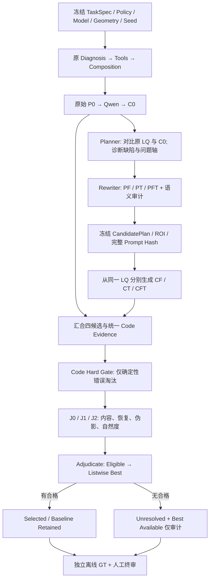

# HarnessIR 多候选生成与证据驱动 Judge：工程实施方案 v1.1

> 日期：2026-11-14  
> 交付性质：供工程师直接分阶段实现的设计/验收合同；**不是已经完成的代码或实验报告**。  
> 仓库：[`baolinv0/HarnessIR`](https://github.com/baolinv0/HarnessIR)  
> 参考设计：[`docs/restoration_candidates_v1/IMPLEMENTATION_PLAN.md`](https://github.com/baolinv0/HarnessIR/blob/docs/restoration-candidates-judge-plan-20261114/docs/restoration_candidates_v1/IMPLEMENTATION_PLAN.md)（v1.0）  
> 本版增量：落实本轮讨论最终确定的 **Code 硬检查 → Code 质量证据 → VLM 合格判断 → Listwise Best 选择**；把实现接口、四槽策略、实验预算、异常恢复、验收用例写成明确合同。优先保持 v1.0 已锁定的设计，不另建系统。

## 0. 执行摘要：不允许工程师自行改动的决定

1. **同一仓库独立模块、独立命令、默认关闭**。新增 `engine/src/hre/candidates/`，不把四个策略候选塞进原始 redo 多轮循环；旧 `harness/`、`engine/src/hre/sr/` 行为必须保持。
2. 复用原 `Diagnosis → Tools → Composition`，得到完整 `P0`；先以原 LQ 生成 `C0`；Planner 比较 LQ/C0 并生成替代计划；从**同一原始 LQ**独立生成 `CF、CT、CFT`。C0 仅作为规划/评审输入，不是后续生成器的图像输入。
3. 首轮固定**一个**现有 Qwen 执行器，固定模型 revision、steps、CFG、几何、后处理和环境。候选只能在事先定义的语义策略和 seed schedule 上变化；不能额外引入 PE、专用人脸/OCR 生成器、局部融合或训练。
4. 四候选是**策略覆盖**，不是统一的弱/中/强生成档位：`C0=P0`；`CF=只替代人物恢复策略`；`CT=只替代文字恢复策略`；`CFT=同一人物替代策略+同一文字替代策略`。无人物/文字时按预定规则适配槽位，不假造人物/文字问题。
5. **Code-first 是保留的，但淘汰权限严格限定**：Code 确定性检查可排除不可解码、输出尺寸错误、源/候选/ROI/证据绑定不一致等候选；锐度、OCR 置信度、LR consistency、NR-IQA 等**软指标不预先淘汰**候选，只向 Judge 供证。
6. Judge 首先做每候选**可接受性**（content conflict、restoration adequacy、artifact），形成 `eligible_ids`；之后仅在 eligible 内做 Listwise 优选。允许 `best_available` 存在但 `best_candidate=null`，即 `unresolved`；严禁将“相对最好”等同于“已验证真实”。
7. 默认优先实现 `J0=单 VLM+图像` 和 `J1=单 VLM+图像+绑定 Code 证据`；`J2=人物/文字/整图技术/日常观看四视角+终审` 是**消融验证方案**。若 J2 未带来净收益，使用 J1，不强行上线专家团。
8. 任务用途必须在生成前冻结：`photo_restoration` 容许无可见冲突但未经真实性验证的自然细节；`information_critical` 对关键字符/号码/身份的未知不能声称正确。
9. 在线阶段**绝不读取 GT**；GT 与独立人工判断只用于离线评估。评审匿名，不暴露策略名、seed、执行模型、Prompt 和离线评分。
10. 实验比较“P0 四次 seed 采样”与“C0+CF+CT+CFT”；**共享 C0，每图总计 7 次图像生成**。Pilot=10 张，协议冻结后 held-out=24 张；比较候选池覆盖和 Judge 选择能力，避免把二者混为一谈。

## 1. 问题、假设和边界

### 1.1 研究问题

- **H1 候选覆盖**：同为 4 次图像生成，针对 C0 实际缺陷的策略分支是否比 P0 随机采样更容易包含“可接受”结果？
- **H2 Judge 选择**：同一冻结候选池上，新 Judge 是否更容易选中独立终审认定的合格/最佳候选？
- **H3 数值证据**：带绑定关系的 Code 证据是否帮助 VLM，还是使其机械地偏好高锐度/保守输出？
- **H4 执行可控性**：CF、CT 的预期语义变化是否真实发生，还是差异主要来自随机 seed？

### 1.2 实验模式

| 模式 | 输入→输出 | 重点 | 不可混用的评价 |
|---|---|---|---|
| `restoration_x1` | 8-bit sRGB LQ → 同内容尺寸 | 去噪、去模糊、去压缩、真实图像恢复 | 不把插值后的 x1 当成 x4 |
| `sr_x4` | LR → 严格 4W×4H | 有 GT 的合成退化 SR、真实性与感知质量平衡 | 不用原始等尺寸 Gate 误判正常 x4 |

第一轮质量实验优先 `sr_x4`，`restoration_x1` 作为独立数据层；只接受经过解释的 SDR/sRGB 输入，RAW/HDR/透明度转化必须另记数据流程；不得隐式将原图长边缩成 1024。

### 1.3 本轮明确不做

跨执行器路由、自动研究经验库、RSI/强化学习、局部裁图生成+融合、专用人脸修复器、OCR 条件生成器、硬 Mask、Prompt 多轮反馈追跑、PE 优化、自动重新训练、动态增加第 5 个候选。若观察到稳定的区域干扰或策略无效，作为下一阶段研究，而非本轮隐式实现。

## 2. 仓库与实现起点

- 固定参考基线：`codex/reference-unified-20261101 @ 90283e5189160c4c6e3429ddfa48f04d5bc27dfd`。
- 建议实现分支起点：`codex/evidence-sr-v02-20261111 @ d44d40fa209a9978d37ce38efa9a6ef89abe7432`；其相对 reference-unified ahead 2、behind 0（读取时状态），已有 evidence/runtime 接口可借鉴。
- 设计分支：`docs/restoration-candidates-judge-plan-20261114`；设计文档不是实现提交。
- 新实现分支建议：`feat/restoration-candidates-v1-20261114`，独立 worktree；工程开始前**重新核对远端 HEAD 与服务器未提交 diff**，不 reset、不 force push、不覆盖旧实验。
- 确认已有真实接口：`harness/pipeline.py::run_sample`、`harness/stages/diagnosis.py::run_diagnosis`、`harness/stages/compose.py::run_compose`、`harness/stages/verify.py::run_verify`、`harness/selection.py::select_final`、`engine/src/hre/v3/{qwen,dispatch,common}.py`、`engine/src/hre/sr/{evidence,runtime,contracts}.py`。
- 原始 Verify 已有确定性 Gate、VLM verdict、缺陷、`needs_redo`、`best_round`；新模块重用思想与安全函数，不对原 `select_final` 进行语义修改。原选择器在全部 Gate 失败时仍可选择输出，新入口必须改为 `unresolved`。
- 工程桥接 `harness/` 需显式 `harness_source_root` 与版本/资源校验；该目录不随 engine wheel 自动包含，不能靠从仓库根目录运行时的隐式 import。

## 3. 全链路与冻结点



**冻结点 F0（C0 之前）**：任务/用途、模型 revision、参数、x1/x4、候选规划算法、策略预算、统一封装、seed schedule、评价政策、成本上限、tie_order，统一存档和 hash。

**冻结点 F1（C0 之后、生成 CF 前）**：C0 的实际问题、各 issue 的 ROI/来源/证据/替代解释、F/T 策略、完整 PF/PT/PFT、fallback、审计结果。看到 CF/CT/CFT 后禁止修改计划补抽。

状态机：`created → baseline_ready → plan_frozen → candidates_complete → evidence_ready → reviewed → selected | baseline_retained | unresolved`。独立异常状态：`blocked`（依赖/契约缺失）、`failed`（确定失败）、`unknown`（调用可能已提交但无回执）。每次状态转移附操作 ID/证据。

## 4. 核心对象合同（Schema v1）

所有对象以 `schema_version=hre_candidates_v1` 标识；使用 pydantic/dataclass+显式校验均可，必须拒绝未知枚举、非有限浮点、重复 ID、悬空 evidence refs、无效路径与 hash。

| 对象 | 必要字段 | 约束 |
|---|---|---|
| `TaskSpec` | `case_id,source,task_mode,scale,usage_policy,user_intent,critical_attributes` | `task_mode ∈ {restoration_x1,sr_x4}`；x1/x4 输出几何确定；用途生成前冻结 |
| `RuntimeConfig` | `harness_source_root/sha,diagnoser/composer/planner/judge endpoints,qwen profile/model revision,steps,cfg,dtype,device,geometry,PE=off,seeds,budgets,output_root` | 实际环境/模型权重缺失则 preflight=blocked；凭据只从环境变量读取 |
| `EvaluationContract` | `task_goals,critical_attributes,content_policy,acceptance_rules,unverifiable_policy,tie_order` | 来源于用户任务与任务类型；不能从生成 Prompt 反推或事后宽松修改 |
| `BaselineContext` | `source_hash,original_diagnosis,tool_evidence,visual_pack,P0,C0,receipts` | P0 原文、生成器真实 condition、C0 原生/交付产物均归档 |
| `Issue` | `issue_id,region_ids,attribute,observation,evidence_refs,alternative_explanation,desired_change,protected_attributes,support` | `support∈{supported,ambiguous,unavailable}`；不能用 VLM 自报概率当校准置信度 |
| `CandidatePlan` | `issues,roi_registry,shared_requirements,candidate_specs,plan_reason,fallbacks,freeze_hash` | 最多 2 个问题轴 / 4 个槽；不读取 GT、后验候选评分 |
| `CandidateSpec` | `strategy_id,sample_index,seed,issue_refs,full_prompt,prompt_hash,expected_effect,source_hash` | 每个候选对应可重放的完整请求；不只记录“人物增强”名称 |
| `CandidateArtifact` | `request_id,status,native_image,delivered_image,sha256,geometry,model_version,compiler_version,seed,receipt,cost` | 原生尺寸错误=contract_fail；禁止 resize 冒充 x4 成功 |
| `EvidenceBundle` | `roi_registry,anonymous_image_refs,measurements,measurement_status,bindings` | 匿名候选图片；禁止泄露策略名、Prompt、GT |
| `ExpertReview` | `role,applicability,assessments,preference_groups,conflicts,evidence_refs,limitations` | 有证据定位与未确定状态；允许同分组并列 |
| `SelectionResult` | `contract_valid_ids,eligible_ids,preference_groups,best_candidate,best_available_id,status,content_verification,reason` | best 必在 eligible 首组；eligible 为空则 best=null |
| `OracleLabels` | `candidate_hash,acceptable,best_set,GT_metrics,content_error,annotator_disagreement` | 仅 offline 使用，在线模块不得导入 |

`Measurement` 至少绑定 `source_sha256,candidate_sha256,roi_id,geometry_sha256,method_id,method_version,value,status`。`status∈{measured,missing,failed,stale,not_applicable}`；缺失≠0、缺失≠通过。

## 5. Candidate Planner：C0 后如何规划 CF/CT/CFT

### 5.1 输入与职责

Planner 输入只含：原始 LQ、已生成 C0、P0、原诊断/工具/视觉证据、ROI 记录、TaskSpec、EvaluationContract。输出：具体失败原因、F/T 轴策略、需保持的其他目标、完整 Prompt 差分说明。**不得**读取 GT、Oracle 标签、CF/CT/CFT 输出。

每个 Issue 需回答：**哪一处**（ROI）→ **什么实际缺陷**（观测）→ **怎么证明/可能误判**（Code/图证据及替代解释）→ **调整什么属性** → **不改什么** → **如何观察是否落实**。

### 5.2 固定四槽策略

| 槽位 | 人物策略 | 文字策略 | 从哪张图执行 |
|---|---|---|---|
| `C0 = baseline` | P0 原样 | P0 原样 | LQ |
| `CF = face_alt` | 替代人物策略 F | P0 原样 | LQ |
| `CT = text_alt` | P0 原样 | 替代文字策略 T | LQ |
| `CFT = joint_alt` | **同一个** F | **同一个** T | LQ |

这里“只修改人物/文字”指 Prompt 的**语义策略差异**；执行仍是整图生成，不承诺非目标像素不变。

- 人物常见问题：`under_restored_features`（五官边界断裂→受依据支持的连续结构恢复）；`waxy_skin`（蜡感→减少过平滑、恢复自然低对比纹理）；`over_sharpened`（假毛孔/过锐→降低无依据伪高频）；`body_hand_incorrect`（身体/手部几何错误→受可见结构约束的修复）。不能将增强等同美颜、改变身份、表情或姿态。
- 文字信息等级只在**原 LQ**上标注：`legible`（字符可确认→修复已有笔画）；`partly_legible`（确认部分增强，其余未知保留）；`unreadable`（仅探索可见性/布局，不要求输出具体词语）。OCR 是证据，不等于 GT；清晰错字优先标记内容冲突。
- 两类问题均有依据时生成 C0/CF/CT/CFT；仅 F 或仅 T 有问题时，按 v1.0 已冻结的替代 A/B 和 P0 resample 规则分配；只有一个合理替代方向则空余槽位按预定 seed 采样；无明确分歧时 P0 四次采样；其他场景如建筑/草地将轴真实命名为其他 issue，不强制叫 F/T。
- C0 失败：记录 `baseline_failed`，本 case 的 C0 后反馈策略**不可进行**，不偷偷换 seed 制造 C0；对照统计包含失败案例并单独报告成功执行子集。

### 5.3 Rewriter 规范

输入：完整 P0 + Issue/F/T 的期望变化 + protected 属性 + 公共 SR/x1 wrapper。一次批量输出 PF/PT/PFT 的**完整 Prompt**及：`changed_requirements,retained_requirements,evidence_refs,expected_effect`。修改原有相关作用域，不在末尾简单叠加与原要求矛盾的句子。

示例：如果 P0 的“preserve text unchanged”导致可见笔画无法恢复，T 策略改为“restore visible broken/merged strokes where supported by LQ; preserve confirmed characters/layout; do not invent unknown text”。如果 C0 人物蜡感，F 策略可以增加自然细微纹理，不允许统一提高生成强度。

**语义审计（最多一次修复）**：验证全局去退化任务没有遗漏、非目标要求未丢、已知文字未被重写、F+T 联合方向与两个单项一致；失败时将对应槽位变为预定 `baseline_resample`，记录 fallback，不能冒充 face/text 策略已经执行。通过后保存完整文本与字节 hash，不再动态修 Prompt。

## 6. 执行器、坐标与复现

### 6.1 执行契约

新 `bridge.py` 复用 v3 `profile_id=qwen21,task_mode=restoration,strategy=native,intent=null,inputs=[source],spatial.mode=full_frame` 与明确 seed/canvas。`native` 是请求路由术语，不代表没有使用原 Composer。

- 将已冻结完整 Prompt 作为 `condition.text`；用已有 `dispatch.seal_condition` 绑定，再调用 `dispatch.generate`。
- **不要**通过现有通用 `render_instruction()` 再附加“保持画布/源内容”的模板，以免 x4 或候选差异被改变；只在候选 bridge 内提供可审计的完整 Prompt 直通。
- 检查“冻结 Prompt SHA = 实际送达生成器的 condition.text SHA”，并记录 dispatch 输入绑定 hash。
- C0/PF/PT/PFT 使用同一模型版本、推理步数、dtype、guidance、颜色处理和输出解析；seed schedule 预先冻结。`PE=off`、`color_adjust=off` 为首轮默认值。
- 无硬 Mask；ROI 是证据坐标而非生成模型空间约束。所有候选从规范化 LQ 执行，不得传入 C0 作为编辑图。

### 6.2 x1 / x4 几何

| 模式 | 输入 padding | 执行 canvas | 最终裁切 | 错误处理 |
|---|---|---|---|---|
| x1 | LR 宽高向右/下 pad 到 32 倍数 | padded W×H | 原 W×H | native 尺寸不符=contract_fail |
| x4 | LR 宽高向右/下 pad 到 8 倍数 | 4×padded W/H，满足 Qwen 32 网格 | 严格 4W×4H | 不得 resize 成“通过” |

EXIF 先归一化，记录 ICC/sRGB 处理、padding 像素、裁切坐标、ROI 从 LQ 到交付图的投影矩阵；固定 `[x0,y0,x1,y1)` 左上原点。原 Composer 接收未经 padding 的图像，避免边框污染语义。保留 native 和 delivered 两套 hash/图像。对于模型或 adapter 实际不支持的 canvas 配置，preflight 阻断，不擅自降级倍率。

## 7. 证据与 Code 权限：严格区分 Gate 和 Measurement

### 7.1 Code Hard Gate：可以淘汰的条件

1. 输出不可解码、为空、尺寸不符合声明倍率、位深/通道不符合约定。
2. request/source/output hash 或几何/ROI/measurement 绑定不一致，记录被篡改或 stale。
3. 输入源并非冻结的 LQ、实际 Prompt/seed 与冻结版本不一致、执行失败或 artifact 缺失。
4. 可确定的格式/空间契约错误：例如 native 输出尺寸错误、错误裁剪映射。

原 Verify 的全图结构 SSIM/颜色漂移 Gate 不能直接搬过来当严格 x4 的内容真实性判定；若需要保留，只可作为支持当前任务的软证据或在证明其判据适用后重新定义。未知/缺失检查为 `unknown`，不默认通过。

### 7.2 Code Soft Evidence：默认只提示风险，不淘汰

- `clipping_ratio`、`edge_energy`、颜色变化、声明下采样条件下 `lr_consistency`（若真实退化未知，标记为 proxy）；
- OCR 输入/候选识别与置信度、LQ 的可确认笔画；人脸框/关键点偏移、可用时 embedding（不能单独证明身份）；
- LQ↔候选、C0↔其他候选的同坐标 ROI/Change Map；
- NR-IQA 可选，标记模型/版本/有效性，不能以数值高低自动筛掉低锐度但自然的候选。

### 7.3 ROI Registry 和 Judge 可见图片

ROI 来源优先：已有 detector 或合法人工标注；必要时 Planner 建议但必须记录 `provenance`。Pilot 只允许**看 LQ**修正 ROI，不能看 GT/候选优劣后再移动框。默认主要 ROI ≤6（人/文字各最多 3），超过上限标记 `coverage_incomplete` 或分包，不允许静默遗漏。候选结构位移时保持同一投影框，位移本身是错误证据。

Judge 输入包含：独立的 LQ 整图、四张匿名候选整图、相同位置/尺寸的人物与文字 ROI，以及必要上下文；不能只给缩水拼图。全部候选同一显示和压缩设置，保存实际传输图 hash。候选随机匿名 `A01…A04`，本地保留映射；**不传** Prompt/策略名/seed/GT/离线评分/最终综合分。

## 8. Judge：J0/J1/J2、可接受性和终审

### 8.1 先最小功能，再验证专家分工

| 实验版本 | 图像 | Code 软证据 | Judge 组织 | 对照目的 |
|---|---|---|---|---|
| `J0` | 同一匿名整图及关键 ROI | 不提供 | 单 VLM | 视觉选择基线 |
| `J1` | **与 J0 完全相同** | 提供 hash 绑定测量 | 单 VLM | Code 证据是否增益 |
| `J2` | 同一个冻结候选池，关键 ROI 覆盖一致 | 提供相关绑定证据 | J-P/J-T/J-G/J-U 独立 + J-A | 专家分工是否增益 |

同一策略/图像池下分别执行，不共享其他 Judge 的结论。J0/J1 匿名顺序必须相同；J2 顺序固定且记录。可以离线用固定图片包测试 Judge，无需重新生成。

### 8.2 四种角色（仅 J2）

- **J-P 人物**：脸、皮肤、头发、身体/手的清晰度、蜡感、过锐、可见表情与姿态变化；不得把自然等同真实身份。
- **J-T 文字**：原 LQ 可支持的字符/笔画、布局、可读性、错字/虚构文字、未知；不能用候选 OCR 冒充 GT。
- **J-G 技术画质**：去退化充分性、残留噪声、伪影、色彩/几何、人物文字之外的背景问题；不以锐度分数抵消重要内容错误。
- **J-U 日常观看**：正常观看尺寸下是否愿意保留、自然性、局部/整体协调；它是任务视角，不代表真实厂商或统计用户人群。

不适用的专家返回 `not_applicable` 且可跳过调用；专家之间不能读其他专家输出。不得把四专家分数简单求均值。

### 8.3 单候选的 Judge 输出

```json
{
  "candidate_id":"A02",
  "content_state":"no_visible_conflict",
  "restoration":"adequate",
  "artifact_severity":"minor",
  "issues":[{"region_id":"face_01","attribute":"skin_texture","severity":"minor","observation":"slightly waxy","evidence_refs":["roi_face_01_A02"]}],
  "preference_reason":"more natural face texture than A01 without confirmed text conflict",
  "limitations":["unknown fine text cannot be validated from LQ"]
}
```

枚举：`content_state ∈ {supported,no_visible_conflict,conflict,unverifiable}`；`restoration ∈ {insufficient,adequate,strong,uncertain}`；`artifact_severity ∈ {none,minor,major,uncertain}`。重要 `conflict` 必须有图像/ROI/可确认内容引用；否则转 `unresolved` 核查，不能做无证据硬否决。专家可以返回**并列偏好组**。

### 8.4 Adjudicate：两阶段终选

**第一阶段 Eligibility**：先看 Code Hard Gate；对 VLM 指出的问题独立核查原图与证据，确认/驳回/保留未知；按冻结用途政策逐候选判定。明确的关键内容冲突、严重伪影、任务核心恢复不足 → ineligible。软证据数值异常本身不得淘汰。人物/文字以外的背景严重欠恢复，也可以导致不合格。

**第二阶段 Best**：仅对 `eligible_ids` 进行 Listwise 分组排序，比较恢复充分性、自然度、整图协调、用途价值。若首组并列且有 C0，保留 C0；否则使用 F0 冻结 `tie_order`。前两名出现实质争议时最多一次二选一复核（交换匿名显示顺序，保留整图和相关 ROI）；多项关键争议不能用多数投票掩盖。

输出：`best_available_id`（硬契约有效池相对最好，**可不合格**）、`eligible_ids`、`preference_groups`、`best_candidate`、`status∈{selected,baseline_retained,unresolved,judge_failed}`、`content_verification`、`reason`。所有候选 ineligible 则 `selected_output=null`，只记录 best_available 供分析。Judge 失败不使用综合 NR 分数悄悄选图。

### 8.5 用途政策

| 场景 | `photo_restoration` | `information_critical` |
|---|---|---|
| 已确认文字/表情改变 | 不合格 | 不合格 |
| 自然细纹理未能验证但无可见冲突 | 可接受，注明未知 | 非关键属性可接受 |
| 关键号码/身份不确定 | 视觉候选可被保留但不得声称真实 | 不作为“已核实准确”交付；必要时 unresolved |
| 恢复不足只剩内容一致 | 不合格 | 同样不合格 |

注意：`no_visible_conflict`≠`verified_true`。若用户明确要求身份和号码准确，未知项不能自动转 PASS。

## 9. 运行、审计、异常与预算

新增目录建议：

```text
engine/src/hre/candidates/
  __init__.py
  contracts.py        # schema、验证、Policy 与状态
  bridge.py           # 原 harness / v3 Qwen 适配与 Prompt 直通
  planner.py          # C0 缺陷分析、四槽、Rewriter 与 audit
  evidence.py         # ROI、Hard Gate、Soft Evidence、匿名附件
  judge.py            # J0/J1/J2、J-A 与资格/优选
  runtime.py          # 冻结、任务/请求日志、预算、resume
  report.py           # 逐图对照、CSV、离线评估
  cli.py
engine/src/hre/resources/prompts/candidates_*.j2
engine/examples/restoration_candidates_v1/
engine/tests/test_candidates_*.py
docs/restoration_candidates_v1/
```

CLI 只在 `engine/src/hre/cli.py` 增加独立 `candidates` 子命令，**以下都是拟实现接口，当前仓库不具备**：

```bash
python -m hre candidates preflight --config runtime.local.json
python -m hre candidates create --case-root runs/case01 --spec task.json --config runtime.local.json
python -m hre candidates run --case-root runs/case01
python -m hre candidates resume --case-root runs/case01
python -m hre candidates judge --case-root runs/case01 --variant J1
python -m hre candidates report --case-root runs/case01
python -m hre candidates evaluate-offline --case-root runs/case01 --labels oracle.json --gt gt.png
```

单 GPU 默认**串行**执行四候选，在单 worker 内复用模型；多 GPU worker 必须各有独立 seed/输出目录/随机状态。GPU 并发不是多候选算法要求。

每次模型/工具外部调用前先持久化 request + submitted（操作 ID、hash、预算），收到响应后保存 raw response/receipt，才能标记 completed；断连无回执 → `unknown`，不自动重发（需要人工 reconcile）。resume 复用 completed 内容、保留确实产生的成本。图片像素 hash 完全相同时记录 duplicate；不靠近似感知 hash 删掉可能不同的关键笔画/表情。

每 case 存：`case.json`,`freeze.json`,`baseline/`,`plan/plan.json`,`plan/prompts/`,`candidates/<id>/request/condition/native/delivered/receipt`,`evidence/`,`judge/aliases+requests+responses`,`selection.json`,`report.md`,`contact_sheet.png`,`results.csv`,`offline/`。`offline/` 不能被在线模块遍历/导入。模型、Prompt、seed、输入、证据、执行回执与成本均能追溯；费用不可得标 `unknown`，不是 0。

调用预算分开记 image generation、原 diagnosis/composer、planner/rewriter/audit、各 Judge、工具、复核。默认 J2 上限为 4 专家+1 终审+1 次争议复核；一次格式修复独立计费。超时/unknown 不自动触发格式修复或重复执行。

## 10. 试验设计：生成覆盖与选图能力分开

### 10.1 数据分层与盲测

- Pilot：10 张有 GT，建议人物主问题 3、文字主问题 3、人物+文字混合 3、无明显人物文字问题 1。Pilot 用于接口/失败原因诊断，不宣称总体提升。
- Pilot 之后只允许一次协议修订并冻结；held-out 24 张：人物/文字/混合/其他四类各 6；按场景源切分，避免同一场景裁图跨集合。
- 人物与文字按 LQ 信息量分层：可确认、部分可确认、不可确认。记录退化 recipe/seed、ROI、人物/文字尺寸、输入来源和用途。人物 GT 和文字标签有合法出处。
- 两位人工评审在不知道在线 Judge 输出时独立标注；先正常观看评自然度/可用性，再看 GT 和 ROI 评内容真实性；关键分歧第三人裁定。若只有一名评审则报告 single_rater。

### 10.2 候选池生成 A/B：同为 4 图预算

| seed | A：原版多采样 | B：新策略池 |
|---|---|---|
| s0 | `C0 = P0`（共享） | `C0 = P0`（共享） |
| s1 | P0 | PF |
| s2 | P0 | PT |
| s3 | P0 | PFT |

同一 case 实际生成 7 张，分开记录不同策略/seed。策略相较纯 P0 的效果不等于同 seed 纯因果效应；系统级指标是 **Oracle Pass@4、Selected Pass、Cost**。另取少量典型样本做 4 策略 × 2 seed 同 seed 补充实验，用以区分策略方向与随机性。

### 10.3 Judge 消融

冻结相同 B 池图像，执行 J0/J1/J2；J0/J1 图像、候选次序与用途政策相同，唯一差异是软证据输入；J2 同池、按角色分包且全区域覆盖。若比较 A/B 的最终系统质量，应**对两池使用相同 Judge 版本 J1**，避免同时变化生成和 Judge。

可选第三种消融 `J_soft_gate`：先按预注册软数值阈值删候选，再交给同 J1。**不是默认生产路径**；专门用来检验软 Gate 的 false reject 和省下的成本，不能事后挑有利阈值。

### 10.4 必报指标

设第 i 个 case 的硬契约有效集合 `U_i`、独立人工认为合格的集合 `A_i`、其中并列最佳集合 `B_i`、在线正式选择 `S_i`：

- `Produced coverage`、`ContractValid coverage`：所有样本作为分母，生成失败不隐藏。
- `Oracle Pass@4 = mean[ A_i != ∅ ]`：判断池里**有没有**好答案。
- `Selected Pass = mean[ S_i ∈ A_i ]`：无正式选择计失败。
- `Conditional Selection Success = mean[ S_i ∈ A_i | A_i != ∅ ]`：有答案时是否选对。
- `Best-in-pool Agreement = mean[ S_i ∈ B_i | A_i != ∅ ]`：并列最佳允许。
- `Avoidable unresolved = mean[ S_i=null | A_i != ∅ ]`。
- `False Reject/False Accept`：分别统计人工合格被筛掉、在线交付而人工不合格，明确分母；软 Gate 的 false reject 单列。
- `Content Error`：已知错字、表情/姿态/结构改变、严重背景伪影，各自报告适用样本数。
- `Prompt Effect`：同 seed 下 F/T 目标 ROI 改善与非目标退化比例；若策略差异不显著报告 `diversity_collapse`。
- `Cost`：图像/VLM/tool 次数、GPU wall-clock、显存峰值、token 或费用（未知标 unknown）。

每 case A/B 为配对比较，给胜/平/负与按**图像 case**重采样的 bootstrap 区间；不能将同图的四候选当作四个独立样本。GT 下 PSNR/SSIM/LPIPS、文字 CER/精确匹配、身份/表情/姿态人工标签只在 offline 报告，不进入 Judge。

## 11. 工程实施顺序与每阶段 DoD

| 阶段 | 工程工作 | 完成条件（Definition of Done） |
|---|---|---|
| P0 基线/预检 | 对照仓库 commit、环境/权重、现有工具和任务、预定配置；独立 worktree | 记录 baseline SHA+未提交 diff；旧入口无回归；缺依赖准确 blocked |
| P1 最小生成闭环 | contracts、CLI、bridge、P0/C0、四个冻结 Prompt 与同 LQ 执行 | fixture + 1 张真实模型结果；Prompt 与 source/seed hash 正确；x1/x4 尺寸严格 |
| P2 Planner / Evidence | C0 差异诊断、F/T 四槽、Rewriter、语义 audit、ROI+Measurement 绑定 | 欠修/蜡感/过锐、文本可知/未知、无脸/无文字、fallback 各有测试；证据匿名且无 GT |
| P3 Judge 基线 | Hard Gate、J0、J1、Eligibility-first、Listwise、unresolved | 固定池可重跑、并列处理、无合格结果 null、重要内容错误有引用、软证据不淘汰 |
| P4 专家消融 | J2 四视角+J-A，冲突复核和审计 | J0/J1/J2 同池独立；顺序置换/争议预算/专家 not_applicable 正确 |
| P5 Pilot | 10 张、7 生成/图、人工 GT 终审、报告 | 10 张逐图全景/ROI对照；分离“生成无解”和“Judge 错选”；成本/错误归因完整 |
| P6 Freeze/Held-out | 修订一次协议后冻结，24 张外部测试，独立代码复审 | 配对统计、全部分母、失败证据、选型决策、可复现 commit 和 CLI 记录 |

**门槛**：P1 只证明系统可运行，不等于恢复质量提高；P4 若 J2 未改善选图且提高成本，默认 J1；P6 只有当 Selected Pass、内容错误、Best Agreement 与成本整体支持时才建议上线。不要预设未经验证的提升百分点。

## 12. 必须覆盖的测试案例

1. **来源与冻结**：CF/CT/CFT 的执行输入全部是同一 LQ；C0 不进入生成器图像输入；P0 原文存档；prompt hash 字节直通；F0/F1 不可静默改变；seed/模型版本/任务政策冻结。
2. **几何**：`256×256`、`257×193`、EXIF 旋转；x1 与 x4 正确 padding/crop；原生错误尺寸不允许经 resize 伪装通过；ROI 投影按 4× 放大。
3. **Planner**：蜡感、五官欠恢复、过锐、结构异常；已知/部分已知/不可读文字；单 F、单 T、其他区域、无分歧；无依据策略不能被编造；C0 失败保留失败。
4. **Prompt Audit**：F 只改变人物要求，T 只改变文字要求，FT 联合一致；不漏掉背景/颜色/整体去退化；相反指令不直接叠加；一次修复失败须有 fallback。
5. **Evidence**：错候选 hash、错 ROI、stale、missing、OCR 空、face detector 失败、ROI 超额、图像压缩/次序不一致、匿名映射与 GT 泄漏全部覆盖。
6. **Judge**：输出顺序置换、并列、C0 最佳、best 不在 eligible、全部不合格、错字更锐利、自然脸但原表情改变、人物改善背景恶化、同一图不同用途政策；软数值不能单独排除候选。
7. **状态与恢复**：操作已完成不重复请求、调用 unknown 不自动重发、模型失败/部分文件写入/工具超时不吞异常、不超预算、重复图仍记真实成本。
8. **GT 隔离与回归**：在线请求日志中不得出现 GT 路径、标签或 OCR 真值；offline 输出不更新在线选择；原 `sr_v02`、reference、v3 CLI 回归测试；wheel 安装后模板与 harness source root 校验有效。
9. **固定反例集**：清晰错字、锐利但换表情、低锐但自然、草地改善而人物变坏、人物改善而背景严重欠修；Judge 必须输出与对应证据匹配的理由。

## 13. 逐图报告、批量报告和交付清单

### 13.1 逐图最小报告

1. **输入**：LQ、任务用途、F0 冻结参数、关键 ROI；GT 单独在离线页展示。
2. **原版诊断**：C0 与 LQ 主要残余问题、依据、候选策略选择的原因；PF/PT/PFT 改动文字 diff + prompt hash。
3. **七图与局部比较**：A 池 4 张、B 池 4 张（共享 C0，只 7 张真实图）；同坐标人脸/文字/背景 ROI、Change Map。
4. **Code**：硬契约、软数值、measurement 状态和来源绑定。
5. **Judge**：J0/J1/J2 的合格集合、排序、最终选中、内容冲突与未知，关键人/文字评语；人工 offline `best_set`。
6. **解释**：若结果失败，判断是**候选池没有答案、Prompt策略没有落实、Code 错筛、VLM 错选还是合同/系统失败**；时延与成本如实记录。

### 13.2 批量输出

`EXPERIMENT_REPORT.md` 固定章节：Configuration、Data、Coverage、Judge Selection、Content Errors、Prompt Effect、Cost、Failure Cases、Decision、Next Experiment。

同步导出 `per_case.csv`、`per_candidate.csv`、`judge_comparison.csv`、机器可读 json、contact_sheet.png；允许仅传回文字统计分析，不依赖开发者先手动看所有图片。

### 13.3 最终交付给研究负责人

- 可复现代码分支/commit、变更文件表、依赖与权重/模型 revision 记录、README/runbook 与配置示例；
- 完整单元/集成/回归测试和测试日志；
- 10 图 Pilot 及其图片/ROI/失败归因、24 图 held-out 统计报告；
- J0/J1/J2 固定池选图对照与是否保留四视角的依据；
- 独立复审记录（由未参与实现的工程师或另一个独立会话检查来源、几何、GT 隔离、Eligibility、异常恢复）；
- 所有未完成项与数据/模型/证据限制明确标注，不把设计合同当作实测结论。

## 14. Research Check：什么时候应该改变技术方向？

| 观察到的失败证据 | 更合理的下一步，而不是继续堆 Prompt/Judge |
|---|---|
| CF/CT 与 C0 真实差异不稳定，同 seed 无目标响应 | 先研究执行器可控性/能力边界、模型适配，再考虑专用工具 |
| 合格候选很少，Judge 选得再好也无解 | 改候选生成能力、扩大策略多样性，不先加专家团 |
| 合格候选常存在但 J1 选错 | 检查 ROI/证据是否充分、终审逻辑，再试 J2 |
| J2 与 J1 表现相近且成本显著更高 | 保留 J1，停止额外专家调用 |
| Code 软证据导致 VLM 经常忽略自然/真实的候选 | 撤销误导测量或明确其含义，不升级为硬 Gate |
| 人物、文字局部各自成功但联合总是干扰 | 下个版本考虑有真实 Mask 支持的局部恢复/融合，本版只记录问题 |
| 无 GT 的重要文字/身份不能被证实 | 收窄真实性结论、按用途政策 unresolved，不靠更多 VLM 投票编造真值 |

**最终研究判据**：这次工作首先验证“针对已发生的恢复缺陷生成差异化候选，能否在固定预算内提高可接受结果覆盖率”；其次验证“在冻结候选池上，证据和专家分工能否提高选择准确率”。不把工程完备、更多专家或更多指标本身当成科研收益。
