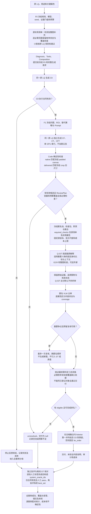
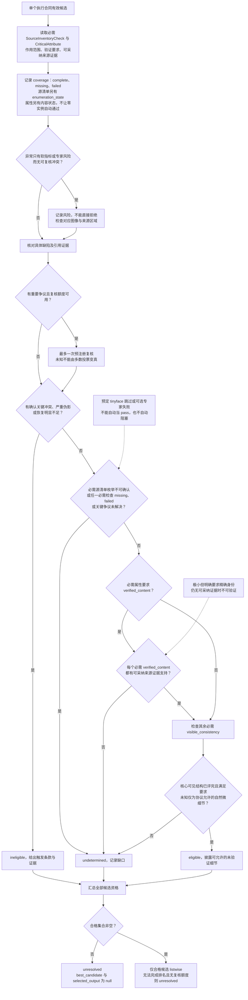

# HarnessIR 图像质量评估方案

版本日期 2026-11-20。状态为待实现、待校准、待实验验证的设计合同。

本文件是质量评估、Judge 选择与相关实验的现行权威规格，覆盖 IMPLEMENTATION_PLAN_V1_1.md 和 CANDIDATE_GENERATION_DETAIL.md 中同主题的旧条款。两份旧文保留候选生成、执行桥和历史设计背景，不能用旧 J1 默认配置替代本文件的 J3。

方案审查通过仅表示未发现未解决的设计缺陷。本文没有声称模型已实现、检测可靠性已知或实验假设成立。

## 1. 目标、输入与最终产物

目标是在同源、固定预算的恢复候选中，选出符合用途、自然、恢复充分且未破坏重要内容的结果。没有满足条件的结果时返回 unresolved，不强行交付相对最好的一张。

在线输入是原始 LQ、冻结的任务与用途、候选图像、可采纳的来源证据。在线阶段不得读取 GT、离线人工标签或离线评分。C0 与其他候选都不是内容真值。

评估分别回答以下问题。

| 问题 | 主要证据 | 不允许的推断 |
|---|---|---|
| 图像是否可用并符合执行合同 | 解码、原生几何、请求和来源绑定 | 修复尺寸后冒充原生合格 |
| 局部与整体画质是否改善 | 直接图像、Q-SiT 质量解释、软测量 | 清晰度高就代表内容真实 |
| 人物是否保持可见身份特征 | 固定人脸比较器、源坐标人物视图 | 高相似度就代表表情和细节正确 |
| 表情、几何、文字是否保持 | 原 LQ 与对应上下文、可采纳来源内容 | 生成的文字或面孔自行证明真实 |
| 哪个合格候选更适合交付 | 合格候选的统一 listwise 比较 | 所有专家分数平均后直接选最大值 |

产物包含逐属性判断、专家原始记录与适用限制、候选资格、排序或并列组、选择结果、拒答原因、成本及独立离线评价。用户报告明确区分画质可接受、可见一致和内容已验证。

## 2. 主方案与专家职责

主方案 J3 为异构专业证据加 VLM 终审。借鉴 EditAgent 的同源多候选、变更和区域证据、listwise 比较。借鉴 AutoRater 的专业模型供证和终审综合。为同一个 VLM 换角色 Prompt 的 J2 保留为消融，不能称为已实现专业模型的能力。

| 组件 | 主方案职责 | 默认状态 |
|---|---|---|
| Code | 确定性执行检查、区域和证据组织、成本记录 | 必需 |
| Q-SiT | 相关区域的画质问答和可定位解释 | 优先接入，模板和适用性待 Pilot 校准 |
| 固定人脸比较器 | 可分析重要人物的身份外观相似证据 | 适用时必需，模型与有效条件须冻结 |
| OCR | 相关文字的可读内容、位置与置信信息 | 有相关文字时接入 |
| VLM 终审 | 看整图、上下文及证据，逐属性判定并优选 | 必需 |
| DreamSim | 人脸或其他重要区域的感知变化辅助证据 | 默认可选实验 |
| PAL4VST | 伪影定位研究，核对具体像素区域 | 默认可选实验 |
| AesExpert | 自然审美的补充解释 | 默认可选实验 |

Q-SiT 的总体分数默认不进入终审，不参与资格阈值或加权总分。若实验采集该分数，只归档并计入成本。显示与隐藏总体分数须作为单独消融。未采集时记录 not_run，不为归档强制增加推理。

Q-SiT 是整体质量评分与质量解释模型，并非原生提供本项目每个维度的校准数值。本文的固定问答是项目适配。问题按清晰度与模糊、噪声、亮度与曝光、色彩、细节自然性组织。蜡感、过锐和细节幻觉问题属于待验证适配，不能假定都在模型可靠覆盖范围内。原始能力范围见 [Q-SiT 论文](https://arxiv.org/html/2503.09197v1)。

所有候选使用相同中立问题、区域和处理。问题不得暗示“此候选有蜡感”等预期答案。局部结果不能和全图分数比较、平均或拼成未经验证的总分。报告保留模型原答、所指区域、无法回答和不确定状态。画质解释不能证明字符或身份内容。

DeepFace 是多模型工具库。本项目借鉴检测、对齐、固定模型提取 embedding、比较的流程，不要求重复安装同类框架。若现有 InsightFace 等能力能提供同一冻结流程，则复用。不能把 DeepFace 当成唯一、固定的识别网络。无需年龄、性别、种族或情绪分类器。模型与流水线范围见 [DeepFace 官方仓库](https://github.com/serengil/deepface)。

DreamSim 是通用感知相似模型，不是专用人脸模型。距离越小表示更相似，不能推断恢复越好。成功去模糊和去噪也可能增大距离。LQ 与候选的距离辅助描述来源一致性，C0 与候选的距离辅助描述干预变化，两者都不是真实性标签。预处理与距离定义须固定。能力与用法见 [DreamSim 官方仓库](https://github.com/ssundaram21/dreamsim)。

PAL4VST 不承担必需伪影门禁，AesExpert 不能用美化收益抵消身份或文字冲突。新增专家只有在冻结池实验改善选择、降低错误且成本可接受后才提升优先级。专业模型的数量不构成独立性或准确性的证明。

## 3. 冻结、候选与原生几何

F0 在生成 C0 前冻结以下规则。

- task_mode、x1 或 x4、用途、用户目标、关键属性、真实性要求。
- 执行模型、revision、steps、CFG、dtype、有效配置、后处理、完整 seed schedule。
- 候选分配算法、回退规则、源实例发现规则、face 尺寸与可分析规则、评价模型和模板版本。
- ReviewPlan 构造规则、专家与终审预算、显示和采样规则、争议复核条件、固定 tie_order。
- E1、E2 和离线评价政策，E2 的案例与 seed 选择规则。

P0 在 composition 完成后、提交生成前冻结完整实际文本。C0 由 P0 与原 LQ 生成。C0 不满足生成合同则停止反馈规划，按失败记入所有案例分母，不能换 seed 补成成功。

F1 在 C0 后、生成其他候选前冻结具体 Issue、源坐标 ROI、人物与文字替代策略、完整 PF/PT/PFT 及回退结果。人物评估范围由原 LQ 与 F0 规则确定，不能看候选质量后选择。C0 可帮助定位恢复问题，不能修改已冻结的用途、证据门槛或人物尺寸规则。

典型池为 C0、CF、CT、CFT。所有候选都从同一原 LQ 独立生成，单 GPU 串行。C0 只是规划和评审输入。F 与 T 分别为人物和文字策略轴，不是固定的生成强弱等级。缺少对应问题时沿用预定槽位回退，不虚构问题。禁止候选后加抽第五张、重规划或跨候选局部融合。

每次 submitted 前比较 FrozenExecutionRequest，包含 seed、完整实际 condition 文本、展开默认值后的有效执行配置、来源与几何。执行后才有的 receipt 不能代替执行前冻结。

x1 和 x4 使用独立 candidate bridge。设 EXIF 归一化后的原 LQ 为 W×H。x1 将输入向右、下 pad 到 32 的倍数，native 必须为 Wpad×Hpad，经冻结 crop 后 delivered 必须为 W×H。x4 将输入向右、下 pad 到 8 的倍数，native 必须为 4Wpad×4Hpad，经冻结 crop 后 delivered 必须为 4W×4H。native 严格匹配冻结的执行 canvas，delivered 严格匹配对应的交付尺寸，两项分别校验。合法 crop 仅去除冻结的 padding，不是 resize 补救。native 尺寸错误时，不得靠 resize 或另设 crop 使其通过。

例如原 LQ 为 257×193，x4 pad 到 264×200，合法 native 为 1056×800，按冻结坐标 crop 后 delivered 为 1028×772。直接生成 1028×772 的 native 不符合该执行 canvas，尽管尺寸恰为原 LQ 四倍，也必须 contract_fail。

原始文件、规范化 LQ、padding 后执行输入、native 和 delivered 分别记录身份与变换。prepared_source 与 canonical_source 不要求相等，但变换必须冻结、可验证。几何与 IMPLEMENTATION_PLAN_V1_1.md §6.2 及 CANDIDATE_GENERATION_DETAIL.md §7.2 一致。旧 square-1024、强制回原尺寸的 delivery 路径不能直接套用 x4。

## 4. 源实例清单与评估范围

候选生成前，以原 LQ 建立源实例清单。使用冻结检测器加整图观察补充规则，必要的 Pilot 人工校正只能看原 LQ。不能因检测器漏检，把明显重要的人物或文字记为 not_applicable。仍无法确认必需范围枚举完整时，按下述源清单检查记录 unverifiable，不声称完整。此规则不要求逐个分析所有微小人脸。

每个实例记录 source_instance_id、原 LQ 坐标、尺寸、任务重要性、可分析性、适用检查和理由。F1 只可依 F0 规则实例化清单与源坐标 ROI，不得按候选恢复成败增减必需对象。新出现、消失或明显移位的人物与文字由整图和上下文检查处理。

每个必需 region_selector 另有源清单级 SourceInventoryCheck。它独立于已发现实例，包含 check_id、scope_selector、required_for_acceptance、enumeration_state、coverage、evidence_refs 和 unresolved_regions。scope_selector 说明要求枚举的对象类别与源图范围；enumeration_state 为 complete 或 unverifiable，表示能否确认该范围已依冻结规则枚举完整；coverage 为 complete、missing 或 failed，表示检查本身是否完成。已完成检查却仍不能确认枚举时，记录 coverage=complete 且 enumeration_state=unverifiable。无法定位的缺口可引用整图范围和原因，不得伪造实例框。

F1 将这些检查的 check_id 显式加入 ReviewPlan.required_checks，即使 selector 没有匹配到任何实例也不能省略。必需源清单检查 missing、failed，或 enumeration_state=unverifiable，均为所有受该 selector 约束候选的覆盖缺口。已登记对象全部通过不能抵消该缺口。没有确认拒绝理由时，这些候选为 undetermined。只有源图证据支持该范围已完整检查且确实没有适用对象时，才可记录零实例并结束该范围的实例检查。

源清单的作用范围按 F0 的重要性、尺寸和用途规则确定。预先豁免的极小非关键人脸和可选对象不产生必需枚举缺口；若用户明确要求极小人脸身份准确，则仍保留对应必需属性的 unverifiable，不以专项跳过解除要求。

人物专项范围按原 LQ 中的像素尺寸、可分析性与任务重要性冻结。候选放大到 x4 不会让原本极小的人脸自动具备可信身份信息。具体尺寸阈值和可分析性规则由 Pilot 校准，未定时不以旧 detector 最小尺寸冒充质量阈值。

| 情形 | 人物专项处理 | 对最终判定的影响 |
|---|---|---|
| 特别小的人脸且未要求精确身份 | skipped_small_face，跳过局部 Q-SiT、身份 embedding 和 face DreamSim | 非通过、非检测失败，单独统计，整图仍评 |
| 特别小但用户要求精确身份 | 仍不强制做无意义的人脸 IQA，关键身份记 unverifiable | 若身份为必需验证属性，该候选 undetermined |
| 可分析且重要的人脸 | 按冻结职责执行局部质量、身份及源坐标上下文检查 | 按逐属性证据判定 |
| 非重点人物 | 保留整图观察，按预定规则是否做局部 | 不以可选专项缺失自动拒答 |
| 源图已纳入专项，候选提取失败 | 记 failed 或 missing，保留上下文检查 | 不得改记 tiny 或跳过来掩盖失败 |
| 源图身份本身不可判断 | 身份证据 unavailable，不能把更清晰的生成脸作真值 | 依该属性是否必需及验证要求处理 |

特别小的人脸占比、专项覆盖和专项失败采用不同计数。skipped_small_face 不进入人物专项成功率分母，也不能提高成功计数。整图检测到明显人物新增、丢失、畸形或结构异常时仍需记录风险与图像证据。

## 5. 人脸、文字与整图证据

人脸拆成三个判断，不能互相替代。

1. 局部画质。直接看统一区域和 Q-SiT 解释，判断模糊、噪声、蜡感、过锐或不自然细节。
2. 身份外观。按源位置与几何对应同一个人，固定检测、对齐、模型和距离定义后比较 embedding。
3. 可见结构。保留未对齐的源坐标上下文，查看脸位置、朝向、眼口与表情、遮挡及身体关系。landmark 只作适用时的辅助。

多人图不能仅靠最高 embedding 相似度自由匹配。对齐 crop 用于身份，源坐标上下文用于保留位移、缩放和结构问题。不能只给对齐脸，使终审看不见偏移。低质量源图、遮挡、侧脸或提取失败的限制必须随结果传递。身份相似不验证眼神、表情、牙齿、年龄细节或真实皮肤纹理。

文字以源坐标 ROI 为单位，保留整块文字和上下文。OCR 内容与置信度是证据。候选 OCR 更确信地输出一串文字不能证明恢复正确。源 LQ 可辨字符或 F0 已声明的可信在线内容才能支持 verified_content。源内容无法辨认时保留 unverifiable。看到候选结果后补写的人工猜测不可作为在线真值。

整图必需检查恢复充分性、自然性、曝光与颜色协调、目标与非目标区域损害、整体结构，以及人物或文字明显增加、消失和移位。局部人脸改善不能覆盖背景损坏，局部文字清晰不能覆盖错误字符。

伪影记录具体位置与表现，包括边缘光晕、振铃、双边缘、重复纹理、块状或网格、过度锐化、塑料皮肤、纹理涂抹、错乱五官、笔画粘连或断裂，以及恢复生成的明显不合结构细节。锐度、色差、SSIM、LR consistency、NR-IQA、DreamSim、PAL 热图和 embedding 都是软证据，单一异常值不自动证成严重伪影。

## 6. 区域、显示与匿名输入

坐标统一来自 EXIF 归一化后的原 LQ。对所有候选使用同一源坐标映射、padding 变换与上下文范围。位移检查保留相同坐标框，不追随候选新位置重选框。若比较需展示移动后的对象，新增视图只能辅助，原坐标视图必须保留。

主包的 6 个主要 ROI、至多 3 个人物与 3 块文字是单包容量，不是全场景重要实例总上限。所有必需对象必须进入 ReviewPlan。超出容量时按预注册规则分包，不能静默忽略。

同一比较中，各候选使用一致显示缩放、压缩和 ROI crop 规则。x4 同时保留统一日常观看尺度和必要的原生细节视图，不能只缩小至看不见缺陷。全图总览始终存在。显示预算必须验证终端实际图像分辨率和上下文容量，不以拼图文件存在代替可看清。

终审只收到匿名原 LQ、候选、区域与上下文、任务用途、逐属性合同和带适用限制的证据。隐藏生成策略名、Prompt、seed、执行模型、GT 与离线指标。文件名、文本说明和排列也不得泄漏策略。内部保留匿名映射与来源绑定供审计。复核可换匿名排列，不得更换候选池。

## 7. 证据可采纳性与属性状态

每个 CriticalAttribute 在 F0 声明 attribute_id、region_selector、required_for_acceptance、verification_requirement、可采纳证据及冲突处理规则。region_selector 在 F1 绑定源实例与 ROI。

verification_requirement 分两种。

- visible_consistency 要求保持源图可见内容、结构及无可见冲突。允许协议预先认可的不可知自然微细节，但必须披露未验证。
- verified_content 要求来源内容有可采纳在线证据支持。单纯 no_visible_conflict 不足以满足要求。

一般照片恢复可采用 visible_consistency。information_critical 或用户明确要求准确的关键字符、号码与身份使用 verified_content。任务用途不能在看到候选后降低要求。所有 verified_content 属性如果原 LQ 根本无可采纳内容证据，系统须报告该案例受证据上限限制。更多 VLM 投票不能解除限制。

| 内容状态 | 定义 |
|---|---|
| supported | 引用的可采纳来源证据直接支持该属性满足相应要求 |
| no_visible_conflict | 已检查可见内容，没有发现冲突，但无法证明未知内容 |
| conflict | 有可定位、可复核的图像或来源内容证据证明冲突 |
| unverifiable | 已检查但现有证据不能验证或排除关键问题 |

逐属性 coverage 单独记录 complete、missing、failed。complete 与内容状态 unverifiable 可以同时出现。源清单检查使用相同 coverage 枚举，并另存 §4 的 enumeration_state，不能把清单级枚举未知只写在备注中。缺项默认为 missing，不能默认为 supported。测量另外记录 measured、missing、failed、stale、not_applicable、skipped_small_face 或 not_run，值不存在不能写成零分。

Q-SiT 的答案、识别相似度、OCR confidence、DreamSim 或 PAL 输出只能提出观察和风险。VLM 必须引用实际来源图像、对应区域及可采纳内容，不能用“模型非常确定”把 unverifiable 升级为 supported。即使两个模型同意，也不构成两个独立真值来源。

专业证据与视觉观察冲突时，先记录争议及各自证据。可见、可复核的明确错误可直接形成 conflict。只有代理异常、结论互相矛盾或重要区域看不清时，不直接认定 conflict，在预留预算内复核。复核后仍无法确认的必需问题保持 unverifiable 或 coverage 不足，不能靠多数投票或低风险代理决定。

候选来源或原生几何不符属于确定性执行合同失败。仅某项测量 stale 或绑定不符时，首先拒收该测量，按该检查是否必需处理 coverage，不能把错误的测量当成候选本身内容错误。若候选来源本身无法绑定，则候选不得入池。

## 8. 候选资格与选择规则

每个执行合同有效候选先判断资格，状态只有 eligible、ineligible、undetermined。先处理确认的拒绝理由，再处理必需未知，最后才给 eligible。

| 条件 | 结果 |
|---|---|
| 有确认的关键冲突，或可定位严重伪影，或按预注册用途恢复明显不足 | ineligible，引用证据与触发条款 |
| 尚无确认拒绝理由，但必需源清单检查缺失、失败或枚举不可确认，或必需属性缺评、失败、真实性无法验证、重要争议未解 | undetermined，说明缺口 |
| 所有必需源清单检查完成且枚举完整，所有必需属性检查完成并满足验证要求，且无确认拒绝理由 | eligible，披露未验证的可允许细节 |

对 visible_consistency，complete 且 no_visible_conflict 可以满足预定要求。未知仅涉及协议允许的自然微细节时，不因此否定一般照片恢复。不能把核心结构仍无法判断也归入这项豁免。对 verified_content，只有可采纳证据支持的 supported 才满足。可选专家失败或预定 tinyface 跳过不自动导致 undetermined。

严重伪影或恢复不足必须按 F0 的用途与质量描述及参考用例判定，给出具体区域和缺陷。未经校准的单一阈值或专家自报风险不能自动拒绝。规则不要求把所有可疑区域判坏，也不容许把看不清解释成已通过。

终审只在 eligible 中做 listwise。比较恢复充分性、细节自然性、非目标损害、整体协调与任务用途，不平均专家分数。可输出 preference_groups 表示并列。C0 在第一并列组时保留 C0，否则按冻结 tie_order 选择。

触发预注册的重要争议时最多一次复核，换匿名顺序并保留原始回答。复核不能增加生成、修改任务或新引入真值。内容争议未解则候选保持 undetermined。若最终排名本身无法完成且复核已耗尽，案例 unresolved，不能以任意顺序冒充已得排名。

没有 eligible 时 best_candidate=null、selected_output=null、status=unresolved。best_available 仅供审计，不能交付或计为 selected。若连相对比较都不足，best_available 也为 null。baseline_retained 同样要求 C0 eligible，不是失败后的默认回退。

全池未知可能来自真实证据上限，也可能来自覆盖、成本或模型失败。分别报告，不能为降低 unresolved 在事后放松关键要求，也不能靠提高拒答率宣称检测更准。

## 9. ReviewPlan、预算与恢复

ReviewPlan 在第一次评估推理前冻结具体 pool、ROI、检查职责、每包覆盖、模型与模板、匿名顺序、调用预算、聚合规则和结果绑定。required_checks 同时包含源清单级检查与已发现实例的属性检查。F0 冻结构造规则，F1 实例化，不能弱化必需覆盖。

先计算全部必需包与聚合所需容量。预算或图像上下文不足时，零次部分评估后直接 unresolved，原因 review_budget_insufficient。不得先评容易的区域，再忽略其他必需项交付。此零调用指本 ReviewPlan 的评估推理，不否认此前已有诊断或生成成本。

默认单包 J3 的终审 VLM 最多三次，包括一次主审、最多一次争议复核、整个 variant 最多一次格式修复。三次是总上限，不是保证全部执行。格式修复只处理已明确收到但无法解析的输出，不添加免费重试，不替代缺失证据。

Q-SiT 各问题和各 crop、OCR、人脸模型、可选 DreamSim 与其他专家的真实 forward 单独计数和预算。一次终审不等于一次系统调用。每项记录输入规模、批处理、推理次数、耗时、GPU 或 API 成本及 token。共享来源 embedding 等缓存必须绑定相同模型、预处理和来源，披露复用，不能把省略工作当模型收益。

多包时必须预注册每包调用和一次或多次聚合所需的独立预算及职责。单包上限三次不能直接套用多包。聚合器必须能看到每个必需属性的状态与对应图像证据，不能只看“都通过”的摘要。任何包缺失都不能由总评掩盖。J2 的默认四角色、一次聚合、一次争议和一次全 variant 格式修复合计最多七次，仍需单列专家 forward。

每次外部调用依次执行以下操作。

1. 核对当前请求与冻结清单。
2. 预留总预算，持久化完整请求与 submitted 状态。
3. 调用服务。收到输出后保存原始响应、实际成本与 completed 记录。
4. 失败须区分明确 failed 和服务结果不明的 unknown。
5. unknown 消耗已预留预算，不自动重试。通过服务回执或人工核对解决，不能因本地文件缺失再次调用。
6. 已完成且绑定一致的结果可复用。文件存在本身不能证明该请求已成功完成。
7. 明确格式错误且修复额度、总额均剩余时最多修复一次。耗尽后 judge_failed，禁止退回 NR-IQA 自动选图。

运行主状态为 created、baseline_ready、plan_frozen、candidates_complete、evidence_ready、reviewed，终态为 selected、baseline_retained 或 unresolved。blocked 表示运行前依赖或冻结参数不具备；failed 与 unknown 保存具体阶段和请求状态。选图字段不能同时指向两个终态。

运行前未定的必需模型、revision、模板、tinyface 尺寸和可分析规则、适用阈值、终审预算等进入冻结清单。若缺少主方案必需项，正式实验 preflight=blocked，不能使用“以后再定”的假默认。Pilot 可使用显式标注的待校准配置，不能把其结果混入最终 held-out。

## 10. 独立离线标签

离线评价与在线 Judge 物理或接口隔离。人工看不到策略名、模型、Prompt、seed、专家分数、Judge 资格和选择结果。不能沿用 Judge 的 eligible 作为真值。

两名评价者先独立逐候选标注，先看统一日常观看尺度，再看固定区域和细节尺度。允许对所有候选使用一致的缩放与切换规则。之后才显示 GT 或声明可信的离线参考，核对内容，并分别记录参考是否足以判断。看过其他候选后的相对优势不能替代单张最低可接受性。

每个候选独立记录以下标签。

- perceptual_acceptability 为 pass、fail 或 unknown。
- required_content_status 为 pass、fail 或 unknown，并记录字符、身份、表情与结构类别以及证据范围。
- acceptable 依据预注册用途合并上述标签。photo_restoration 可容许协议认可的未知微细节，information_critical 的必需内容 unknown 不能当作 pass。
- acceptable 保留为人工标签，不因执行合同状态覆盖其原值。无效产物仍可有感知或内容 pass，用于单独诊断。
- 所有单张标签及分歧裁决完成后，离线代码只用确定性执行合同状态与人工标签构造 system_oracle_ids，集合成员必须同时 contract_valid=true 且 acceptable=pass。合同状态来自独立复核的冻结请求、原生几何和执行记录；明确不符记 contract_fail，证据不足则保留合同不可确认，不混作确认失败。禁止用在线 eligible 或 VLM 判断过滤。
- 再向仍保持盲态的评价者展示 system_oracle_ids 中的全部候选，由其重新比较并给出系统 best_set，允许并列。候选子集不显示合同原因或在线结果。集合为空时 best_set 为空。不得只从合同过滤前的单一最佳组删除无效项，因为该组之外仍可能存在有效的最佳候选。

GT 的像素差异不自动代表内容错误。参考本身不清晰、不匹配或信息不足时保留 unknown。无 GT 时不能强迫评价者猜真实文字或身份。只有一名评价者时显式标注，不能称为独立双人共识。

两人分歧进入第三方裁决，保留原始标签、分歧和裁决依据。无法裁决的内容仍 unknown。评价者不得借助在线模型输出作答案。报告视觉可接受性与真实性的评价一致性，不能只报告一个合成标签。

## 11. 实验与统计口径

沿用旧名称，避免实验身份漂移。

| variant | 定义 |
|---|---|
| J0 | 单 VLM 加图像 |
| J1 | 单 VLM 加图像和绑定 Code 软证据 |
| J2 | 同类 VLM 的人物、文字、整图技术、日常观看四视角与终审 |
| J3 | 本文主方案，Code、Q-SiT、适用人物与文字证据、单 VLM 终审 |

固定相同候选池、用途和覆盖协议做增量消融，比较 J0、J1、J2、J3，以及 Q-SiT 单增量、人物单增量、两者共同接入。Q-SiT 总分展示与隐藏单独比较。DreamSim、PAL4VST、AesExpert 分别可选，不一次全部加入后宣称每个都有贡献。

如果声称专业分工本身带来收益，需要预算匹配对照，匹配模型、候选、图像区域、任务政策、调用限额与输出 token 额度，并披露专业模型额外计算和实际总成本。仅比较 J3 与较廉价的 J1 可说明整个系统的收益和成本，不能单独证明分工因果。

E1 比较 A=P0 的四个 seed 与 B=C0 加三策略候选，两组共用 C0，每源案例最多七次唯一图像生成。两组使用相同冻结 J3、ROI 和判断政策。A 的 seed 对照不能接受 B 不受约束的额外候选。报告候选池覆盖与最终选择两项收益，生成或评价失败进入全案例统计。

E2 在读取 E1 输出、Judge 与人工标签前，按原 LQ 场景、人物与文字尺寸及可确认程度预注册案例，冻结选择算法、seed、缺额规则和清单。四策略各用两个评价 seed，评价 seed 不同于用于规划的 C0 seed。F1 后不得重规划。额外生成与评价成本单列。仅单轴或回退策略不满足交互分析条件时标 not_applicable，失败保留，事后探索样本另列。不能把 E2 的额外图像放回 E1 候选池。

Pilot 十张只用于接口、失败分析、模板与阈值校准。最多一次协议修订后冻结，再跑按源场景隔离的 held-out 二十四张。两者是早期验证，不足以证明生产可靠性。固定候选池调参也不得泄漏 held-out 结论。

按源案例为单位计算以下指标，保留全部计数。下表 OraclePass@4、条件选择成功率、best_set agreement 和 avoidable unresolved 均使用 §10 的 system_oracle_ids，即合同有效且人工 acceptable=pass 的集合。执行合同无效的产物不进入这些系统可交付指标的成功集合，其人工原始标签仍保留。

| 指标 | 分子与分母 |
|---|---|
| OraclePass@4 | system_oracle_ids 非空的案例数，除以全部预注册案例。合同无效、缺失产物和人工 unknown 不当 pass |
| SelectedPass | 实际选中候选属于 system_oracle_ids 的案例数，除以全部案例。null、合同无效、失败和人工 unknown 不计成功 |
| 条件选择成功率 | 在 system_oracle_ids 非空的案例中，实际选择落入该集合的比例 |
| best_set agreement | 在系统 best_set 非空的案例中，选择落入该组的比例，另报 null 与不可判定。best_set 仅在 system_oracle_ids 内独立重评 |
| 交付率 | selected 或 baseline_retained 的案例数，除以全部案例 |
| 可判错交率 | 实际交付中，确定合同无效或合同有效且人工 acceptable=fail 的数，除以可判交付数。可判交付包括确定合同无效或合同有效且人工 acceptable 非 unknown 者，同时报告该分母占全部交付的比例 |
| 未知交付比例 | 合同不可确认，或合同有效但人工 acceptable=unknown 的已交付数，除以全部交付。确定合同无效的交付已计确认错交，其人工 unknown 原始标签另报 |
| 内容错误率 | 必需内容可判定的已交付中存在确认内容错误的比例，同时报告可判内容覆盖率 |
| avoidable unresolved | unresolved 且 system_oracle_ids 非空的案例数，报告占全部案例与 unresolved 的比例 |
| 无效产物的人工 pass | 明确 contract_fail 但人工 acceptable=pass 的产物数及比例，分母为可获得人工标签的明确无效产物。另报合同不可确认、缺失或无法标注数，不纳入系统 Oracle |
| 专项覆盖与失败 | 按适用源实例统计，每个小脸跳过、无关、缺失、失败和不可验证原因分别计数，另报必需源清单枚举缺口案例数 |
| 成本 | 每案例、每候选与每专家的实际调用、token、耗时、费用与 unknown 占额 |

同时给出全部交付中的确认错交数及比例和未知数，不能只在可判子集报一个低错误率。将未知全部视为失败的保守成功口径和仅可判子集口径并列，避免掩盖证据不足。

在 Pilot 或专用验证集上，用预先声明的不同判定阈值或政策生成 risk-coverage 曲线，观察交付率与错交风险的权衡。held-out 仅评冻结操作点，不反复调参。不同语义用途的政策不能混为同一风险阈值。

A/B 使用源案例配对分析，区间和重复采样按独立源案例或源场景聚类，不能把同图四候选、多个人脸或多次模型回答当独立样本。比例报告分母、区间方法和不确定性。零观察错误不等于真实错误率为零。少量交付会导致风险区间很宽，不能据此宣布可靠。未知、跳过、失败和拒答不得从全案例结果中消失。

## 12. 验收用例与实施顺序

先检查接口、绑定和状态，再验证证据行为，再评独立标签与模型收益。

| 用例 | 必须出现的行为 |
|---|---|
| 清晰但错误的字符 | 候选 OCR 高置信不能自证，基于来源冲突拒绝或来源不足保持 unknown |
| 身份相近但表情改变 | identity 相似不覆盖源坐标表情冲突 |
| 仍模糊但相似度高 | 不能因 embedding 或 DreamSim 高相似直接接受，仍检恢复充分性 |
| 人脸改善但背景损坏 | 整图与非目标损害进入资格和排序 |
| 极小非关键人脸 | skipped_small_face，不触发局部专项、不算通过，整图继续 |
| 极小关键身份 | 不强制无意义 IQA，但所需身份不可证时 undetermined |
| 源重要人脸已入专项，候选提取失败 | failed 或 missing，不能改记 skipped_small_face |
| 源检测漏检重要人物或文字 | 保留必需 SourceInventoryCheck，无法确认枚举时 complete 加 unverifiable，候选无确认拒绝理由时 undetermined，不能因零实例自动 not_applicable |
| 已登记号码均通过，但另一必需范围无法确认枚举 | 源清单覆盖缺口仍阻塞受影响候选，不被已登记对象的 supported 抵消 |
| 极小非关键人脸已按 F0 豁免 | 不产生必需枚举缺口，保持 skipped_small_face 与整图职责 |
| x4 的 257×193 输入合法 pad/crop | pad 为 264×200，native 为 1056×800，冻结 crop 后 delivered 为 1028×772，几何检查通过 |
| 同输入直接生成 1028×772 的 native | 虽为原 LQ 四倍，但不符冻结执行 canvas，contract_fail，不 resize 补救 |
| 只有合同无效产物人工 pass，其余有效产物均 fail | system_oracle_ids 为空，OraclePass@4 不成立，合法 unresolved 不计 avoidable unresolved |
| 无效产物比有效 pass 更好看 | 在全部合同有效且人工 pass 的集合内重评 best_set，不因无效产物赢得原始视觉偏好而惩罚合法选择 |
| 只有软指标异常 | 记录风险和证据，不能自动 ineligible |
| 必需 verified_content 只有无可见冲突 | undetermined，不能宣称 supported |
| 可选专家失败 | 保留限制，不自动拒答 |
| 重要区域超出单包 | 预定分包，否则零评估调用的预算不足 |
| submitted 后服务结果不明 | unknown 占额，不自动重试，不重复计成功 |
| 主审与复核均有格式错误 | 最多一次全 variant 格式修复，额度耗尽 judge_failed |
| 全池拒绝或未知 | unresolved、best_candidate=null、selected_output=null |
| C0 不合格但并列排序靠前 | 不得 baseline_retained，只能在 eligible 内比较 |
| 评价者看到 Judge 标签 | 视为盲评协议破坏，重新隔离评价并记录 |

实施阶段如下。

1. 在不调用质量模型的固定样例上打通冻结请求、原生几何、ROI、匿名包、状态与成本日志。
2. 接入 Q-SiT 及人物比较器，逐项证明输入、原答、适用限制和失败状态真实保存，加入 OCR 与整图职责。
3. 接入 J3，跑逐属性资格、并列、拒答、复核、预算和断点恢复用例。任何模型结论均不冒充人工真值。
4. 运行 Pilot，决定模板、人物阈值、可选专家与预算。保留修订记录，冻结最终协议。
5. 冻结池消融、E1、预注册 E2 和 held-out，独立人工标签、成本与区间一并交付。
6. 基于实测决定保留哪些专家。没有收益证据时保留较简单方案，并说明当前主方案假设未获支持。

每阶段有真实产物和检查记录再进入下一阶段。没有执行的步骤标 not_run，不能以文档存在视为验证成功。

## 13. 报告、待定项与审查边界

每案例报告原 LQ、全部候选和统一区域图、Prompt 差异的内部审计页、执行清单、来源与模型版本、逐专家原始回答、逐属性 coverage 和内容状态、资格理由、排序、选择或拒答、全部失败与 unknown、独立人工标签及成本。Prompt 和离线页与在线匿名输入分开。

当前待 Pilot 确定的参数包括 tinyface 尺寸与可分析性、固定人脸模型与距离规则、Q-SiT 中立问题和适用范围、各类检查的可采纳证据、恢复不足与严重伪影参考例、DreamSim 是否启用、多包容量与预算、风险阈值和评价重复策略。未冻结时不得运行宣称正式的最终实验。

文档独立审查检查逻辑、状态、证据权限、统计口径、用户约束和可实施性。尚未进行的真实模型实验列为实验门槛，不靠补写正面结果消除。独立 agent 只能发现并帮助修复方案缺陷，不能保证所有模型错误被检测，也不能证明实际检测错误概率。

## 14. 总流程图

## 15. 资格判定流程图

