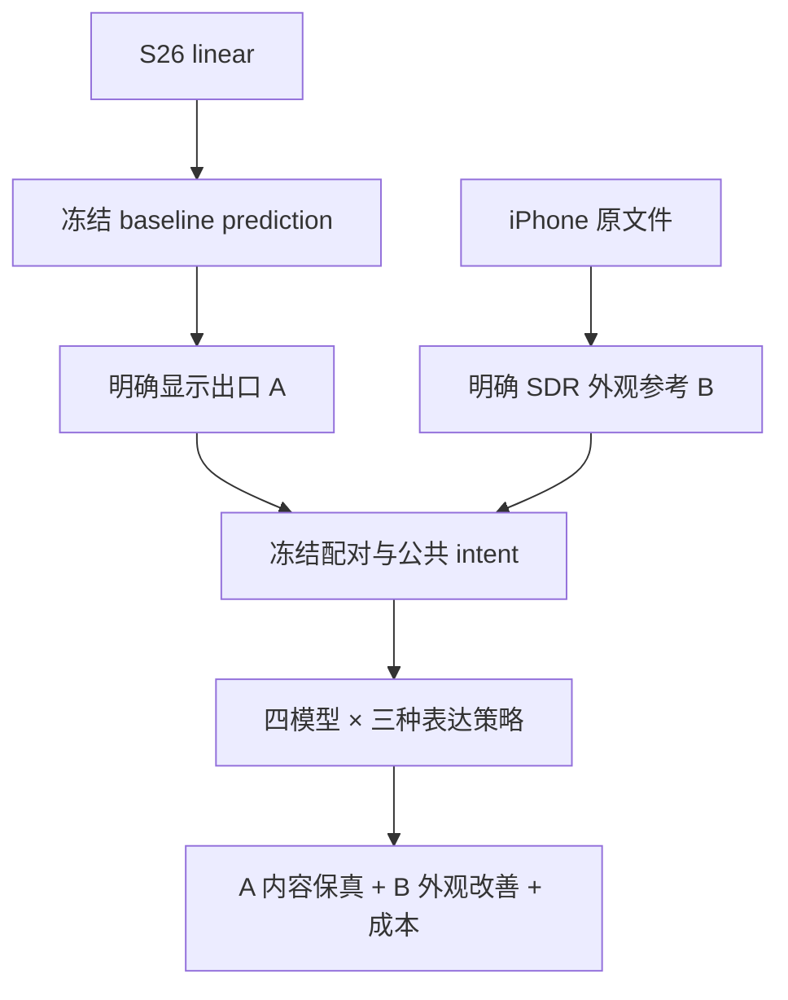

# S26 / iPhone 前置实拍四模型实验计划

**日期**：2026-10-24。**状态**：`PLANNED / NOT_RUN`。**任务**：冻结 S26 linear→baseline→prediction A，在未对齐 iPhone B 的外观参考下比较 Qwen、FireRed、FLUX、FIBO。**代码依据**：`86284d5d190614369c4e6c47c5ad8ed021c93a35`，`hre models`。

本方案取代本次新任务中不适用的旧单图/NB 实验设定；不会改写旧研究记录。真实样本未提供，“20 张”按待确认处理。

## 1. 两个研究问题与结论边界

| 主张 | 要回答什么 | 最小证据 | 实验块 |
|---|---|---|---|
| C1：存在可用的参考增强 | 完整系统能否在保持 A 人物/内容的前提下，改善 A 的前置观感与指定参考外观关系？ | 四模型相对零编辑 A 的可用增强计数；保真失败单列；A-only 对照；每例记录 | B1、B3、B5 |
| C2：模型表达指导有增益 | 相同任务、同一初始 intent、同一模型 compiler/editor 下，model_aware 是否比 shared 更有用？ | 模型内配对差、seed 稳定性、未见正式样本、全部失败保留；native 作完整系统基线 | B1、B2、B5 |

排除的替代解释：改了 baseline/颜色出口；换了公共 VLM；只给某模型更多采样；复制 B 内容；用锐度替代保真；删掉 OOM/无输出；挑漂亮例图或测试集调参。

本轮可用于筛选后续验证对象；小规模非对齐实拍不能证明像素真值恢复、跨人群普遍排名、各原生 compiler 的独立因果收益，也不能证明新算法的论文新颖性。

## 2. 任务和数据合同

- A 是内容与几何基准。允许的改动是已指定的曝光、肤色/白平衡、对比、高光/阴影和主体—背景影调关系；噪声与模糊只在用户列为目标且有证据时处理。
- B 是不对齐的外观参考，可能有视差、FOV、表情、反射和拍摄时刻差异。不能移植 B 的脸型、眼形、表情、文字、物体或纹理；不强制复制其阴影几何。
- 默认不做自动磨皮、美白、瘦脸、眼睛/牙齿重画。新生成的细节无法由 A 核实时记为不确定，不称真实恢复。
- 统一 opaque、8-bit SDR sRGB 测试输入；原始高精度版本另存。颜色和分辨率协议见 [DATA_REQUIREMENTS.md](../DATA_REQUIREMENTS.md)。主比较不能混合不同工作分辨率；共同下采样实验不能被描述成原始分辨率验证。
- 所有实验先 full_frame、共同 pad32，交付回到测试 A 画布。ROI 是分析证据，不是对齐图或编辑 mask。暂不混入 FLUX bbox/FIBO mask 等模型特有空间条件；尤其 FIBO native mask 不能与 A+B 同时使用。

### 数据划分与重复

记开发配对数为 `D`，正式配对数为 `N`。优先另备 2–4 对开发图，正式 20 对只做冻结评估。若现有 20 对用于质量调参，先按 scene/session/burst 的 `group_id` 约分为 4 对开发、16 对正式（实际分组优先于恰好 4/16）。单纯安装/协议验证且未据画质改变设置，可记录后仍评估全部 20 对。

同一连拍、场景、裁块、镜像派生图放同一组，不跨开发/正式。`subject_id` 另外记录：同一人在两组出现时，只能评价相应人物的新场景，不声称跨身份泛化。若所有图来自极少场景或一个人，应据实限制结论，不强凑独立组数。baseline 曾用于训练/开发的样本不得称未见测试集。

## 3. 四个系统身份与真正被改变的变量

| profile | 固定图像模型 | 原生 compiler | 主运行原生设置摘要 |
|---|---|---|---|
| qwen21 | Qwen/Qwen-Image-2.1 | Qwen-Image-2.1-PE-I2I | 40 steps、true CFG 1、KV cache；实际输出画布记录 |
| firered11 | FireRedTeam/FireRed-Image-Edit-1.1 | 官方模板 + 显式本地文本 Recaption | 40 steps、true CFG 4；Recaption 为文本输入 |
| flux3_klein | black-forest-labs/flux-3-image-klein distilled | 本地 PUP | 16 steps、explicit_canvas；不再重复上采样提示 |
| fibo2_dev | briaai/Fibo-2.0-dev | 本地 Thales/VGL | 50 steps、guidance 5；完整结构化条件 |

这些是代码基准的配置摘要，**服务器必须填实际权重 revision、hash、dtype、offload 和最终参数**；不把各模型 CFG 数值相同或 steps 相同作为公平条件。比较对象是不同原生执行系统，模型内的 strategy 对比必须固定 compiler/editor 和公共 VLM。

| strategy | compiler 得到的信息 | 可以回答的问题 |
|---|---|---|
| native | brief + A/B 角色/保真合同，无 Harness intent | 原生编译链能否直接完成当前任务 |
| shared | 同上 + 跨模型冻结的同一 EditIntent | 公共分析/证据/意图是否有帮助 |
| model_aware | 同一 EditIntent + 当前模型表达指导 | 模型表达指导是否带来增量 |

三者都经过各自原生 compiler。因此 shared→model_aware 不是 PE/PUP/VGL 开关消融。Qwen/FireRed 的 direct 可以另行研究；FLUX/FIBO 没有等价的通用 direct 组，不在本轮主表中混用。

## 4. 实验块与运行矩阵

### B0：部署与输入 sanity（必须）

- **数据**：`D=2–4` 对开发样本，覆盖实际有的正常/困难情况，不人为合成配额。
- **配置**：四模型，A+B，model_aware，single，seed 42，各一张。
- **目的**：检查 A/B 顺序、颜色、方向/镜像、公共 VLM、原生 compiler、输出尺寸、冻结输入、报告完整性；测实际资源。
- **Go**：四条链能在同一输入政策下完成、保留原生条件/输出、没有静默换模型/降分辨率。某模型不通先排部署；失败记录保留。
- **成本**：`4D` 张。实际GPU小时未知，必须以服务器 pilot 测得；不得用软件测试时间代替。
- **范围**：若据 pilot 修改质量设置，该数据转开发集，正式评估使用冻结后版本。

### B1：单轮参考增强主结果（必须）

- `N × 4 models × {native, shared, model_aware} × S seeds`，每次最多一张，成本 `12NS`。
- 原始 A 单独作为零调用 baseline；B 不是另一个待排名算法输出，也不作为像素 GT。
- 所有相关 arms 在**同一个 batch**，`share_planning=true`。每个 pair 的 shared/aware 和所有 seed 共用初始 intent；native 不得到 intent。
- **主表**：可用增强率、重大保真损伤率、胜/平/负、技术交付率；成本并列。保真失败不能被较高外观分抵消。
- **支持 C1 的证据**：重复出现、能指认的外观改善且无重大损伤；正式集/seed 上有一致趋势。若无改善或出现身份损伤，应记录失败，不能用一句“更清晰”判成功。

### B2：共享表达与模型表达指导（必须，复用 B1，不新增生成）

- 主要比较同模型、同 pair、同 seed 的 aware vs shared；native 对照提供上下文。
- 每模型列差值，不把一个模型的增益外推给另外三个。
- 简洁性判断：若 shared 已达到同等可用性、aware 没有稳定增益，则优先保留公共表达或将改进转为后续开发；不因“模型特点”叙述强行宣布有效。
- 可选研究 `model × strategy` 差中差，但 20 对的小样本仅作探索；“一个显著、另一个不显著”不等于模型差异显著。

利用已保存的原生条件补充人工机制审计，不新增模型调用：

| 模型 | 条件审计重点 | 与人像实拍的关联 |
|---|---|---|
| Qwen PE | A/B 角色是否保留、源画布要求、语义关系是否遗漏或新增 | 人物与背景的相对影调，身份/表情约束 |
| FireRed Recaption | 文本改写是否保留区域和细节约束，是否虚构像素观察 | 脸/发丝/衣纹的保护；它的 Recaption 本身不看图 |
| FLUX PUP | 最终 caption 是否扩写出新物体/纹理/构图，保持条款是否丢失 | 限制生成先验侵入真实前置内容 |
| FIBO VGL | 场景字段与 edit_instruction 是否一致，A/B 图像引用及禁止属性是否被改写 | 局部外观目标与完整场景的一致性 |

条件符合 schema 只证明可执行结构，不证明语义正确；记录遗漏/新增目标与对应输出失效即可，不能把这些关联直接当机制因果证明。正文报告应把“编译链已运行”和“发挥该能力带来质量改善”分开。

### B3：无参考图 A-only 消融（推荐作为核心交付）

- `N × 4 models × model_aware × S seeds`，single，成本 `4NS`。
- `task_mode=restoration`，从规划、证据、compiler、editor、内部 verifier 全链移除 B；独立生成 A-only intent，不导入 A+B intent，ROI 中也删除 reference_box。
- brief 使用一般前置自然增强目标，不包含从 B 手工提取的逐图颜色描述；所有模型共用相同 A-only 目标。
- **最终外部人评可看 B**，以同一使用目标比较结果。这是 B 对整个系统的增益，包含 B 带来的意图/评价变化，不是仅编辑器像素条件的消融。
- 若有 B 没有更好，可能是参考利用不足、B 并不适合该场景、保真冲突或样本太少；按病例区分，不能直接归因某一种架构。

### B4：有限反馈与固定条件重采样（可选，次级探索）

- 把 aware_feedback3、aware_resample3 与 B1 的三个 arms **一起预先放入同一 main_reference batch**，最多新增 `24NS` 张。
- feedback 最多三轮，有据反馈才重写，首次 accepted 或没有可执行反馈可以早停；resample 固定第一轮原生 condition，按计划用满上限。二者始终从原始 A/B 生成。
- 公平口径是**相同生成次数上限**，不是相同实际算力。报告实际图像、编译、VLM 调用、时间和早停原因；共享规划成本单列。
- 两个 arm 的首轮 compiler 独立执行。检查相同模型/pair/seed 的 `condition.text_sha256`；若不同，结论只限“完整策略比较”，不声称严格隔离后续反馈机制。即使文本一致，底层硬件非确定性也须记录。需要严格固定首轮候选的因果消融时，另设协议和实现，不偷偷改冻结记录。
- 不将“看完 B1 后挑失败例加跑”作为主证据；那只能是开发/失败诊断。

### B5：失败、成本和案例（必须，复用全部结果）

- 汇总所有计划 run，包括 blocked_planning、OOM、协议错误、无交付、未接受候选、source_baseline 回退。
- 预先规定展示全部 pair 的概览；正文选典型成功、明显失败、不确定/无变化各类，注明选择规则，不能只给最好案例。
- 性能报告所冻结部署下的实际端到端时间，区分装载、编译、图像推理、stage、共享规划、导出。默认 worker 切换可能反复装载；CSV 的 image_seconds 不能直接称纯热推理时延。

### 预算总表

| 正式配对数 N | seeds S | B1 | B3 | 核心合计 | 含 B4 的正式生成上限 |
|---:|---:|---:|---:|---:|---:|
| 20 | 1 | 240 | 80 | **320** | **800** |
| 20 | 3 | 720 | 240 | **960** | **2400** |
| 16 | 1 | 192 | 64 | **256** | **640** |
| 16 | 3 | 576 | 192 | **768** | **1920** |
| 10 | 1 | 120 | 40 | **160** | **400** |

另加 pilot `4D`，表中未计 stage/compiler 调用与失败重试。核心公式为 `16NS`；加反馈上限为 `40NS`。实际 early stop、空规划和技术失败会改变实际产出，必须同时报告计划数和实际数。

初次可选 S=1、`[42]` 完整核心矩阵；要验证随机稳定性则在开始前选 S=3、`[42,1042,2042]`。如果后来新增 seeds，须覆盖整个冻结正式矩阵并标为后续重复，不悄悄与原 batch 视为同一规划条件。batch 的 seed 是全局字段。

runtime 多轮从 base seed 递增，所以不使用 `[42,43,44]` 作三个三轮重复起点。跨模型相同数字不等于相同噪声；每个 single seed 会重新原生编译，测的是完整链随机性。只有单个 resample case 内才保证固定 condition。

GPU 预算用 pilot 测量外推：`总时间 ≈ 各实际调用数量×相应测得耗时 + 装载/切换/共享规划/IO`。同一 GPU 上的 VLM 与 editor 若抢资源，须记录；在 GPU 型号、显存和实测前不填 GPU-hour 数字。

## 5. 主评价：可用性双门与原始评分

推荐至少 3 名评审，隐藏模型/策略/seed、随机试验顺序；统一 SDR 显示与观看环境，关闭自动色温/鲜艳模式，固定全图 fit 与 100% crop 观察规则。只有 1 名评审时仍可做，但结论标为单评审观察。自动报告带模型名，**不是盲评页**；提供的材料脚本生成 model-masked 页面，不声称双盲。

每项输出按以下顺序评分：

1. **保真视图 A→Y**：人物身份、脸型五官、眼睛/牙齿/表情、发际线与发丝、衣纹、文字、物体数、构图和照明几何。记录 no_damage / minor / major / uncertain，重大损伤必须有位置或说明。
2. **外观视图 A/B/Y**：B 始终标为未对齐外观参考，评估相对 A 的目标改善。外观分 `-2,-1,0,+1,+2`，含义为明显变差、轻微变差、无实质变化、可见改善、明显改善。
3. **自然度/可见细节 A→Y**：同样 `-2..+2`；噪声、伪细节、塑料皮肤、锐化光晕和过平滑分别记录。可疑细节记不确定。

**主终点（预先冻结）**：流程正常完成且有有效编辑交付、至少 2/3 评审外观改善≥+1、至少 2/3 自然度不低于 0、保真通过；保真中任何 major/uncertain 先做仍隐藏模型身份的复核，未解决者不计通过。若只有一个评审，用同一规则的单人版本，并降低结论范围。minor 只有经确认不影响身份、结构或内容且无需修复才可通过。每项复核保留原评分、理由和最终裁决，不覆盖原始表。

流程失败但仍保留合法选中交付图时，图片进入匿名画质诊断，流程完成率仍记失败，不能计主可用成功。因此“流程正常完成”与“有效图像交付”是两个分别报告的量。

同时报告原始保真类别、外观/自然度分布与相对 A 的胜/平/负；零编辑 A 应为外观无变化，可作为评审控制，不算模型改善。

`verifier accepted` 只代表内置自动判断；confidence 不是画质分。内部用于选择/反馈的 VLM 不能作为唯一终点评审。

## 6. 不对齐条件下的辅助指标

| 指标 | 比较对象 | 用途及边界 |
|---|---|---|
| ROI 显示亮度分位数、RGB/颜色统计 | Y/A 的固定源 ROI；B 单独同语义 ROI | 解释脸部/背景影调变化；不是逐像素误差或线性曝光 EV |
| 同语义皮肤/中性物 ROI 色度中心距离 | A↔B、Y↔B | 可解释“区域统计更接近参考”；不能叫真实肤色误差，必须控制反光、阴影、背景混入 |
| 可见几何/文字/物体变化 | Y 相对 A | 人工复核为主；可选固定版本 landmark/OCR，检测失败单列，不做输出专属配准掩盖变化 |
| 技术交付/异常/耗时/显存 | 全部计划 runs | 衡量部署可用性；显存和整批 wall time 需服务器另外采集 |

不采用 Y 对未对齐 B 的整图 PSNR/SSIM/LPIPS 主排名；不把 Y 对 A 的低误差作为增强优劣（它奖励不改图）；不以 20 个样本的 FID 或单一无参考 IQA 分数定胜负。若未来有真正配准的独立 GT 子集，应另定义严格评测，不能对每个输出拟合几何/颜色后再混报。

当前核心只自动提供输入/ROI 基础统计、候选、原生条件和运行记录；终点 ROI 计算、landmark/OCR/IQA、统计推断并未在 `hre models report` 中实现。可以人工完成本轮主评价，非必要指标不阻塞实验。

## 7. 统计、成功标准与报告分母

- 主分析单位是 pair 或独立 scene/session 组。先在 pair 内聚合 seeds/评审，再跨组；不把 3 seeds、多个 ROI 或 3 评审当作 3 倍独立照片。
- 流程完成率、有效交付率、可用增强率以**计划运行数**为分母；一个模型×arm×pair×seed 的 case 是一次运行，反馈的三轮候选不算三个独立样本。所有无交付/阻塞保留。另列成功交付子集画质，但不拿它代替主结果。未完成人评单列 missing，不无声剔除或当作零分补齐。
- 原始计数定义为：`n_plan` 计划运行数、`n_pipeline_completed` 正常完成数、`n_valid_delivery` 有效选中交付数（可包括流程失败的诊断图）、`n_rated` 已完成人评数、`n_missing` 有效交付待评数、`n_missing_eligible` 其中流程已正常完成的待评数、`k_usable` 已确认主可用数、`k_major_damage` 已确认重大损伤数。
- 所有计划运行都进入终态后，若仍有待评，`k_usable/n_plan` 只能标为“已确认可用比例下界”，上界为 `(k_usable+n_missing_eligible)/n_plan`；`n_missing_eligible=0` 后才给最终主率。未交付的技术失败不属于待评。若仍有尚未执行/暂停/结果不明的运行，只报告进度与已确认计数，不宣称最终比例或上述已收敛上界。
- 保真损伤只对已评分图可知，列 `k_major_damage/n_rated` 与剩余 missing，另列受影响的计划 runs；不能把技术失败或未评分图记作“无损伤”。已评子集质量与主系统可用率分开。
- 报原始 k/n、每 pair 结果、配对差、seed 间一致方向。可用组 bootstrap 作探索区间，若独立组太少就只做描述；不要声称 20 对足够证明普遍优势。
- 成功的工程信号：多例可复核的可用改善、严重保真失败不增加、收益值得实际成本；若区间宽/方向不稳，结论写证据不足。产品可接受失败率由用户在正式运行前定，不能事后按结果改阈值。
- 模型比较不强制排出唯一第一名。可给“外观更好但损伤多”“稳健但改动小”“成本高”等有依据的取舍。

## 8. 运行里程碑与停止条件

| 里程碑 | 任务 | Go / Stop | 成本/状态 |
|---|---|---|---|
| M0 数据冻结 | 数量、配对、颜色出口、分组、baseline 身份、目标/尺寸确认 | 任一颜色或配对未知不得启动正式质量对比 | 当前待补充 |
| M1 部署 pilot | doctor；四模型同一开发图跑通；审计 compiler/原生输出 | OOM、镜像/色彩异常、静默fallback、B顺序错误先解决 | `4D` |
| M2 核心 | 在解盲前冻结 models/arms/seeds、公共 VLM、指标；B1+B3 | 只按已定重试/恢复处理技术问题；不调正式图参数 | `16NS` |
| M3 可选策略 | 预先纳入 B4；有据反馈 vs 固定条件重采样 | 原始条件不同则限定归因；报告实际成本 | 最多新增 `24NS` |
| M4 外部评审 | 匿名材料、原始评分、盲态争议复核 | 不读模型映射调分；缺失明确登记 | 人工时间由 pilot 估计 |
| M5 报告与回传 | 全例表、失败、成本、结论边界、证据包 | 任何无日志的“最佳例”不得代替完整结果 | 待服务器结果 |

## 9. 依据与代码定位

- 当前代码：[`contracts.py`](../../../engine/src/hre/v3/contracts.py)、[`batch.py`](../../../engine/src/hre/v3/batch.py)、[`common.py`](../../../engine/src/hre/v3/common.py)、[`runner.py`](../../../engine/src/hre/v3/runner.py)、[`report.py`](../../../engine/src/hre/v3/report.py)。另附下列固定 commit 链接便于追溯。
- [固定代码基准](https://github.com/baolinv0/HarnessIR/tree/86284d5d190614369c4e6c47c5ad8ed021c93a35/engine/src/hre/v3)：输入 SDR 边界、策略和共享规划、seed/预算、早停/选择、报告能力的实际依据。
- [W3C CSS Color 4](https://www.w3.org/TR/css-color-4/)：sRGB 与 linear sRGB 的编码不同；色域和传递函数转换需区分。本协议的相机出口仍须由用户提供，不能由这份标准推断 camera RGB。
- Ghildyal, A.; Liu, F. *Shift-tolerant Perceptual Similarity Metric*, ECCV 2022，[arXiv:2207.13686](https://arxiv.org/abs/2207.13686)：现有感知相似指标对配准误差敏感。本实验的跨设备大视差也不能被“小位移鲁棒”指标自动解决。
- [ITU-R BT.500-15](https://www.itu.int/rec/R-REC-BT.500)：主观评价方法参考。本轮是小规模工程评审，未声称满足完整标准化主观试验人数和条件。

## 10. 冻结前检查

- [ ] 20 的计数含义、实际 N/D、group_id 和训练/开发重叠已确认。
- [ ] A/B 显示编码、镜像、工作尺寸、hash 与转换脚本已冻结。
- [ ] 主要外观目标、保真硬门和评审规则已冻结。
- [ ] 四模型、compiler、公共 VLM、参数、环境、seeds 与预算已冻结。
- [ ] 核心与可选实验分开；main 相关 arms 在同一 batch。
- [ ] A-only 不继承任何 B 内容；报告没有无效逐像素 iPhone GT 指标。
- [ ] 计划分母、失败、missing、原生/交付/回退输出都能回传。
- [ ] 所有结果和质量结论仍为待运行，没有把软件验证代替真实实验。
