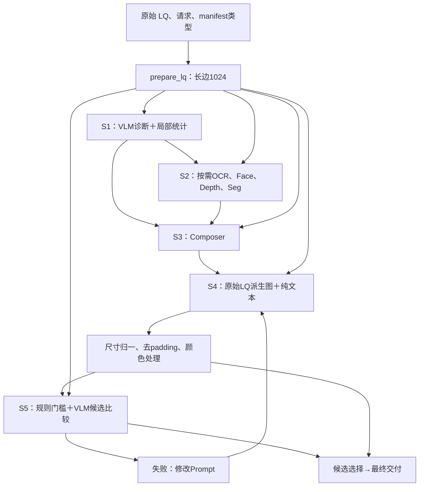

# 1. Original HarnessIR Audit

所有源码位置固定于 [官方773f196](https://github.com/PolyU-VCLab/HarnessIR/tree/773f19654d2d4d9a3b0ce20f80508a4dd0788aff)。用户分支原始相关40个文件与官方字节相同，证明见 `results/source_comparison.json`，不将工程名字当作已完成适配的证据。

## 真实数据流（依据源码重建）

S5只有显式开启Redo才运行；默认单轮直接选择输出。图中的“原始”是从同一源LQ派生的固定输入，不意味着未经重采样的原始字节。诊断图进入Composer，**不进入Executor，也不进入在线Verifier**。

## 五阶段接口与故障审计

| Stage | 输入与来源 | 内部配置/实际逻辑 | 输出和依赖 | 故障/回退 | 共享机制与Executor相关候选 |
|---|---|---|---|---|---|
| S1 | long-edge LQ、用户请求、manifest类型；噪声MAD、Laplacian variance、mean | `stages/diagnosis.py:32-46,143-154` 一次 `chat_json`；tool IDs校验去重 | `DiagnosisResult`：content/degradations/sensitive/tool_plan/difficulty/stats；供S2/S3 | 诊断JSON类型转换失败终止该样本；未知tool字符串不运行；无置信度校准 | 共享退化描述合理；没有证据支持按模型名预测固定风险；局部统计不等于退化真值 |
| S2 | 同一LQ、S1 requested_tools | `tools.py:162-201` 实际顺序FACE→DEPTH→SEG→OCR，只运行被请求项；各工具延迟加载 | `ToolEvidence` OCR文本/置信度位置，face框、depth、seg图及可靠性；归档后重建路径 | 每个工具exception/None记unavailable继续；不代表“图内无此内容” | 调用成功、证据准确、S3保留、S4使用是四个不同事件；实际收益须逐层检验 |
| S3 | photo＋可用seg/depth图；诊断、OCR/face文字；类型块/请求 | `compose.py:150-232` 构造system/user；`compose.txt:211`要求400–800英文词；地图区域转为照片可定位语言 | Composition的`instruction`→`prompt`，另有treat/preserve/region_notes/evidence_used；只有prompt到S4 | 空prompt重试一次，仍空抛错；只按空字段推断截断，并未检查真实finish_reason；evidence_used是自述 | 模型专属表达值得测；“更短更好”“积极生成更好”目前都不是事实 |
| S4 | 固定源LQ派生图、单段prompt | `execute.py:78-155`准备长边1024，调用前pad正方形；`MFMClient.edit`图+文本，IMAGE-only/aspectRatio/imageSize | 返回PIL后若尺寸不同强制resize，再crop；可选颜色对齐 | 异常回path=None；client `_retry`所有exception重试；logical mfm=1不等于真实HTTP调用数 | 输入/尺寸/参数适配属于必要接口差异；是否带来质量收益仍须E4 |
| S5 | LQ＋所有已有候选、类型评价准则、每轮NR与结构统计；不看生成prompt | `verify.py:443-503`先gates再VLM；needs_redo控制停止；Composer另读失败图＋defects重写；从固定LQ重做 | verifier包含failure_mode/defects/checklist/overall/needs_redo/best_round；selector决定交付 | needs_redo缺失抛错；多类型有NameError；全gate失败仍选择一张并标记reason | 评价标准应共享；错误分类不等于已知根因；模型相关修复须经干预证明 |

工具实现：[OCR](https://github.com/PolyU-VCLab/HarnessIR/blob/773f19654d2d4d9a3b0ce20f80508a4dd0788aff/harness/perception/ocr.py)、[Face](https://github.com/PolyU-VCLab/HarnessIR/blob/773f19654d2d4d9a3b0ce20f80508a4dd0788aff/harness/perception/faces.py)、[Depth](https://github.com/PolyU-VCLab/HarnessIR/blob/773f19654d2d4d9a3b0ce20f80508a4dd0788aff/harness/perception/depth.py)、[SAM3](https://github.com/PolyU-VCLab/HarnessIR/blob/773f19654d2d4d9a3b0ce20f80508a4dd0788aff/harness/perception/segment.py)。工具权重未在本轮运行。

## 影响归因的关键细节

1. **地图只给Composer。** `visuals.py:155-224`对不可靠seg、缺失文件过滤；`227-301`在地图缺失时回退文字。`Composition.anchors/evidence_used`只是模型自述，不能证明工具因果贡献，更不能证明编辑模型消费了每条证据。不可靠seg的图会被排除，但文字fallback仍可能列出其classes并在notes注明排除原因；不能把“图像过滤”当成所有低可信标签都未传给Composer。
2. **任务标签绕开诊断影响整条链。** `pipeline.py:129-145`缺类型默认为mix；类型影响S3规范、S4颜色模式、S5门槛和DF评分。低光被标成mix时，效果差不能直接归因于Executor或诊断。这个分支也不支持把`blur`直接填成任意新类型：原始block键为haze/rain/snow/lowlight/mix；噪声/压缩/模糊须保留真实任务要求并按支持的mix评价，另外以外部taxonomy分层。
3. **颜色后处理能掩盖或抵消生成。** `color_adjust.py:41-48,59-72,125-150`仅纯mix做AdaIN，迁回输入RGB通道均值/标准差；命名任务copy。`pipeline.py:243-252`覆盖模型输出文件后才评估。没有native中间图就无法分辨模型没提亮与后处理拉回输入。Direct也默认处理（`run_baseline.py:94-103`），但baseline从原始LQ统计、Harness从resized LQ统计，两者并非严格相同计算图。
4. **几何归一会掩盖原生尺寸错误。** `execute.py`先resize/crop再进`check_gates`，size_match通过不能证明模型原生输出正确。单图Direct从原图一次resize/pad；Harness先`prepare_lq`再`pad_to_square`（即使尺度已为1仍重新resize）。两路应共享被冻结的executor输入字节才是严格E0/E1控制。
5. **S3有目标冲突。** `compose.py:56-57`默认要求保留glare/flare；`compose_blocks.txt:152-156`mix要求抑制遮挡内容的veiling glare/halo。模型可能优先服从保护，也可能修改真实光学现象。这是可定位的规范冲突，尚未证明它导致某个真实失败。低光块本身已经要求显著打开阴影（:58-73），不能把官方描述为只有“抑制生成”。
6. **“确定性门槛”不是确定真理。** `verify.py:254-290`对LQ/output灰度SSIM和色度阈值做排除；阈值是启发式。强去模糊/正确提亮可降低LQ相似度，小文字造假也可不触发。低光/haze仅豁免色度门槛，未豁免结构门槛。
7. **S5错误可丢失已经生成的候选。** `pipeline.py:278-286`先计算verifier再append当轮；验证抛错时可能没把图加入rounds，且外层except跳过selection。NameError不只是缺评分，还可能导致无最终交付。修复必须登记为E1-fixed，不可偷偷作为原版成绩。
8. **调用、预算、恢复记录不足。** `pipeline.timed`只加逻辑计数；Composer空prompt会额外调用，client重试又增加transport calls。原始配置不显式seed。`run_harness.py`/baseline resume主要依据交付文件存在，配置变更不能复用同目录继续。
9. **Redo仅改Prompt，不重诊断/补工具。** `pipeline.py:298-307`固定S1/S2；`refine.py:156-185`读取原包＋失败输出＋defects，但没有显式重新接收原user_intent字段，只能从上轮prompt间接保留。`failure_mode=under_doing/over_reach/both`是现象分类，六类根因在现实现中不存在。

## 论文、代码、工程、实验分别证明什么

| 证据 | 可支持 | 不能支持 |
|---|---|---|
| 论文v3 §3/§4.4、App A/C | 作者提出五阶段，报告NB2/GPT在其设置的收益；对redo与in-place作对照 | Qwen版本有效、五阶段都须专属、工具单独收益、同预算的反馈因果收益 |
| 官方源码773f196 | 当前可检查的真实运行逻辑；默认Redo关闭、几何/颜色路径 | 论文所有运行配置都等于仓库default；在线服务内部确切权重身份 |
| 用户分支e1b610e | engine已有条件编译、worker、冻结输入/回执机制 | 原始单图Model-Aware链路、NB2 profile、质量提升、真实S5策略有效 |
| 旧adapter zip | 版本哈希与仓库记录吻合、离线compiler实现存在 | 11图低光质量因果结论；本地Qwen实际运行版本 |
| 本轮确定性回归 | 特定故障可复现且已修复；native图可保留；统计工具遵守配对单位 | 任一生成模型画质或泛化提升 |

论文§3.4描述质量统计为诊断线索，不用固定接受阈值；源码仍以固定gates淘汰候选。因此精确论文复现应索取作者运行配置和逐图trace，而非只按README执行。DF-Score主评价者与规划/验证使用同型号Gemini，角色分离不等于模型家族独立。详见02、06、08。
