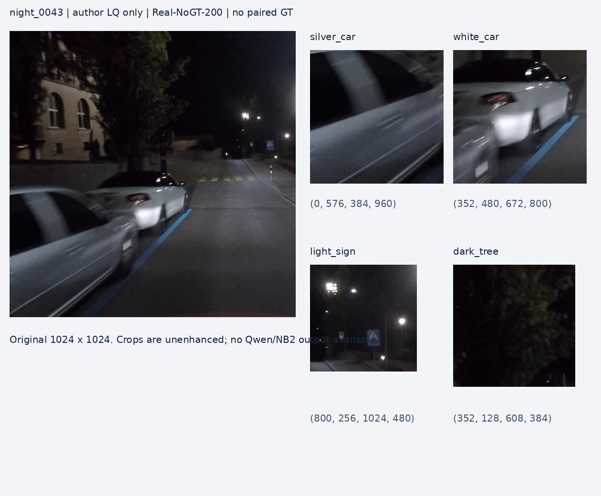

# 5. Failure Casebook

状态区分：A=实际图像观察；C=确定性代码复现；R=仅用户/作者报告；P=待做的干预。当前没有本轮Executor质量实验。

## F001：night_0043，严重拖影与暗部

来源：[作者数据固定revision](https://huggingface.co/datasets/VCLab-PolyU/HarnessIR/tree/d64b3fc51d30944b6750326f3aeadecd2006ed8d)，dataset.zip条目`dataset/Real-NoGT-200/LQ/Low-Light/night_0043_acdc-night.png`。实际取得1024×1024 LQ，SHA/ROI见`evidence/night0043_source.json`。作者zip目录确认此图属Real-NoGT，**没有同图paired GT**。可见图像不等同于原始传感器数据。实际manifest请求为“恢复清晰、干净、自然状态并恢复正常亮度”，type=[lowlight]、无gt；不能把提亮本身当失败，也不能假称用户在此manifest额外要求keep-night-mood。夜景保持来自通用任务规范，需区别用户请求与系统约束。

**A/观察：**左前银车线条沿近水平至斜向拉开、轮廓和车窗交界偏软；中部白车与背景受影响程度不同；上半树冠很暗；点光源核心很亮并有局部光晕。不能从显示图唯一分离曝光期间相机运动、物体运动、低SNR与原图压缩的比例。没有读到RAW、快门轨迹或原始拍摄参数，原因不作确定物理反演。

**R/先前用户观察（未当作本轮复测）：**Qwen direct与Harness输出残余模糊较重，作者NB2结果更清晰。当前未取得那次Qwen的精确revision、CFG、输入预处理、Prompt或逐轮日志；作者NB2/HarnessIR-NB2图在公共压缩包目录中存在，但本轮具体输出下载被网络规则阻断。因此不展示或臆测这些输出，不声称已经再次目视比较。

| Stage | 本图已有材料 | 必查的最早偏差 | 固定变量干预 | 可能结论/副作用 |
|---|---|---|---|---|
| S1 | LQ；诊断trace缺失 | 是否把拍摄拖影当自然景深/把可恢复车身全划成不确定 | 同VLM重放原trace与仅修一条独立标注诊断；下游不变 | 救回支持诊断相关，不自动证明原诊断是唯一根因 |
| S2 | 真实OCR/Depth/Seg输出缺失 | 错OCR是否成为强制文字；Depth是否将运动关联错成距离关联 | 正确/无/打乱证据；相同S3表达 | 证据能防错也可能带偏；不把Depth当运动核 |
| S3 | 实际最终Prompt缺失；已知通用模板存在保护与泛光抑制冲突 | 是否要求“未知不改”覆盖整辆车，或遗漏明确去拖影目标 | 同一intent、同长度，局部恢复目标vs同义保真表达；专属policy交叉给两模型 | D增加且文字/结构不劣才采纳；锐利与生成更强不能等价真实 |
| S4 | 本次没有Qwen/NB2运行 | 原生steps/CFG、单图输入、负prompt、颜色AdaIN | 逐个修配置；先native后matched；保留native/geometry/delivered图 | 若native已改善而交付未改善，则找后处理；native仍失败不立刻判模型上限 |
| S5 | 原verdict/选图缺失 | 是否误把高LQ相似度/保留模糊当高保真；redo是否真的从固定源图 | 固定候选pool盲排、same-prompt重采样、反馈重写、原LQ redo；同预算 | 分离selector、随机采样和反馈贡献；过度修复可能造轮辐/字符 |

真实性登记：可核对车辆数、位置、粗轮廓、遮挡、可读标记；看不清的轮辐数、轮胎花纹、字符等为`unverifiable`。重建更像汽车属于先验合理性证据，不是原图真实恢复证据。

**当前根因：unknown。**“保守Harness压制了Qwen”是可证伪机制假设，不是已验证结论。有限策略都失败只能报“在已测试设置与预算内未解决”，不能宣称达到Executor绝对上限。

## F002：多类型验证在调用VLM前中断（C）

- 最早失败：S5组装规范，`harness/types.py:186`调用不存在的`_colour_clause_judge`，真实错误`NameError`。
- 输入：`build_verify_system(['rain','lowlight'])`；不依赖模型。实际公开MiO manifest有1440条，其中180条type列表含多个值（rain|lowlight 100、rain|haze 80），清单hash见`evidence/author_manifest_inventory.json`。这不等于本轮重跑MiO或论文MiO100的样本单位。单一`mix`标签代表混合退化**不会触发**这个多元素列表分支，因此不能用此bug解释用户所有Qwen结果。
- 干预：只改为已存在的`_colour_clause_verify`。此前回归报错；此后保留两套namespaced checklist且色彩冲突规则正确输出。
- 改善性质：恢复验证执行，不是增强图像。原版/修复版必须分臂。

## F003：几何/颜色处理覆盖模型原生结果（C + 未完成真实图干预）

- 源码证据：S4强制尺寸归一，颜色处理原位覆盖；失去“模型返回了什么”的端点。
- 确定性控制：80×60已知输出交付为40×30，修复前没有原生图；修复后两图均在，原生hash可核对；Direct/Harness使用同一存档合同。
- 干预：仅增加decoded native PNG存档及input/native size元数据，不改交付像素算法。
- 边界：真实AdaIN是否削弱低光提升尚未运行；模拟编辑器测试不能证明真实模型质量。HTTP原始图像字节及模型alpha转RGB前内容尚未完整留存。

## F004：旧11图低光表只能定位研究线索（R）

`docs/qwen_adaptation/evidence/lowlight_11_arms_reported.csv`明标USER_REPORTED；原图/ROI/seed/metric色彩空间缺失。旧adapter完整包已获得，SHA256与`artifacts.json`吻合，但包内VERIFICATION明确“不运行图像推理”。所以不能重算或将其并入新实验CI。P0/P1/P2名称不是E0/E1/E2的随机化对照；未知参数和输入差异必须先补齐。

## 后续成功/失败样本挑选规则（P）

逐退化类型预先选一代表场景，再从全部冻结结果按预注册分位挑最大改善、典型、中位、最大退步、严重保真错误；方法名解盲前选图。每条记录保存LQ/GT(if valid)/全部轮次、五stage payload、第一次可观察偏差、干预与副作用。不得只展示被新策略救回的图；失败无法定位保留unknown。当前不能填写不存在的成功案例。
